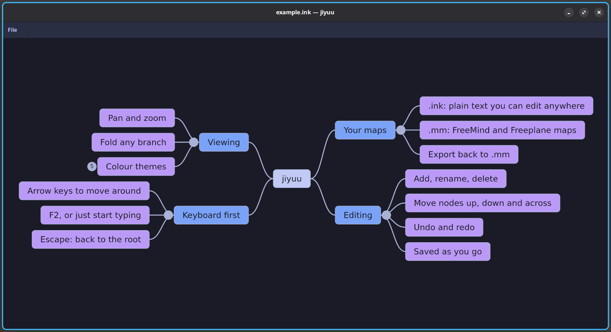

# jiyuu

A mind map viewer and editor, in the style of FreeMind and Freeplane, written in Python with
[Flet](https://flet.dev). It opens FreeMind/Freeplane `.mm` files and its own `.ink` files,
draws them with the root in the middle and branches growing to the left and right, and saves
every change as it is made.



The map above is [`docs/example.ink`](docs/example.ink); after installing, open it with
`jiyuu docs/example.ink`.

jiyuu is part of the [InkSpireEditor](https://github.com/InkSpireEditor) projects. It is
tested on Linux only.

## Install

jiyuu needs [uv](https://docs.astral.sh/uv/), which also provides a suitable Python (3.12 or
newer) if the system has none. From a clone of this repository:

```bash
git clone https://github.com/InkSpireEditor/jiyuu.git
cd jiyuu
scripts/install.sh              # for the current user, in ~/.local/bin
scripts/install.sh --system     # or for every user, in /usr/local/bin (uses sudo)
scripts/install.sh --uninstall  # remove it again
```

The script installs jiyuu in an environment of its own, with its dependencies at the versions
recorded in `uv.lock`, and asks no questions. Running it again updates jiyuu from the clone.

Without a clone, `uv tool install git+https://github.com/InkSpireEditor/jiyuu` installs the
latest version, with its dependencies at the newest versions allowed by `pyproject.toml`.

jiyuu's window is drawn by Flet's desktop client, which is downloaded from Flet's GitHub
releases into `~/.flet/client` (about 40 MB once unpacked) once per user: by the script, for
a user install, and otherwise the first time a map is opened.

## Use

```bash
jiyuu path/to/map.ink                                # open a map; same as `jiyuu open …`
jiyuu path/to/map.mm --theme solarized-dark          # in another colour theme
jiyuu check path/to/map.ink                          # list problems; fails on an error
jiyuu export --mm path/to/map.ink path/to/map.mm     # write a Freeplane .mm file
```

A file whose name is also a command's, such as `check`, is opened with `jiyuu ./check`.
`jiyuu` alone, or with a first argument that is neither a command nor an existing file,
prints the help.

The bundled themes are `tokyonight-night` (the default), `nord`, `nord-frost`, `nord-aurora`
and `solarized-dark`. `--theme` also takes the path of a theme file of your own, in the
format described in [`jiyuu/assets/themes/README.md`](jiyuu/assets/themes/README.md).

### Moving around

| Action | Does |
|---|---|
| Two-finger move, or click and drag | Pan |
| Ctrl + two-finger move up or down | Zoom, around the pointer |
| Arrow keys | Move the selection. On the right side, Right goes away from the root and Left towards it; on the left side, the reverse. Up and Down move between siblings |
| Click a node | Select it |
| Space | Fold or unfold the selected node |
| Click the circle beside a node | Fold or unfold its branch; a folded branch's circle shows how many nodes it hides |
| Escape | Select the root, and go back to 100% with it in the middle of the window |

### Editing

| Key | Does |
|---|---|
| F2 | Edit the selected node's text |
| Typing a character | Replace the selected node's text, starting with that character |
| Enter, while editing text | Keep the text typed; clicking outside the text does the same |
| Escape, while editing text | Leave the node's text as it was |
| Insert or Tab | Add a child to the selected node, and edit its text |
| Enter | Add a sibling after the selected node, and edit its text |
| Delete | Delete the selected node and its branch |
| Ctrl + Up or Down | Move the selected node up or down among its siblings |
| Ctrl + the arrow towards the root | Move the selected node up one level; on a node directly under the root, move it to the root's other side |
| Ctrl+Z | Undo the latest change, folds included |
| Ctrl+Y, Ctrl+Shift+Z | Redo |

### Saving

There is no Save command: every change, folds included, is saved 1.5 seconds after the last
one, to the `.ink` file the map was opened from.

A `.mm` file is never written to. Opening one writes a `.ink` copy beside it, and changes are
saved to that copy. If the copy already exists, it may hold changes made the last time the
`.mm` was opened, so it is left untouched, and at the first change the window asks for the
name of a new file instead.

If another program changes the file while the map is open, a banner appears within about a
second, and nothing more is saved until you choose to reload the file, dropping the window's
unsaved changes, or to keep the window's version, writing it over the file.

The File menu above the map exports it as a Freeplane `.mm` file, to a new file whose name
you type; an existing file is never written over. `jiyuu export` does the same from the
command line, and replaces an existing file only with `--overwrite`.

## The `.ink` format

An `.ink` map is plain text, readable and editable in any text editor: a `meta` section, the
tree as an indented list, then a `nodes` section recording which side of the root each branch
is drawn on and which nodes are folded.

```
===== ink:meta
kind: mindmap
===== ink:body
- Project
  - Goals
    - Foo
    - Bar
  - Risks
===== ink:nodes
"7be48fc73f0ebe9c": {side: "right", folded: "true"}
"32a21dfedf2cf99c": {side: "left"}
```

Each `nodes` line is keyed by an id computed from the node's text and the text of the nodes
above it. Renaming or moving a node in a text editor changes its id, so its line no longer
applies: the node opens unfolded, and its side is chosen again.

The section syntax is that of [inkspire-api](https://github.com/InkSpireEditor/inkspire-api)'s
`.ink` files (see its `docs/ink-format.md`); jiyuu's copy of the grammar is in
[`jiyuu/formats/ink.py`](jiyuu/formats/ink.py). jiyuu writes `kind: mindmap` in the `meta`
section, to tell a map apart from other `.ink` files.

## Limitations

- Zooming needs a trackpad: hold Ctrl and move two fingers up or down. There is no zoom by
  mouse wheel or by keyboard yet.
- Maps are opened from the command line only. Flet's file picker needs Zenity on Linux, so
  there is no Open dialog, and the name of a file to export to or save as is typed.
- jiyuu receives the key pressed, not the character it types. The character that starts
  editing a node's text is worked out from the key's name and Shift: it is right for
  letters, and can be wrong for a key whose shifted character differs from its name, such as
  the digit row of an AZERTY keyboard. Every character after it is typed normally.
- Node text is one line. Notes, icons, links and styles from Freeplane maps are not read,
  and so are not written back by an export.

## Development

```bash
uv sync
uv run jiyuu path/to/map.ink
uv run pytest
uv run pylint --rcfile=.github/workflows/pylintrc --fail-under=9.5 jiyuu
uv run ty check
```

## Licence

[PolyForm Noncommercial 1.0.0](LICENSE). The bundled font and the colour themes' palettes
come with licences of their own: see
[`jiyuu/assets/DejaVuSans-LICENSE.txt`](jiyuu/assets/DejaVuSans-LICENSE.txt) and
[`jiyuu/assets/themes/README.md`](jiyuu/assets/themes/README.md).
