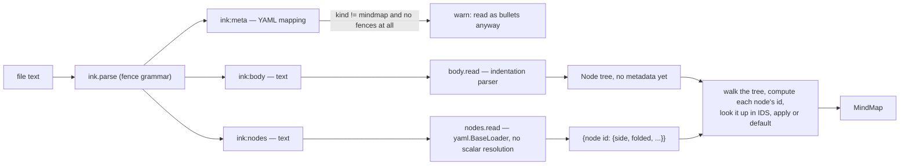

# jiyuu — roadmap

jiyuu is a desktop mindmap viewer and editor, similar to FreeMind and Freeplane, written in
Python with Flet. It opens existing Freeplane `.mm` maps and stores its own maps as `.ink`
files, using the file grammar from inkspire-api — a public, separate project of the author's
at https://github.com/InkSpireEditor/inkspire-api — so the two tools could be merged later.
The `.ink` format is jiyuu's native format; there is no separate markdown format.

This file is the only specification an implementing agent needs. Every algorithm, data
structure, numeric default and worked example below is final, not illustrative — where a
hash or a coordinate is shown, it is the real output of the stated algorithm on the stated
input, reproducible by running it. An implementer should not need to invent an approach
where this file already gives one; where it leaves something open, that is said explicitly
under "Open questions" or inside the step, with a default to use until it is revisited.

Where a step names inkspire-api, it is referring to a public project
(https://github.com/InkSpireEditor/inkspire-api) — citing it in a shipped docstring or
comment is fine, but only together with that link and, where relevant, the specific file or
commit, never assumed as something the reader already knows. The same test applies to any
other outside reference: name it only with enough of a link that a reader could go check it
themselves.

## How to use this file

Steps are done in order. A step is started by setting its status to `in progress`. It is
finished in the change that completes it: every box in the step is ticked, its status
becomes `done`, and any decision taken while doing the step is added to the Decisions table
below. That change is staged and proposed for commit, never committed automatically — see
`CLAUDE.md`'s session workflow for how a step moves from implementation to a commit the user
makes themselves. A step whose done condition fails stays `in progress`, and the failure is
written under it. A step may not start before every step it depends on is `done`.

Status values: `todo`, `in progress`, `done`, `blocked: <reason>`.

## Decisions

| Decision | Reason |
|---|---|
| Python `>=3.12,<4.0.0` in `requires-python`, 3.14 in CI | Same as inkspire-api |
| Flet 1.0.x (1.0.4 on PyPI on 2026-10-16, `requires_python >=3.10`) | Possible mobile build later from the same code |
| Linux desktop only for now. One map per window | User's choice |
| Maps up to ~1,000 nodes. The window keeps one control per node and updates only what an action changed (step 9.5) | A user's map of ~600 nodes took ~0.8 s per key press when the view was rebuilt on each change |
| Native format: `.ink`, grammar copied from inkspire-api `origin/main` at `01bc14a` (`inkspire_api/ink.py`, `docs/ink-format.md`) | Possible merge with inkspire later |
| `ink:meta` holds `kind: mindmap` | Tells a map apart from a prose `.ink` file |
| `ink:body` holds the tree as indented `- ` bullets, 2 spaces per level | Readable as a markdown list, editable on a phone |
| Node text is one plain line | User's choice |
| `ink:nodes` holds per-node metadata (folded, side), keyed by node ID | `ink-format.md`: metadata derived from the body goes in a section after it |
| Node ID: blake2b of a JSON-encoded path, first 16 hex chars | Same primitive and length as inkspire's `paragraph_hash`; JSON encoding removes every escaping question a delimiter-joined path would raise |
| Same-text siblings get an occurrence number (1, 2, 3, ...) inside the path | Each can be folded or sided independently |
| An `ink:nodes` entry matching no current node is dropped on save; the node gets defaults | Metadata can be recalculated, never needed to keep the tree |
| FreeMind-style layout: the root forks into an independent left column and an independent right column; every other node's children stay on their ancestor's side | User's choice |
| Layout defaults: node padding 16px horizontal / 8px vertical each side, vertical gap between sibling subtrees 12px, horizontal gap between a parent's edge and its children's edge 48px | Concrete numbers needed to implement step 3; no visual design pass has been done — revisit once the viewer is on screen |
| `.mm` read and written; Freeplane data jiyuu does not model is dropped | User has Freeplane maps |
| A `.mm` file is never overwritten by autosave; editing it creates `<stem>.ink` beside it | Autosave would otherwise drop Freeplane data on every write |
| "Keep mine" in the conflict banner writes the window's map over the changed file (step 12) | User's choice; writing to a side file instead left the conflict unresolvable |
| Opening a `.mm` whose `<stem>.ink` exists asks for a new file name at the first change (step 12) | User's choice; that `.ink` may hold changes made the last time the `.mm` was opened |
| Markdown: export only | User's choice |
| Autosave, no explicit save. Debounce 1.5 s | User's choice |
| Freeplane default shortcuts | User's choice |
| Build order: viewer (reading `.mm`), then `.ink`, then editor, then exports | Autosave needs `.ink` to exist before editing exists |
| uv replaces Poetry for development, locking, building and CI (step 15) | User's choice, to try uv before moving inkspire-api to it |
| jiyuu is installed with `uv tool install` through `scripts/install.sh`, user-level by default, `--system` for `/usr/local/bin`; no desktop entry (step 16) | User's choice among uv tool, pipx, an Arch package and `flet build` |
| `jiyuu <file>` is `jiyuu open <file>` (step 16) | User's request: open a map by typing `jiyuu <file>` |
| Markdown export (step 14) dropped | User's choice: editing `.ink` files is enough |
| jiyuu is licensed PolyForm-Noncommercial-1.0.0, copyright Maxime PUYS, same as inkspire-api | Lets step 7 copy code from inkspire-api into jiyuu with no licence conflict, since both are the same author's projects |
| `jiyuu/cli.py` defines an empty `@app.callback()` alongside `version` | Typer collapses a `Typer()` app with exactly one registered command into that command itself, invoked with no name; the callback keeps `version` (and every command added later) addressed by name, e.g. `jiyuu version` |
| `.github/workflows/pylintrc` disables `unexpected-keyword-arg` (E1123) and `too-many-function-args` (E1121) | Confirmed by direct test: astroid cannot infer that Flet's `@control`-decorated classes behave like dataclasses, so every Flet control call with arguments is a false positive (even `flet.Text("hi", size=16)` alone triggers both). `ty check`, run on every change alongside pylint, infers this correctly and is kept as the real check for this error class |
| Rendering approach confirmed (step 1): one `Container` per node on a `Stack` inside an `InteractiveViewer`, text measured with Pillow and padded by `LayoutSettings.pad_x`/`pad_y` | Step 1's checks B and C passed against this approach with real measurements; no fallback needed |
| Every node's box is as tall as one line of the font (ascent plus descent), whatever its characters (after step 12) | A height from the characters' shapes made an empty node's box too short to type into, and boxes differ in height by their letters |
| Font: DejaVu Sans, size 16 by default | Step 1 confirmed its licence (Bitstream Vera, permissive; DejaVu's own changes public domain) permits bundling, and measured its rendered width against Pillow's prediction |
| Redo is also bound to Ctrl+Shift+Z, alongside Ctrl+Y | Step 1's keyboard check: confirmed as this desktop's own convention, and as a distinct, reliably-reported `(key="Z", shift=True, ctrl=True)` event |
| `Node` is `@dataclass(eq=False)`: compared and hashed by identity, not by field values | Same-text sibling disambiguation and `dict[Node, Rect]` (step 3) both need this; default dataclass equality would make two structurally identical siblings collide and would make `Node` unhashable |
| DejaVu Sans ships as a package asset (`jiyuu/assets/DejaVuSans.ttf`, with its own licence text alongside it, both listed in `pyproject.toml`'s `include`), not referenced by a system path | Portability: step 1's feasibility check used this machine's own system font path, which only this machine has |
| Colours live in YAML theme files (`jiyuu/assets/themes/`), never as constants in UI code; five bundled: `nord` (from Freeplane's `dark_nord_template.mm`), `nord-frost`, `nord-aurora`, `tokyonight-night` (default), `solarized-dark` | User's choice: themes stored separately and editable without touching code; `tokyonight-night` as default, chosen by the user after seeing them |
| Theme contrast floor is 3.0 (WCAG AA large text / non-text), not 4.5 | Several palette colours cannot reach 4.5 against any text colour in their own palette; replacing them would no longer be the palette |
| Themes are step 4.5, before the viewer, not 5.5 after it | Theme loading has no Flet dependency, and the viewer can be built on it from the start instead of being refactored afterwards |
| Zoom is Ctrl + two-finger vertical move; a two-finger move or click-and-drag pans; no pinch | Pinch reaches Flet with a scale stuck at 1.0 on this Linux platform, and trackpad scrolling never reaches `on_scroll`; tested by hand in step 5 |
| Escape selects the root as well as centring on it; Home is not bound | The user's keyboard has no Home key; Escape already centred on the root |
| Maps open from the command line only (`jiyuu open <file>`); no in-app File → Open yet | Flet's `FilePicker` needs Zenity on Linux, not installed here; the user chose to defer it |
| `InteractiveViewer` needs `constrained=False` and a large `boundary_margin` to pan at all around content bigger than the viewport, and `trackpad_scroll_causes_scale=True` so a trackpad's scroll zooms (matching FreeMind) rather than pans | Found by hand in step 3's demo viewer; step 1's check B never exercised real pointer gestures, only the programmatic `.pan`/`.zoom` calls, so this went unnoticed until something used it interactively (step 5 later stopped using `InteractiveViewer` for the window itself; see the next row) |
| Undo restores recorded values onto the same `Node` objects, not a deep copy of the tree (step 10) | The window keeps each node's shapes by `Node` object; a copied tree would make every shape again, ~0.6 s per undo on a 614-node map |
| Among the root's children, siblings are the nodes on the same side, for moving and for the selection after a delete (step 10) | Each side is drawn as its own column; Up and Down already move only within one side |
| The window pans and zooms by setting the map's `left`/`top`/`scale` from a `jiyuu.view.View`, not with `InteractiveViewer` | `InteractiveViewer` can only zoom around its content's top-left corner, so zooming around the pointer took two calls and jittered; found by hand in step 5 |
| Version 1.0.0 in `pyproject.toml`, git tag `v1.0`; `jiyuu.__version__` read from the package metadata (step 18) | The user's choice of names; one place to write the number |
| Tasks are synced with taskwarrior through its command line (`task import`, `task export`), never its database (steps 19–21) | The command line's JSON is the same in taskwarrior 2.6 and 3.x, while the database changed from text files to SQLite in 3.0; the other choices for tasks are in the table before step 19 |
| A new task's uuid is derived from the map's path and the node's id (step 21) | A sync whose map is not saved afterwards would otherwise create the task again at the next sync |
| Tests run with `TASKRC`/`TASKDATA` in their own folder and in `Europe/Paris` time (step 21) | No test may read or write the user's taskwarrior; due dates convert between local time and UTC |

## The `.ink` map file

### Shape

A map file is an `.ink` file (inkspire-api grammar, `===== ink:<name>` fences) with exactly
three sections in this order, the last two optional:

```
===== ink:meta
kind: mindmap
title: Project
===== ink:body
- Project
  - Goals
    - I/O
    - TODO
    - TODO
  - Risks
    - Flet performance
===== ink:nodes
"7be48fc73f0ebe9c": {side: "right"}
"32a21dfedf2cf99c": {side: "left"}
```

`ink:meta` → `ink:body` → `ink:nodes` is the pipeline a reader follows:



### `ink:meta`

A YAML mapping, exactly as inkspire's `ink:meta`. `kind: mindmap` marks the file as a map; it
is added on first save if missing. Any other key (`title`, or one inkspire itself would read,
such as `status`) is kept verbatim across a load/save round trip, unread by jiyuu.

### `ink:body` — reading

Reading never drops node text; anything it cannot place is attached to the tree anyway and
reported through `check`.

**Line shape.** A node line is: optional leading whitespace, a marker (`-`, `*` or `+`), one
required space, then the text, which is stripped of surrounding whitespace. A line with no
recognised marker is still read as a node — the whole stripped line becomes its text — with a
warning. Leading whitespace is counted in characters (a tab counts as one character, and
mixing tabs and spaces inside a body is reported as a warning, but does not stop the parse).

**Algorithm.** A stack of `(indentation, node)` pairs tracks every node on the path from the
root down to the line most recently read — the nodes that could still become a parent of what
comes next.

```python
def read_body(text: str) -> tuple[Node | None, list[Problem]]:
    problems: list[Problem] = []
    lines = [(i + 1, line) for i, line in enumerate(text.splitlines()) if line.strip()]
    if not lines:
        return None, [Problem(1, ERROR, "the body is empty")]

    root: Node | None = None
    stack: list[tuple[int, Node]] = []

    for line_no, raw in lines:
        indent, marker_found, text = split_line(raw)  # indent = count of leading ws chars
        if not marker_found:
            problems.append(Problem(line_no, WARNING, "line has no '-', '*' or '+' marker"))
        node = Node(text=text)

        if root is None:
            root = node
            stack = [(indent, node)]
            continue

        while len(stack) > 1 and indent <= stack[-1][0]:
            stack.pop()

        parent_indent, parent_node = stack[-1]
        if indent > parent_indent:
            parent_node.children.append(node)
            stack.append((indent, node))
        elif indent == parent_indent:  # len(stack) == 1: back at the root's own indentation
            problems.append(Problem(line_no, ERROR,
                "more than one top-level line; attached as a child of the first"))
            parent_node.children.append(node)
            stack.append((indent, node))
        else:  # indent < parent_indent, len(stack) == 1: dedented past the root itself
            problems.append(Problem(line_no, WARNING,
                "indentation does not match any open level; attached as a child of the root"))
            parent_node.children.append(node)
            stack.append((indent, node))

    return root, problems
```

**Worked trace**, over the canonical example above (indentation shown as the character count):

| Line | Text | Indent | Stack before (indent:text) | Action |
|---|---|---|---|---|
| 1 | `- Project` | 0 | — | becomes root; stack = `[(0, Project)]` |
| 2 | `  - Goals` | 2 | `(0,Project)` | `2 > 0` → child of Project; push `(2, Goals)` |
| 3 | `    - I/O` | 4 | `(0,Project),(2,Goals)` | `4 > 2` → child of Goals; push `(4, I/O)` |
| 4 | `    - TODO` | 4 | `(0,P),(2,G),(4,I/O)` | `4 <= 4` → pop I/O; now top is `(2,Goals)`, `4 > 2` → child of Goals; push `(4, TODO₁)` |
| 5 | `    - TODO` | 4 | `(0,P),(2,G),(4,TODO₁)` | same as line 4 → child of Goals; push `(4, TODO₂)` |
| 6 | `  - Risks` | 2 | `(0,P),(2,G),(4,TODO₂)` | pop `TODO₂`, pop `Goals` (both `<=2`); top `(0,Project)`, `2 > 0` → child of Project; push `(2, Risks)` |
| 7 | `    - Flet performance` | 4 | `(0,P),(2,Risks)` | `4 > 2` → child of Risks |

A malformed input, for the two reportable cases:

```
- Project
  - Goals
- Extra root line
```

Line 3 has indent 0, equal to the root's own indent, with the stack already popped back to
just `(0, Project)` — this is the "more than one top-level line" case: `Extra root line`
becomes a third child of `Project`, and `check` reports an error on line 3. The tree is never
left without that text.

### `ink:body` — writing

Always exactly `- ` and 2 spaces per indentation level, `\n` line endings, a final newline.
Every written line starts with spaces or `-`, so a written body can never be misread as a
`.ink` fence line (which must start with `=====`).

```python
def write_body(root: Node) -> str:
    lines: list[str] = []

    def emit(node: Node, depth: int) -> None:
        lines.append(f"{'  ' * depth}- {node.text}\n")
        for child in node.children:
            emit(child, depth + 1)

    emit(root, 0)
    return "".join(lines)
```

### Node paths and IDs

A node's **path** is the list of `[text, n]` pairs from the first level below the root down
to the node, where `n` is 1 for the first sibling with that exact text under its parent, 2
for the second, and so on. The root itself is never part of any path, so renaming the root
keeps every other node's metadata.

```python
def path_of(node: Node, root: Node) -> list[list]:
    chain: list[list] = []
    current = node
    while current is not root:
        parent = parent_of(current, root)
        same_text = [c for c in parent.children if c.text == current.text]
        occurrence = same_text.index(current) + 1
        chain.append([current.text, occurrence])
        current = parent
    chain.reverse()
    return chain

def node_id(path: list[list]) -> str:
    encoded = json.dumps(path, ensure_ascii=False, separators=(",", ":")).encode("utf-8")
    return hashlib.blake2b(encoded).hexdigest()[:16]
```

JSON-encoding the whole path before hashing is what lets node text contain `/`, `"`, `#` or
anything else without any escaping rule: the path is one opaque byte string to the hash, not
something built by joining text with a separator.

**Real computed values**, for the worked example tree above (`Project` is the root and is not
hashed):

| Node | Path | `node_id` |
|---|---|---|
| Goals | `[["Goals", 1]]` | `7be48fc73f0ebe9c` |
| Risks | `[["Risks", 1]]` | `32a21dfedf2cf99c` |
| Goals → I/O | `[["Goals", 1], ["I/O", 1]]` | `3a3e72d688ada732` |
| Risks → Flet performance | `[["Risks", 1], ["Flet performance", 1]]` | `1beebbe825bf2289` |
| Goals → TODO (1st) | `[["Goals", 1], ["TODO", 1]]` | `ef079784f78e907e` |
| Goals → TODO (2nd) | `[["Goals", 1], ["TODO", 2]]` | `7269069835dc2cda` |

So the worked `ink:nodes` section at the top of this document, in full, is:

```
===== ink:nodes
"7be48fc73f0ebe9c": {side: "right"}
"32a21dfedf2cf99c": {side: "left"}
```

(`Goals` on the right, `Risks` on the left; everything else defaults to unfolded, and
non-first-level nodes never carry `side`.)

### `ink:nodes`

One line per node carrying metadata, in body order (a stable, deterministic order rather than
hash order, so a diff of two saves is readable). The key is quoted with `json.dumps`; the
value is a flow mapping whose string values are quoted the same way. Reading uses
`yaml.load(text, Loader=yaml.BaseLoader)` — the same approach as inkspire's
`provenance.py`'s `render_section`/loading, and for the same reason: an unquoted 16-hex-digit
key that happens to be all digits is read by a normal YAML loader as an integer, which then
matches no node.

**A real all-digit example**: the path `[["Node", 1], ["974", 1]]` hashes to
`1984891675846323` — sixteen decimal digits, a legal hex string that is also a legal
(enormous) YAML integer if left unquoted. Written through `json.dumps`, it is
`"1984891675846323"`, read back as the string `1984891675846323` by `BaseLoader`, and matches
its node. Left bare, this exact file would silently lose that node's metadata on every load —
which is why every key is unconditionally quoted on write, with no "is this one risky"
check.

Known keys inside an entry: `side` (`"left"` or `"right"`, meaningful only on first-level
nodes — written for every first-level node, so layout does not depend on re-running the
balancing rule the same way twice), `folded` (`"true"` only; its absence means unfolded, so a
map with nothing folded has no `folded` keys at all). Any other key already present in an
entry is kept on save as long as that entry's node still exists; an entry whose key matches no
current node's `node_id` is dropped.

```python
def read_nodes_section(text: str) -> dict[str, dict] | None:
    try:
        loaded = yaml.load(text, Loader=yaml.BaseLoader)
    except yaml.YAMLError:
        return None
    if loaded is None:
        return {}
    if not isinstance(loaded, dict):
        return None
    return loaded  # every key and every string value is already `str`, by BaseLoader

def render_nodes_section(entries: dict[str, dict]) -> str:
    lines = []
    for node_id, fields in entries.items():  # body order
        body = ", ".join(f"{k}: {json.dumps(v)}" for k, v in fields.items())
        lines.append(f"{json.dumps(node_id)}: {{{body}}}\n")
    return "".join(lines)
```

### Applying metadata on load, dropping it on save

```python
def apply_nodes_section(root: Node, entries: dict[str, dict]) -> None:
    for node in walk(root):               # body order, excludes the root
        fields = entries.get(node_id(path_of(node, root)), {})
        node.side = fields.get("side")       # None if absent -> balancing decides it
        node.folded = fields.get("folded") == "true"
        node.extra = {k: v for k, v in fields.items() if k not in ("side", "folded")}

def build_nodes_section(root: Node) -> dict[str, dict]:
    entries: dict[str, dict] = {}
    for node in walk(root):
        fields = dict(node.extra)
        if node.parent_of(node) is root and node.side is not None:
            fields["side"] = node.side
        if node.folded:
            fields["folded"] = "true"
        if fields:
            entries[node_id(path_of(node, root))] = fields
    return entries
```

An entry is simply never produced for a node with nothing to say, so a freshly-created map
file has no `ink:nodes` section at all — `ink.render` already omits an empty section, per
the grammar in step 7.

## Cross-cutting guards

These apply to every step below, not just the one that introduces them.

- CI (pylint ≥ 9.5, `ty check`, pytest) passes at the end of every step.
- Modules outside `jiyuu/ui/` never import `flet`. A test added in step 2 enforces this by
  importing every non-UI module in a subprocess and checking `flet` is not in `sys.modules`
  afterwards.
- No real person's name, real map content, or other identifying detail anywhere that gets
  committed: not in a fixture, a test, a docstring, a code comment, a commit message, or this
  file. Fixtures use placeholder text (`Project`, `Goals`, `Foo`, `Jane Doe`). The user's own
  Freeplane and `.ink` maps are opened from outside the repository for manual testing and are
  never copied into it, even temporarily — see `CLAUDE.md`'s privacy section for the full
  rule and what to do when one of them exposes a bug.
- Reading never drops node text. Anything not understood is reported through `check`, not
  raised.
- Writing never produces a file its own reader cannot read back to the same tree (round-trip
  tests in steps 8, 9 and 14).
- A `.mm` file is never written except by an explicit export to a path the user chose.
- Autosave never overwrites a file that changed on disk since jiyuu last read or wrote it.
- Writes are atomic: write a temporary file in the same directory, then `os.replace`.
- Whenever a step produces something visually meaningful (a tree, a computed layout, a
  parsed map), it is shown in a real Flet window, so the user can look at and try new
  features as they land rather than only reading a test-pass report. Until step 5 that was
  `scripts/demo_viewer.py`; step 5 moved it into `jiyuu/ui/` and removed the script, so from
  then on it is the real window, opened with `jiyuu open`, that grows with each step.

## Steps

Each step lists what it depends on, its tasks, its tests, step-specific guards, blockers or
risks, and the condition that marks it done. Tasks and tests are tracked with checkboxes.

### Step 0: Project setup

- [x] Status: `done`
- Depends on: none.
- Tasks:
  - [x] `git init`.
  - [x] `pyproject.toml`:

    ```toml
    [project]
    name = "jiyuu"
    version = "0.1.0"
    description = "A FreeMind/Freeplane-compatible mindmap viewer and editor"
    requires-python = ">=3.12,<4.0.0"
    dependencies = [
        "flet (>=1.0.4,<2.0.0)",
        "pyyaml (>=6.0.3,<7.0.0)",
        "defusedxml (>=0.7.1,<0.8.0)",
        "typer",
        "pillow",
    ]

    [project.scripts]
    jiyuu = "jiyuu.cli:app"

    [tool.poetry]
    requires-poetry = ">=2.0"
    packages = [{ include = "jiyuu" }]

    [tool.poetry.group.dev.dependencies]
    pytest = "*"
    pytest-cov = "^7.1.0"
    pylint = "^4.0.8"
    ty = "^0.0.80"

    [tool.pytest.ini_options]
    testpaths = ["tests"]

    [build-system]
    requires = ["poetry-core>=2.0"]
    build-backend = "poetry.core.masonry.api"
    ```
  - [x] Dev dependency group: already included above.
  - [x] `.editorconfig` copied verbatim from inkspire-api (`charset = utf-8`, LF,
        4-space indent, trim trailing whitespace, `.md` exempted from trailing-whitespace
        trimming).
  - [x] `.gitignore`: `__pycache__/`, `*.py[cod]`, `/.venv/`, `/.pytest_cache/`,
        `/.ruff_cache/`, `/.coverage`, `/htmlcov/`, `/dist/`, `*.egg-info/`.
  - [x] `.github/workflows/lint.yaml`, `test.yaml` and `pylintrc` copied from
        inkspire-api's, with `inkspire_api lorebook timeline` replaced by `jiyuu` everywhere
        it is the lint/test target, and the pytest coverage flag changed to
        `--cov jiyuu`.
  - [x] `LICENSE`: PolyForm Noncommercial 1.0.0, matching inkspire-api's, with `license`
        and `license-files` set in `pyproject.toml` (not originally listed in this step's
        tasks; added because step 7 copies code from inkspire-api, which carries this
        licence — see the Decisions table).
  - [x] `jiyuu/__init__.py` holding `__version__ = "0.1.0"`.
  - [x] `jiyuu/cli.py`:

    ```python
    import typer

    from . import __version__

    app = typer.Typer()

    @app.callback()
    def main() -> None:
        """jiyuu's top-level command group."""
        # Typer collapses an app with exactly one registered command into that command
        # itself, invoked with no name. This callback, though it does nothing on its own,
        # keeps `version` (and every command added later) invoked by name instead.

    @app.command()
    def version() -> None:
        """Print jiyuu's version."""
        print(__version__)
    ```
  - [x] `tests/__init__.py`, `tests/conftest.py` (empty to start).
  - [x] `README.md` with install (`poetry install`) and run (`poetry run jiyuu version`)
        commands.
- Tests:
  - [x] `jiyuu version` prints `0.1.0` (checked with typer's `CliRunner`).
- Blockers/risks: a dependency without a Python 3.14 wheel. If one turns up, record it here
  and pin the development virtualenv to 3.13 while keeping 3.14 in CI only if it installs
  there. **Did not occur**: all 37 dependencies, including Flet 1.0.4, installed cleanly
  under Python 3.14.7.
- Done when: `poetry install`, `poetry run pytest`, `poetry run pylint ...` and
  `poetry run ty check` all pass locally, and the first commit is made. **Met**: pytest 1
  passed, pylint 10.00/10, `ty check` reports no errors; the commit itself is proposed below
  for the user to make.

### Step 1: Flet feasibility check

- [x] Status: `done`
- Depends on: 0.
- Purpose: confirm the rendering approach before any UI code depends on it. Steps 3 and 5
  are written assuming "one `Container` per node on a `Stack`" works; this step either
  confirms that or forces a rewrite of step 5's approach before it starts.
- Tasks, in `scripts/flet_check.py` (excluded from pylint and coverage since neither's CI
  invocation targets `scripts/`, and from pytest by not matching `test_*`):
  - [x] Check A — open a bare Flet desktop window: `flet.app(target=main)` where `main`
        just sets a page title, on Linux, under Python 3.14.
  - [x] Check B — place 200 `ft.Container(content=ft.Text(...))` at absolute positions
        inside `ft.Stack`, that `Stack` inside `ft.InteractiveViewer` (Flet's pan/zoom
        container), with edges drawn as cubic Bézier paths on an `ft.canvas.Canvas`
        beneath the stack. Programmatically pan and zoom a few times and print the time
        between each `page.update()` call. Record whether it stays under roughly 33 ms
        (≈30 fps) per update with all 200 nodes visible.
  - [x] Check C — text measurement: bundle one TTF font with a licence compatible with
        this project (DejaVu Sans is Bitstream Vera + Public Domain/Arev, both
        redistributable; confirm before bundling), register it via `page.fonts`, and for a
        set of 10 sample strings compare Pillow's
        `ImageFont.truetype(font_path, size).getlength(text)` against the width Flet
        actually renders a `Container` at (read back via the control's resulting size, or
        an `on_resize`-style callback if Flet 1.0 exposes one for a `Text` control).
        Record the largest absolute difference across the 10 strings.
  - [x] Check D — keyboard: attach `page.on_keyboard_event` and, with an `ft.TextField`
        on the page, manually press each of: every arrow key, Tab, Insert, Enter, F2,
        Delete, Space, Ctrl+Z, Ctrl+Y. For each, record (a) whether the page-level handler
        fired, and (b) whether it fired while the `TextField` had focus.
- Blockers/risks: none of the three anticipated fallbacks below were needed; kept for
  reference in case a future machine or Flet version behaves differently.
  - No reliable way to read back a rendered text width (check C has no fallback reading):
    fall back to the Pillow estimate plus a fixed padding margin (record the margin chosen
    here), and accept that very unusual fonts/scripts may not fit exactly. **Not needed**:
    `Container`/`Text` is a `LayoutControl`, whose `on_size_change` reports the real
    rendered size after layout — see Check C's results below.
  - Check B exceeds ~33 ms per update with 200 controls: fall back to drawing every node as
    `canvas.Text` plus `canvas.Rect` on one `ft.canvas.Canvas`, with hit-testing done in
    Python against the same rectangles `layout.py` already computes (point-in-rectangle,
    tested top-most node first). Record this fallback here, and rewrite step 5's tasks to
    draw on the canvas instead of building controls before step 5 starts. **Not needed**:
    see Check B's results below.
  - Tab does not reach `page.on_keyboard_event` (it moves focus instead): fall back to a
    different key for "new child" in step 11 (Insert alone, dropping the Tab alias), and
    record that as a decision in the Decisions table above. **Not needed**: see Check D's
    results below — Tab reaches `page.on_keyboard_event` reliably.
- Done when: each of the four checks has a written result in this section (pass/fail and
  the measured number), and the chosen approach — or whichever fallback was needed — is
  added to the Decisions table. **Met**:

  **Check A — pass.** `ft.run(main)` opened a native window on this Linux desktop (Wayland,
  via XWayland fallback for input) under Python 3.14.7, with no exception.

  **Check B — pass.** Ten programmatic `zoom`/`pan` calls on 200 positioned containers,
  timed end-to-end around each `page.update()`, across four separate runs:

  | Run | Update times (ms) |
  |---|---|
  | 1 | 23.5, 20.3, 22.9, 16.8, 11.6, 15.5, 5.2, 4.8, 4.5, 4.7 |
  | 2 | 23.6, 15.2, 35.9, 28.4, 17.7, 13.8, 14.7, 16.6, 11.1, 12.0 |
  | 3 | 17.0, 12.4, 24.8, 18.1, 10.4, 13.6, 23.3, 9.0, 12.4, 14.5 |
  | 4 | 17.7, 13.0, 21.9, 48.7, 31.2, 14.5, 9.8, 7.5, 12.0, 9.5 |

  Most calls land well under the 33 ms (≈30 fps) budget; two calls, in two different runs,
  exceeded it (35.9 ms, 48.7 ms) without a repeating pattern — most likely one-off
  scheduling jitter on this desktop rather than a sustained cost of the approach. One
  `Container` per node on a `Stack` inside an `InteractiveViewer` is confirmed as the
  rendering approach for step 5; the canvas-only fallback is not needed.

  **Check C — pass.** Comparing `ImageFont.getlength` (DejaVu Sans, size 16) against each
  string's actual rendered width, reported through `Container.on_size_change`:

  | String | Pillow (px) | Flet (px) | Difference |
  |---|---|---|---|
  | `Project` | 54.78 | 56.49 | +1.71 |
  | `Goals` | 44.81 | 46.02 | +1.21 |
  | `I/O` | 22.70 | 23.45 | +0.75 |
  | `TODO` | 47.30 | 48.28 | +0.98 |
  | `Risks` | 41.53 | 42.75 | +1.22 |
  | `Flet performance` | 137.38 | 141.32 | +3.95 |
  | `Résumé` | 64.17 | 65.65 | +1.48 |
  | `A/B` | 27.33 | 28.06 | +0.73 |
  | `#tag` | 39.66 | 40.64 | +0.98 |
  | `He said "hi"` | 94.14 | 97.09 | +2.95 |

  Flet always renders slightly wider than Pillow's prediction, by 0.7–4.0 px across these
  ten strings, growing mildly with string length. `Container.on_size_change` (inherited
  from `LayoutControl`) is a reliable way to read back a rendered size, so the Pillow-only
  fallback margin is not needed; the existing `pad_x = 16` px per side in `LayoutSettings`
  already absorbs a gap several times this size.

  **Check D — pass, with one correction.** `page.on_keyboard_event` fired for every key
  tested — every arrow key, Tab, Insert, Enter, F2, Delete, Space, Ctrl+Z, Ctrl+Y — whether
  or not an `ft.TextField` on the same page had focus at the time; no key was ever silently
  consumed before reaching it. While the field had focus, Flutter's own `TextField` *also*
  consumed several of these for editing — arrow keys moved the text cursor, Delete deleted
  a character, Space inserted one, and Enter blurred the field — independently of
  `page.on_keyboard_event` still firing for the same key press. This confirms step 11's
  design is necessary, not optional: jiyuu's own code must suppress tree-navigation actions
  while a node is being text-edited, since Flet delivers the event regardless of what the
  focused field does with it. One correction to step 11's keybinding table: on this
  desktop, Ctrl+Shift+Z is the conventional redo shortcut, confirmed as a distinct
  `(key="Z", shift=True, ctrl=True)` event — added as a second accepted redo binding
  alongside Ctrl+Y (recorded in the Decisions table).

### Step 2: Tree model and node IDs

- [x] Status: `done`
- Depends on: 0.
- Tasks:
  - [x] `jiyuu/model.py`:

    ```python
    @dataclass
    class Node:
        text: str
        children: list["Node"] = field(default_factory=list)
        folded: bool = False
        side: str | None = None          # "left" / "right" / None; meaningful on
                                          # first-level nodes only
        extra: dict[str, str] = field(default_factory=dict)  # unknown ink:nodes keys

    @dataclass
    class MindMap:
        root: Node
        meta: dict = field(default_factory=dict)      # ink:meta, as read
        other_sections: dict[str, str] = field(default_factory=dict)  # anything besides
                                                                       # meta/body/nodes
    ```
  - [x] `walk(root) -> Iterator[Node]`: depth-first, body order, **excluding** the root
        (paths are never computed for it).
  - [x] `parent_of(node, root) -> Node | None`: depth-first search for the parent; `None`
        only for the root itself.
  - [x] `path_of(node, root)` and `node_id(path)`, exactly as given under "Node paths and
        IDs" above.
  - [x] `tests/data/node_ids.json`, with exactly this content (every value below is a real
        computed hash, not a placeholder):

    ```json
    [
      {"label": "root's direct child", "path": [["Goals", 1]],
       "id": "7be48fc73f0ebe9c"},
      {"label": "deep node, three levels", "path": [["Goals", 1], ["I/O", 1], ["Sockets", 1]],
       "id": "4f8376264b3ac471"},
      {"label": "first same-text sibling", "path": [["TODO", 1]],
       "id": "93daa0a88332d655"},
      {"label": "second same-text sibling", "path": [["TODO", 2]],
       "id": "57b391dbe76f697e"},
      {"label": "non-ASCII text", "path": [["Résumé", 1]],
       "id": "d372d71ad9aa94a8"},
      {"label": "text containing a slash", "path": [["A/B", 1]],
       "id": "5fd47c1d5589e7e2"},
      {"label": "text containing a quote", "path": [["He said \"hi\"", 1]],
       "id": "979299541639824d"},
      {"label": "text containing a hash", "path": [["#tag", 1]],
       "id": "c5d91d056df13401"},
      {"label": "empty text", "path": [["", 1]],
       "id": "84085c5ae4973aef"},
      {"label": "all-digit hash (quoting hazard)", "path": [["Node", 1], ["974", 1]],
       "id": "1984891675846323"}
    ]
    ```
  - [x] The no-`flet`-import test described under Cross-cutting guards, in
        `tests/test_no_flet_import.py`: for each module under `jiyuu/` except
        `jiyuu/ui/*` and `jiyuu/cli.py`, run
        `python -c "import <module>; import sys; assert 'flet' not in sys.modules"` in a
        subprocess.
- Tests:
  - [x] Every vector in `node_ids.json` matches `node_id(path)` exactly.
  - [x] Building a tree with two `TODO` siblings under `Goals`, then swapping their order,
        leaves the first position holding occurrence 1 and the second holding occurrence 2
        (occurrence is positional among same-text siblings, not tied to a specific
        `Node` object).
  - [x] The no-`flet`-import test passes.
- Done when: the tests above pass, and `tests/data/README.md` says one line: `node_ids.json`
  is a specification (hashes computed by hand with `hashlib` directly), not a recording of
  whatever the code currently does. **Met**: 19 tests pass, 100% coverage of `jiyuu/model.py`.

  One bug found and fixed while writing the tests: `parent_of`'s search only walked
  `walk(root)`'s results, which exclude `root` itself by design — so it could never find
  `root` as the parent of one of its own direct children, and raised `ValueError` for every
  first-level node instead. Fixed by checking `root.children` directly before falling back
  to the walk.

  One decision not spelled out in the pseudocode above: `Node` is declared
  `@dataclass(eq=False)`, so it compares and hashes by identity. Two sibling nodes can be
  completely identical in every field — the two bare `TODO` leaves in the occurrence test
  are exactly this case — and still need to be told apart by which object they are, both
  for `path_of`'s occurrence counting (`list.index`, `in`) and so a `Node` can be used as a
  dictionary key (needed by `dict[Node, Rect]` in step 3) at all; the default dataclass
  behaviour would make equal-by-value nodes collide and would make `Node` unhashable.

### Step 3: Layout

- [x] Status: `done`
- Depends on: 1, 2.
- Rule (FreeMind-style, root forks, everything else inherits its side): the **root** splits
  its children into two independent vertical columns, left and right; **every other node**
  stacks all of its children in one column on its own side. A node with no side recorded
  among the root's children is assigned, in body order, to whichever column currently has
  the smaller total height — ties go to the right.
- Coordinate convention: a node's box is `Rect(x, y, width, height)` with `(x, y)` its
  **top-left corner**. The root's box is horizontally centred on `x = 0` (`x = -width / 2`);
  everything else is built outward from its parent's edge nearest to it. For a right-side
  node, `x` is its left edge; `horizontal_gap` is measured from a parent's right edge to its
  child's left edge. For a **left-side** node, the box is still stored as
  `Rect(x, y, width, height)` with `x` its left edge, but it is *placed* right-to-left: the
  placement algorithm below computes each left-side node's right edge first (the edge
  nearest its parent) and derives `x = right_edge - width`. Vertically, the **whole plane**
  is centred on `y = 0`: the top-level call passes `y_top = -height / 2`, where `height` is
  the full height the root's subtree needs, so the root — and, in a balanced layout, often
  its first-level children too — ends up centred on `y = 0`, not merely starting there.
- Tasks:
  - [x] `jiyuu/measure.py`:

    ```python
    class Measurer(Protocol):
        def size_of(self, text: str) -> tuple[float, float]: ...  # (width, height) of the
                                                                    # text alone, no padding

    class PillowMeasurer:
        def __init__(self, font_path: str, size: int): ...
        def size_of(self, text: str) -> tuple[float, float]:
            font = ImageFont.truetype(self.font_path, self.size)
            left, top, right, bottom = font.getbbox(text or " ")
            return (right - left, bottom - top)
    ```
    and a `FixedMeasurer(width_per_char: float, height: float)` fake for tests, returning
    `(len(text) * width_per_char, height)`.
  - [x] `jiyuu/layout.py`:

    ```python
    @dataclass
    class LayoutSettings:
        pad_x: float = 16.0      # each side
        pad_y: float = 8.0       # each side
        vertical_gap: float = 12.0    # between sibling subtrees
        horizontal_gap: float = 48.0  # parent edge to child edge

    def node_box_size(node: Node, measurer: Measurer, settings: LayoutSettings) -> tuple[float, float]:
        w, h = measurer.size_of(node.text)
        return (w + 2 * settings.pad_x, h + 2 * settings.pad_y)

    # --- pass 1: bottom-up, heights only -----------------------------------

    def column_height(nodes: list[Node], measurer, settings) -> float:
        if not nodes:
            return 0.0
        heights = [subtree_height(n, measurer, settings) for n in nodes]
        return sum(heights) + settings.vertical_gap * (len(heights) - 1)

    def subtree_height(node: Node, measurer, settings, *, is_root: bool = False) -> float:
        _, own_h = node_box_size(node, measurer, settings)
        if node.folded or not node.children:
            return own_h
        if is_root:
            right = column_height([c for c in node.children if resolved_side(node, c) == "right"], measurer, settings)
            left = column_height([c for c in node.children if resolved_side(node, c) == "left"], measurer, settings)
            return max(own_h, right, left)
        return max(own_h, column_height(node.children, measurer, settings))

    # --- pass 2: top-down, assign Rects -------------------------------------

    def place_column(nodes, near_x, y_top, available_height, side, measurer, settings, out):
        heights = [subtree_height(n, measurer, settings) for n in nodes]
        total = sum(heights) + settings.vertical_gap * (len(heights) - 1)
        y = y_top + (available_height - total) / 2
        for child, h in zip(nodes, heights):
            place(child, near_x, y, h, side, measurer, settings, out)
            y += h + settings.vertical_gap

    def place(node, near_x, y_top, height_for_node, side, measurer, settings, out, *, is_root=False):
        w, h = node_box_size(node, measurer, settings)
        y_center = y_top + height_for_node / 2
        x = (near_x if side == "right" else near_x - w) if not is_root else -w / 2
        out[node] = Rect(x, y_center - h / 2, w, h)
        if node.folded or not node.children:
            return
        if is_root:
            right_x = x + w + settings.horizontal_gap
            left_x = x - settings.horizontal_gap
            place_column([c for c in node.children if resolved_side(node, c) == "right"],
                         right_x, y_top, height_for_node, "right", measurer, settings, out)
            place_column([c for c in node.children if resolved_side(node, c) == "left"],
                         left_x, y_top, height_for_node, "left", measurer, settings, out)
        else:
            child_near_x = (x + w + settings.horizontal_gap) if side == "right" \
                           else (x - settings.horizontal_gap)
            place_column(node.children, child_near_x, y_top, height_for_node, side,
                         measurer, settings, out)

    def layout(root: Node, measurer: Measurer, settings: LayoutSettings) -> tuple[dict[Node, Rect], list[Edge]]:
        rects: dict[Node, Rect] = {}
        height = subtree_height(root, measurer, settings, is_root=True)
        place(root, 0.0, -height / 2, height, "right", measurer, settings, rects, is_root=True)
        edges = [Edge(parent=p, child=c, side="right" if rects[c].x >= rects[p].x else "left")
                 for p in rects for c in p.children if c in rects]
        return rects, edges
    ```
    `y_top = -height / 2`, not `0.0`, is what centres the root (and the whole plane) on
    `y = 0` — see the Coordinate convention above. `resolved_side(root, child)` reads
    `child.side` if set, else runs the balancing rule against the **current** running
    totals computed so far in body order (ties to the right), and writes the result back
    onto `child.side` itself — which both makes passes 1 and 2 agree on the same assignment
    without re-deriving it twice, and keeps the assignment stable across repeated layout
    calls rather than re-balanced from scratch, possibly differently, every time. An edge's
    side is read off the two boxes already placed — whichever one is further right — rather
    than tracked separately, since it has to agree with wherever they actually ended up.
  - [x] An edge is drawn from the midpoint of the parent's facing edge (right edge if the
        child is on the right, left edge if on the left) to the midpoint of the child's
        near edge, as a cubic Bézier curve bulging horizontally (control points offset
        horizontally by half of `horizontal_gap`, not vertically) — this is what step 1's
        check B already exercised.
  - [x] `scripts/demo_viewer.py`: builds the worked-example tree from this document as real
        `Node`/`MindMap` objects, lays it out with `layout.layout`, and draws it in a Flet
        window — the same positioned-`Container`-on-a-`Stack`-inside-an-`InteractiveViewer`
        approach `scripts/flet_check.py` already validated, with edges as the same Bézier
        curves. Stays open until closed by hand, so the result is something to actually look
        at rather than only a passing assertion on its coordinates.
- Worked example, over the same tree as above, with every node given a **fixed** box height
  of 32px (ignoring real text metrics here, only to keep the arithmetic checkable by hand;
  real heights come from `node_box_size` once step 1 picks a font) and
  `vertical_gap = 12`, `horizontal_gap = 48`:

  ```
  Project
   ├─ Goals (right)
   │   ├─ I/O
   │   ├─ TODO
   │   └─ TODO
   └─ Risks (left)
       └─ Flet performance
  ```

  - `subtree_height(I/O) = subtree_height(TODO₁) = subtree_height(TODO₂) = 32` (no children).
  - `column_height(Goals' children) = 32*3 + 12*2 = 120`.
  - `subtree_height(Goals) = max(32, 120) = 120`.
  - `subtree_height(Flet performance) = 32`; `column_height(Risks' children) = 32`;
    `subtree_height(Risks) = max(32, 32) = 32`.
  - Right column height = `column_height([Goals]) = 120`. Left column height =
    `column_height([Risks]) = 32`.
  - `subtree_height(Project, is_root) = max(32, 120, 32) = 120`.
  - Placement: the whole plane is centred on `y = 0`, so the top-level call uses
    `y_top = -height/2 = -60`. `Project`'s own box is centred at
    `y_center = -60 + 120/2 = 0`, height 32, so its box top is `y = -16`. The right column
    gets the *same* span, `y_top = -60`, `available_height = 120`; since its one child
    (`Goals`) already needs the full 120, it is placed with no further offset
    (`y = -60 + (120-120)/2 = -60`), so `Goals`'s own box is centred at
    `y_center = -60 + 120/2 = 0` too — top `y = -16`, the same as `Project`'s. The left
    column gets the same span as well; its one child (`Risks`, height 32) is centred within
    it: `y = -60 + (120-32)/2 = -16`, so `Risks`'s own box is centred at
    `y_center = -16 + 32/2 = 0` — top `y = -16`, the same box position as `Goals`'s, because
    both are centred within the identical 120-tall span the root's layout reserved on each
    side.
- Tests:
  - [x] A single root with no children: one `Rect` at `(-w/2, -h/2, w, h)`.
  - [x] One child on each side, with the heights above, matching exactly.
  - [x] Balancing when no side is recorded for any first-level node (first child goes
        right, second goes left, third goes right again, ties broken to the right).
  - [x] An explicit `side` is respected even when it leaves the two columns unbalanced.
  - [x] A folded node's subtree occupies exactly its own height, regardless of what its
        (hidden) children would need.
  - [x] No two rectangles overlap, checked on randomly generated trees of up to 200 nodes
        (property-based, e.g. with `hypothesis`, or a seeded random generator and a fixed
        set of seeds if `hypothesis` is not added as a dependency).
  - [x] Every edge's two endpoints sit on the correct facing edges of the two boxes it
        connects.
- Done when: the tests above pass, laying out 200 nodes takes under 50 ms (timed in a test
  marked `slow`, or measured once and the number written into this section), and
  `scripts/demo_viewer.py` is run and checked by eye against the worked example above (root
  centred, `Goals` on the right, `Risks` on the left, no boxes overlapping). **Met**: 37
  tests pass (`tests/test_layout.py`, `tests/test_measure.py`), 200-node layouts took
  0.7–1.0 ms across 10 random trees, well under the 50 ms budget.

  Two things found and fixed while implementing this step, both now folded into the text
  above rather than left as errata:

  - The worked example's own placement arithmetic used `y_top = 0` at the top level, which
    does not actually centre the root on `y = 0` — it only does that in the trivial case
    where the root's own height equals the whole subtree's height. `y_top = -height / 2` is
    what the Coordinate convention actually requires, and is what both the pseudocode and
    the worked example now show.
  - `jiyuu/layout.py`'s `_place` and `_place_column` originally took every one of their
    parameters positionally, which pylint flagged (`too-many-positional-arguments`) and
    which also made call sites harder to read; `measurer`, `settings` and `out` are now
    keyword-only at both.

  Running `scripts/demo_viewer.py` also found real bugs in how it drove `InteractiveViewer`
  — nothing in `jiyuu/layout.py` itself — fixed by hand, since these can only be found and
  checked by someone actually dragging and scrolling, not by an automated test:

  - `constrained`, which defaults to `True`, forces content bigger than the viewport to fit
    the viewport instead — the exact opposite of what panning around a map needs, per this
    control's own documentation. Panning did not work at all until this was set `False`.
  - `boundary_margin`, which defaults to zero, confines panning to exactly the content's own
    bounds, leaving no empty space around a small map to pan into. Set to a generous margin
    instead.
  - `trackpad_scroll_causes_scale` (default `False`) makes a trackpad's two-finger scroll
    pan rather than zoom; set to `True` so scrolling zooms instead, matching FreeMind's own
    scroll-to-zoom convention — the trade-off being that two-finger scroll no longer pans
    at all (dragging still does).
  - Left open, deferred to step 5 rather than chased down now: with scroll-to-zoom and a
    natural-scrolling trackpad, the zoom direction feels backwards to at least one user.
    No property on `InteractiveViewer` controls this directly; a `GestureDetector.on_scroll`
    handler driving `InteractiveViewer.zoom` by hand, instead of its own built-in trackpad
    handling, is the likely fix, but needs someone with a trackpad to actually check it.

### Step 4: `.mm` reader

- [x] Status: `done`
- Depends on: 2.
- Freeplane/FreeMind element and attribute mapping:

  | `.mm` element/attribute | jiyuu field | Notes |
  |---|---|---|
  | `<node TEXT="...">` | `Node.text` | Primary source of node text |
  | `<node><richcontent TYPE="NODE"><html>...<body>...` | `Node.text`, if `TEXT` is absent | Plain text extracted from the HTML body; any line break inside it becomes one space, with a warning |
  | `<node FOLDED="true">` | `Node.folded = True` | `FOLDED` absent or `"false"` → `False` |
  | `<node POSITION="right"\|"left">`, direct child of the map's root only | first-level `Node.side` | A `POSITION` value other than `left`/`right` is ignored with a warning. A `POSITION` on a deeper node is ignored silently — Freeplane itself does not write one there |
  | everything else (`map_styles`, `attribute`, `attribute_registry`, `icon`, `edge`, `font`, `cloud`, `arrowlink`, `hook`, a `<node>`'s `ID`/`CREATED`/`MODIFIED`/`LOCALIZED_TEXT`) | dropped | counted in the returned warnings so `jiyuu check` can report "N Freeplane attributes were dropped" |

- Example input, exercising the three text sources and both sides:

  ```xml
  <map version="freeplane 1.9.13">
  <node TEXT="Project" FOLDED="false" ID="ID_1">
    <node TEXT="Goals" POSITION="right" ID="ID_2" FOLDED="false">
      <node TEXT="I/O" ID="ID_3"/>
    </node>
    <node POSITION="left" ID="ID_4" FOLDED="true">
      <richcontent TYPE="NODE">
        <html><body><p>Risks</p></body></html>
      </richcontent>
      <node TEXT="Flet performance" ID="ID_5"/>
    </node>
  </node>
  </map>
  ```

  reads as the same tree used throughout this document: `Project` (root) → `Goals` (right,
  unfolded) → `I/O`; `Project` → `Risks` (left, **folded** — read from its `richcontent`
  since it has no `TEXT`) → `Flet performance` (present in the tree even though its parent
  is folded; folding is a view concern, not a parsing one).

- Tasks:
  - [x] `jiyuu/formats/mm.py`, `read(text: str) -> tuple[MindMap | None, list[str]]`
        (`MindMap`, not `MindMap | None`, was written here first, but malformed XML and a
        `<map>` with no `<node>` at all have no tree to return — only a warning), parsed
        with `defusedxml.ElementTree.fromstring` (never the standard library's
        `ElementTree` directly, to keep external entities and DTD processing refused).
  - [x] Recursive descent: `_read_node(element, depth: int) -> Node`, building `Node.text`
        / `.folded` / `.side` per the mapping table, recursing into every child `<node>`
        element, and appending one warning string per dropped/ignored thing it sees (named
        by element or attribute, e.g. `"dropped <icon> on node 'Goals'"`). `depth`, not a
        plain `is_first_level` flag as first written here: a flag can say "read `POSITION`
        on me" but cannot also tell its own recursive call what to tell *its* children,
        which is exactly the bit of information the one call processing the root needs.
  - [x] The map's outermost element must be exactly one `<node>` under `<map>`; anything
        else (`<arrowlink>` at the map level, more than one top-level `<node>`) produces a
        warning and the first `<node>` found is used as the root.
  - [x] `jiyuu check <file>` (`jiyuu/cli.py`): prints every warning `read` returns, one per
        line; exits non-zero only when no tree could be read at all, not for warnings
        alone on a file that otherwise read fine.
  - [x] `scripts/demo_viewer.py` takes an optional `.mm` path on the command line and draws
        that file's tree instead of the fixed example one, printing any warnings first. A
        file that cannot be read into a tree at all is reported the same way, and no
        window opens — checked before `ft.run` is ever called, not inside the page
        callback: destroying a window from inside its own still-mounting callback, tried
        first, crashes the GTK embedding this runs under.
- Tests, against hand-written fixtures in `tests/data/mm/`:
  - [x] A FreeMind 1.0.1-style file (no `richcontent`, `TEXT` on every node).
  - [x] A Freeplane-style file with `map_styles`, `attribute`/`attribute_registry`, `icon`,
        `<node><richcontent TYPE="NOTE">` (a note, not node text — must **not** be read as
        the node's text), `richcontent TYPE="NODE"` node text, and a cloned node (`<node>`
        with no `TEXT`/`richcontent` of its own, referencing another by Freeplane's own
        mechanism — treated as an empty-text node with a warning, since clone resolution is
        out of scope).
  - [x] Malformed XML (an unclosed tag) produces a warning and does not crash; the file is
        reported as unreadable rather than partially parsed.
  - [x] An XML entity (`&amp;`, `&#233;`) and non-ASCII text (`Résumé`) round-trip through
        `read` correctly.
  - [x] The example input above reads to exactly the tree and metadata described after it.
- Guards: no external entities or DTD processing — covered by using `defusedxml` rather than
  `xml.etree.ElementTree` directly; a test feeding a billion-laughs-style payload confirms it
  raises rather than hangs or allocates unboundedly.
- Blockers/risks: a Freeplane variant the fixtures do not cover. The user opens several of
  their own maps by hand at the end of step 5 and reports anything that reads wrong; each
  fix adds a new synthetic fixture that reproduces the problem, so no real map content
  enters the repository.
- Done when: the tests above pass, and `jiyuu check <file.mm>` prints the warnings a file
  produces, one per line. **Met**: 45 tests pass (11 in `tests/test_mm.py`, 4 more in
  `tests/test_cli.py` for `check`), 100% coverage of `jiyuu/formats/mm.py`.

  One real bug found by the tests and fixed: `_read_node`'s `is_first_level` flag, as first
  written, was passed as `False` on every single recursive call — including from the root's
  own frame into its direct children, which are exactly the nodes `POSITION` applies to.
  No `.mm` file's `POSITION` was ever read; every first-level node silently lost its side.
  Replaced with `depth`, for the reason given under Tasks above.

### Step 4.5: Themes

- [x] Status: `done`
- Depends on: 0.
- Purpose: every colour jiyuu draws comes from a named theme stored in its own YAML file,
  not from colour constants in widget code. Placed before step 5 rather than after it, so
  the viewer is built on themes from the start instead of hardcoding colours and having
  them refactored out afterwards.
- Theme file format (`jiyuu/assets/themes/<name>.yaml`; every colour a quoted `"#rrggbb"`
  string, since an unquoted `#` starts a YAML comment):

  ```yaml
  name: Nord Frost
  credits: Nord, https://github.com/nordtheme/nord (MIT)
  canvas: "#2e3440"          # background behind the whole map
  edge: "#d8dee9"            # edges, and node borders
  selection: {text: "#2e3440", background: "#ebcb8b"}
  root: {text: "#eceff4", background: "#4c566a"}
  levels:                    # depth 1, 2, 3, ...; cycles back to the first after the last
    - {text: "#2e3440", background: "#8fbcbb"}
    - {text: "#2e3440", background: "#88c0d0"}
    - {text: "#2e3440", background: "#81a1c1"}
    - {text: "#eceff4", background: "#5e81ac"}
  ```

  A node at depth `d >= 1` uses `levels[(d - 1) % len(levels)]`; the root uses `root`.

- The five bundled themes. Every value is taken from the palette's own published source
  (fetched 2026-10-17), with jiyuu choosing which palette colour plays which role. Each
  pair's text colour is whichever of the palette's own darkest or lightest colour gives the
  higher contrast, computed as the WCAG 2 contrast ratio:

  | File | Source | Canvas | Edge | Root (text / background) | Levels (backgrounds, in order) | Lowest text contrast |
  |---|---|---|---|---|---|---|
  | `nord.yaml` | Freeplane's own `dark_nord_template.mm`, built on Nord | `#2e3440` | `#81a1c1` | `#ffffff` / `#484747` | `#d08770`, `#ebcb8b`, `#a3be8c`, `#b48ead`, `#81a1c1`, `#88c0d0`, `#8fbcbb`, `#d8dee9`, `#e5e9f0`, `#eceff4` (text as in the template, except level 1: `#2e3440`, not the template's `#eceff4` at 2.47) | 3.31 (the template's own selection colours) |
  | `nord-frost.yaml` | Nord Frost group | `#2e3440` | `#d8dee9` | `#eceff4` / `#4c566a` | `#8fbcbb`, `#88c0d0`, `#81a1c1`, `#5e81ac` | 3.50 |
  | `nord-aurora.yaml` | Nord Aurora group | `#2e3440` | `#81a1c1` | `#eceff4` / `#4c566a` | `#bf616a`, `#d08770`, `#ebcb8b`, `#a3be8c`, `#b48ead` | 3.55 |
  | `tokyonight-night.yaml` (default) | folke/tokyonight.nvim, `night` (= `storm` with `bg`, `bg_dark`, `bg_dark1` overridden) | `#1a1b26` | `#a9b1d6` | `#c0caf5` / `#292e42` | `#7aa2f7`, `#bb9af7`, `#7dcfff`, `#9ece6a`, `#e0af68`, `#ff9e64`, `#f7768e` (text `#16161e`) | 6.80 |
  | `solarized-dark.yaml` | altercation/solarized | `#002b36` | `#839496` | `#eee8d5` / `#073642` | `#b58900`, `#cb4b16`, `#dc322f`, `#d33682`, `#6c71c4`, `#268bd2`, `#2aa198`, `#859900` | 4.06 |

  Selection colours: `nord` `#e5e9f0` on `#5e81ac` (the template's own); `nord-frost`
  `#2e3440` on `#ebcb8b`; `nord-aurora` `#2e3440` on `#88c0d0`; `tokyonight-night`
  `#16161e` on `#c0caf5`; `solarized-dark` `#002b36` on `#eee8d5`.

  Contrast floor: 3.0, the WCAG 2 AA threshold for large text, not 4.5 (normal text).
  Several palette colours cannot reach 4.5 with any text colour from their own palette —
  Nord's `#5e81ac` and `#bf616a`, most Solarized accents — and replacing them would no
  longer be the palette. Edges are held to the same 3.0 (WCAG's floor for non-text
  graphics), which is why `tokyonight-night` uses `fg_dark` rather than `comment` (2.76)
  and `solarized-dark` uses `base0` rather than `base01` (2.79).

- Tasks:
  - [x] `jiyuu/assets/themes/*.yaml`: the five files above, plus a `README.md` in that
        directory listing each palette's source repository and licence (Nord MIT, Tokyo
        Night Apache-2.0, Solarized MIT).
  - [x] `jiyuu/theme.py` (no Flet import):

    ```python
    @dataclass(frozen=True)
    class Colors:
        text: str
        background: str

    @dataclass(frozen=True)
    class Theme:
        name: str
        canvas: str
        edge: str
        selection: Colors
        root: Colors
        levels: tuple[Colors, ...]

        def for_depth(self, depth: int) -> Colors: ...   # root at 0, cycling levels after

    class ThemeError(ValueError): ...           # a theme file that cannot be used

    DEFAULT_THEME = "tokyonight-night"
    def available_themes() -> list[str]: ...    # bundled file stems, sorted
    def load_theme(name_or_path: str) -> Theme: ...
    ```
    `load_theme` accepts a bundled theme's name or a path to any `.yaml` file, so a user
    can write their own. It raises `ThemeError` naming the file and the key for: a missing
    key, a colour that is not `#rrggbb`, an empty `levels`, or a file that is not a YAML
    mapping.
  - [x] `pyproject.toml` `include` lists the theme files.
  - [x] `scripts/demo_viewer.py --theme <name>`: draws with the named theme (canvas, node
        colours by depth, edges and borders), defaulting to `nord`.
- Tests:
  - [x] Every bundled theme loads, and `available_themes()` lists exactly the five.
  - [x] `for_depth`: `0` is `root`; `1` is `levels[0]`; `len(levels) + 1` cycles back to
        `levels[0]`.
  - [x] Every text/background pair in every bundled theme (root, levels, selection) has a
        contrast ratio of at least 3.0, and so does every theme's edge against its canvas.
  - [x] `ThemeError` for each of: missing key, bad colour, empty `levels`, non-mapping file.
  - [x] A theme loaded from a path outside the package works the same as a bundled one.
- Done when: the tests above pass, and the user has looked at `scripts/demo_viewer.py`
  under each of the five themes. **Met**: 62 tests pass, 100% coverage of `jiyuu/theme.py`;
  the user chose `tokyonight-night` as the default after trying them.

### Step 5: Viewer window

- [x] Status: `done`
- Depends on: 1, 3, 4, 4.5.
- Tasks:
  - [x] `jiyuu/ui/app.py`: `run(mindmap, path, theme)` opens the window (`ft.run`; Flet 1.0
        renamed `flet.app(target=...)` to it). One `MapWindow` holds the map, its layout
        (`dict[Node, Rect]`, `list[Edge]`), the drawing surface and the controls. The
        selected node arrives with step 6.
  - [x] `jiyuu/ui/canvas.py`: for each visible node, one `ft.Container` at its `Rect` inside
        an `ft.Stack`, over one `ft.canvas.Canvas` holding every edge as a Bézier path.
        `layout.layout` already leaves out every node under a folded ancestor, so the canvas
        code does not filter anything itself.
  - [x] A fold marker (a circle just outside the box, on the side away from the parent) on
        every node with at least one child except the root, which would hide the whole map.
        Empty while unfolded; the hidden-descendant count while folded. Clicking it toggles
        `node.folded`, lays the map out again and redraws it. Folding state lives only in
        memory until step 12 wires up saving.
  - [x] `jiyuu open <file> [--theme <name>]` (`jiyuu/cli.py`). The theme and the file are
        both read before any window opens; either one failing is reported on the terminal
        with a non-zero exit, and no window opens. **`.mm` only**: the `.ink` reader is step
        9, which already lists "the viewer opens `.ink` files" among its own tasks.
        `formats.read_map(path)` picks the reader by extension, for both `open` and `check`.
  - [ ] ~~A File → Open file picker (`ft.FilePicker`).~~ **Moved to "Later"**: Flet's
        `FilePicker` needs Zenity on Linux, which is not installed on the development
        machine; the user chose command-line opening only for now.
  - [x] Pan and zoom, with the two issues step 3 deferred resolved by hand (see the
        findings below): a two-finger move or click-and-drag pans; Ctrl + two-finger
        vertical move zooms around the pointer, in the direction the user checked; zoom
        clamped to 25%–400%. Done without `InteractiveViewer` in the end: the view is a
        `jiyuu.view.View` (offset and scale, plain arithmetic, tested exactly), applied to
        the map's drawing surface as its `left`, `top` and `scale` in one update per
        gesture event, from a `GestureDetector`'s `on_scale_update`. Panning is no longer
        limited to a margin around the map; Escape brings it back.
  - [x] "Centre on root", bound to Escape: back to 100%, with the root box's centre in the
        middle of the window. Also done once when the window first opens.
  - [x] The window title is `"{file name} — jiyuu"`.
  - [x] Every colour drawn comes from the active `Theme` (step 4.5), selected with
        `jiyuu open --theme <name>`; no colour constant appears in `jiyuu/ui/` itself.
  - [x] The drawing surface only ever grows (`layout.Plane`): folding a branch shrinks the
        layout, but every remaining box keeps its position on the surface, so the map does
        not jump on screen when a branch folds.
  - [x] `scripts/demo_viewer.py` removed: its drawing code is now `jiyuu/ui/canvas.py`.
- Findings from `scripts/flet_check.py gestures`, run by hand on the user's trackpad (Linux,
  Wayland, natural scrolling on), which settled the gesture design above:
  - With `trackpad_scroll_causes_scale=False`, a two-finger move pans, which the user found
    right; it arrives as `InteractiveViewer` interaction updates with two pointers.
  - A pinch never changes the reported scale from 1.000 (161 two-pointer updates, all at
    1.000), so pinch-to-zoom cannot be offered on this platform.
  - `GestureDetector.on_scroll` received nothing from the trackpad at all, so the zoom
    direction cannot be fixed by handling scroll events, as step 3 had guessed.
  - The page-wide keyboard event reports key presses only; `KeyboardListener` reports
    releases too, which is what tracking Ctrl needs.
  - `KeyboardListener` is not a layout control: `expand` on it is not honoured, and a map
    inside it rendered at no visible size until wrapped in an expanding `Container`.
  - Zoom direction: `zoom(1 + dy * 0.01)`, where `dy` is the two-finger move's vertical
    distance; the opposite sign, tried first, zoomed the wrong way for the user. With
    natural scrolling turned off the same gesture reports the opposite sign, so this would
    feel reversed there; the constant is `ZOOM_PER_PIXEL` in `jiyuu/ui/app.py`.
  - Zooming around the pointer with `InteractiveViewer` worked but jittered, as the user
    reported: `InteractiveViewer.zoom()` only scales around its content's top-left corner
    (read from Flet's own Dart source), so keeping the pointer still took a `zoom()` then a
    `pan()`, and a frame was drawn between the two. `scripts/flet_check.py transform` set
    the map's position and scale directly instead, one update per event; the user found it
    "a lot better", including panning, which now goes through Python on every event.
- Tests: the automated tests cover the helpers that need no window (`depths`,
  `descendant_count`, `Plane`, `read_map`, `jiyuu open`'s checks before the window opens)
  and which controls and colours a map is drawn with (`tests/test_ui.py`, building the
  controls without opening a window). Everything else is a manual checklist, ticked by the
  user:
  - [x] Every fixture from step 4 opens without a crash.
  - [x] Three of the user's own Freeplane maps open and read correctly.
  - [x] Folding and unfolding works by clicking the marker.
  - [x] Panning and zooming both work, and "centre on root" recovers from being lost.
  - [x] The window resizes without the layout breaking.
- Done when: the manual checklist above is ticked by the user. **Met**: after the move
  away from `InteractiveViewer`, the user reported the window "looks perfect"; the user's
  own maps were opened from outside the repository and none of their content is recorded
  here. 83 tests pass, 100% coverage of every module except `jiyuu/ui/app.py` (55%: its
  gesture and key handlers only run in a live window).

### Step 6: Selection and keyboard navigation

- [x] Status: `done`
- Depends on: 5.
- Rule table — `Navigator.move(selected, key)`, where "outward" is away from the root on
  the selected node's side (Right on the right side, Left on the left side):

  | Key | From a right-side node (or the root, going right) | From a left-side node (or the root, going left) |
  |---|---|---|
  | Right | a child (see "child choice" below), or no move if folded or a leaf | parent |
  | Left | parent (the root, if the node is first-level) | a child, or no move if folded or a leaf |
  | Up | previous sibling, or no move if first | previous sibling, or no move if first |
  | Down | next sibling, or no move if last | next sibling, or no move if last |
  | Space | toggles the selected node's fold; the selection does not move | same |
  | Escape | the root, also back to 100% and centred on it | same |

  From the **root**, Right enters the right side's first-level nodes and Left the left
  side's (so both arrows move "outward", matching FreeMind). Up and Down among the root's
  own children move only between those on the same side.
- **Child choice** on entering a node's children: the child the selection last came back
  out of, if any, otherwise the middle child by index (`children[len(children) // 2]`),
  matching FreeMind. The table first said "first child" here, contradicting this rule; the
  rule is what was built. The memory is kept by `Navigator`, per `(parent, side)` — not as a
  `last_entered` field on `Node` as first planned — because it is window state, not part of
  the map, and because the root needs one per side.
- Tasks:
  - [x] `jiyuu/navigation.py` (no Flet import): `Navigator(root).move(selected, key)`
        implementing the table and child-choice rule above, from `Node`s and their sides
        only, never pixel coordinates. Space is handled by the window, not by `move`,
        since it changes the map rather than the selection.
  - [x] UI wiring: the selected node is drawn in the theme's `selection` colours (the
        themes, from step 4.5, already define them, so this rather than the outline first
        planned); the view pans just enough to keep the selection inside the window, and
        not at all if it already is (`View.reveal`).
  - [x] Clicking a node selects it. Not in the original plan; added because a selection
        that can only be moved by keyboard is awkward to start from.
  - [x] Holding an arrow key keeps moving (`KeyboardListener.on_key_repeat`); holding
        Space does not keep refolding.
  - [x] Folding a node the selection is inside (by its marker) moves the selection to that
        node, since the selected one is no longer shown.
- Tests:
  - [x] A table of `(tree shape, selected node, key) -> expected next selection`, covering:
        a right-side node going both directions, a left-side node going both directions,
        the root going Right then Left, Up/Down at the first/last sibling (no move), the
        root's children staying on their side, a leaf going outward, Home from a deep node
        (`tests/test_navigation.py`). Space on a folded and an unfolded node is tested on
        the window (`tests/test_ui.py`), where Space is handled.
  - [x] Re-entering a subtree after leaving it selects the node last left, not the middle
        child; the root remembers each side separately.
  - [x] `View.reveal`: no pan when visible, the smallest pan off each edge, the top-left
        kept for a box too big to fit (`tests/test_view.py`).
- Done when: the tests above pass, and every key above is checked by hand against the
  running app. The arrow keys, re-entering, Space, clicking, holding an arrow key, the view
  following an off-screen selection and folding over the selection were all checked by the
  user. Home was first planned for "select the root"; the user's keyboard has no Home key,
  so it moved to Escape, which already centred on the root, and Home is not bound at all
  rather than left in unchecked. Escape selecting the root was then checked by the user
  too. **Met**: 118 tests pass, 100% coverage of `jiyuu/navigation.py` and `jiyuu/view.py`.

### Step 7: `.ink` grammar

- [x] Status: `done`
- Depends on: 0.
- ABNF (adapted from inkspire-api's `docs/ink-format.md` at `01bc14a`, same grammar, copied
  here so this step has no external dependency to resolve):

  ```abnf
  fence-line = "=====" 1*SP "ink:" name *SP EOL
  name       = 1*32( %x61-7A / "_" )        ; lowercase ASCII and underscore
  text-line  = *( %x00-09 / %x0B-FF ) EOL   ; any line that is not a fence-line
  EOL        = LF / CRLF

  file     = bare / *section
  bare     = *text-line                     ; no fence anywhere: the whole file is body
  section  = fence-line *text-line
  ```

- Tasks:
  - [x] Copy the grammar part of inkspire-api's `inkspire_api/ink.py` at commit `01bc14a`
        into `jiyuu/formats/ink.py`: `SUFFIX`, `FENCE`, `FENCE_PREFIX`, `SECTION_META`,
        `MAX_NAME_LENGTH`, `NAME_CHARACTERS`, `MAX_HEADER_BYTES`, `ERROR`, `WARNING`,
        `Document`, `Problem`, `_Section`, `fence_line`, `section_name`, `_read`,
        `_mapping`, `parse`, `render`, `read_header`, `check` and their private helpers; and
        `dump_yaml` from `inkspire_api/fs.py`.
  - [x] jiyuu's own section names replace inkspire's: `SECTION_BODY = "body"` (kept, same
        meaning), `SECTION_NODES = "nodes"` (new — jiyuu's own), and
        `KNOWN_SECTIONS = (SECTION_META, SECTION_BODY, SECTION_NODES)`.
  - [x] Drop everything specific to inkspire's own section set and header fields:
        `SECTION_PROVENANCE`, `SECTION_CONTEXT_SUMMARY`, `KNOWN_KEYS`, `header_fields`,
        `with_header`, `render_with`, `display_name`, and the header-field-specific checks
        inside `check` (title/status/summary validation) — jiyuu's own meta key, `kind`, is
        validated in step 9, not here.
  - [x] The module's docstring describes the grammar fully and self-containedly (the shape,
        the fence rule, section ordering, what is preserved verbatim on a round trip), and
        separately credits its origin with an actual link: inkspire-api
        (https://github.com/InkSpireEditor/inkspire-api), `inkspire_api/ink.py`, commit
        `01bc14a`, and the differences from it listed above.
  - [x] Copy inkspire-api's matching tests (`tests/test_ink.py` or equivalent) and adapt
        them to jiyuu's section names.
- Tests:
  - [x] The copied/adapted tests pass.
  - [x] `render(parse(x))` is byte-identical to `x` for every valid fixture file.
  - [x] A fence line is recognised only with exactly five `=` characters — four or six do
        not open a section.
- Done when: the tests above pass. **Met**: 67 tests in `tests/test_ink.py` pass, 100%
  coverage of `jiyuu/formats/ink.py`. inkspire-api's `origin/main` was fetched first and was
  still `01bc14a`, so nothing newer was left out. As built, compared with the tasks above:
  - `check` keeps inkspire's checks that `meta` is YAML and is a mapping, and drops the
    title/status/summary checks and the unknown-key warning, which belong to inkspire's own
    header fields; `_key_line`, used only by those, went with them.
  - Messages say "body" or "text" where inkspire's say "prose", and the "`meta` must come
    first" message no longer mentions inkspire's tree listing. The module docstring lists
    every difference.
  - The copied tests use jiyuu's placeholder text (`Project`, `Goals`) instead of
    inkspire's test prose, whose origin was not known, per the rule on real content.
    Tests of the parts not copied (`display_name`, `with_header`, `render_with`, the
    provenance and context-summary sections, the header-field checks) were dropped.
  - `tests/data/ink/` was added (the worked example, a plain body, an unknown section) for
    the byte-for-byte round-trip test, since there were no `.ink` fixtures before.
  - Wired into the app in the same step, at the user's request, so that no code is
    committed that nothing uses or that cannot be tried by hand: `jiyuu open <map.mm>`
    now also writes `<map>.ink` beside it, through `ink.render`. It never overwrites an
    existing `.ink` (which may hold edits made since), never touches the `.mm`, and writes
    atomically (`formats.write_text_atomically`). Writing the body needed step 8's writer
    (`jiyuu/formats/body.py`, `write`), brought forward; `ink:nodes` (folding, sides) is
    not written until step 9.

### Step 8: Body reader and writer

- [x] Status: `done`
- Depends on: 2, 7.
- Tasks:
  - [x] `jiyuu/formats/body.py`: `read(body: str) -> tuple[Node | None, list[Problem]]` and
        `write(root: Node) -> str` (`write` already done in step 7, tested in
        `tests/test_body.py`; only `read` remains), implementing exactly the algorithms given under
        "`ink:body` — reading" and "— writing" above (this step is where those two code
        blocks actually live; nothing new to design here, only to type in and test).
  - [x] `tests/data/bodies.json`, with entries at least as detailed as:

    ```json
    [
      {"label": "canonical form",
       "body": "- Project\n  - Goals\n    - I/O\n  - Risks\n",
       "tree": {"text": "Project", "children": [
          {"text": "Goals", "children": [{"text": "I/O", "children": []}]},
          {"text": "Risks", "children": []}
       ]},
       "problems": []},
      {"label": "4-space indentation reads the same shape",
       "body": "- Project\n    - Goals\n        - I/O\n",
       "tree": {"text": "Project", "children": [
          {"text": "Goals", "children": [{"text": "I/O", "children": []}]}
       ]},
       "problems": []},
      {"label": "missing marker",
       "body": "- Project\n  Goals\n",
       "tree": {"text": "Project", "children": [{"text": "Goals", "children": []}]},
       "problems": [{"line": 2, "level": "warning", "message_contains": "marker"}]},
      {"label": "two top-level lines",
       "body": "- Project\n  - Goals\n- Extra\n",
       "tree": {"text": "Project", "children": [
          {"text": "Goals", "children": []},
          {"text": "Extra", "children": []}
       ]},
       "problems": [{"line": 3, "level": "error", "message_contains": "top-level"}]},
      {"label": "empty body",
       "body": "",
       "tree": null,
       "problems": [{"line": 1, "level": "error", "message_contains": "empty"}]}
    ]
    ```
- Tests:
  - [x] Every vector in `bodies.json` reads to its stated tree and problems (comparing
        problem messages by substring, per `message_contains`, so wording can be refined
        without breaking the test).
  - [x] `write(read(x)[0]) == x` for every vector whose `body` is already in canonical form.
  - [x] `read(write(tree))[0]` reconstructs an equal tree, for trees generated with up to 200
        nodes and some same-text siblings among them.
- Wired into the app in the same step, so it can be tried by hand rather than only by
  tests:
  - [x] `formats.read_ink(text)` reads a whole `.ink` file into a `MindMap`: the tree from
        `body.read`, `meta` as `MindMap.meta`, every other section (including `ink:nodes`,
        not yet interpreted) kept as text. Its problems and the body's are returned
        together, numbered by line in the whole file, not within the body.
  - [x] `jiyuu open map.ink` opens it; opening a `.ink` writes nothing.
  - [x] `jiyuu check map.ink` prints those problems, one per line.
  - [x] Hand check: open one of the user's own `.mm` maps, edit the `.ink` written beside
        it in a text editor (rename a node, move a branch, re-indent with tabs, break a
        line on purpose), then `jiyuu check` and `jiyuu open` the `.ink`.
- Decided while building, not spelled out above: a line that is only a marker (`-`, as an
  editor trimming trailing spaces leaves `write`'s `- ` for an empty node) reads as a node
  with empty text; a marker must be followed by a space to count (`-Goals` is text with no
  marker, and warned about); mixing tabs and spaces is warned about once per body, on the
  first line that brings in the second kind.
- Done when: the tests above pass, and the hand check is done by the user. **Met**: 239
  tests pass, including the 17 vectors in `tests/data/bodies.json`; 100% coverage of
  `jiyuu/formats/`. The user committed the step (`998b3d6`) and asked to continue.

### Step 9: Map file load/save and `ink:nodes`

- [x] Status: `done (74c94c3)`
- Depends on: 8.
- Tasks:
  - [x] `jiyuu/formats/mapfile.py`:

    ```python
    def load(path: Path) -> tuple[MindMap | None, list[Problem]]:
        document = ink.parse(path.read_text(encoding="utf-8"))
        problems = []
        if document.meta.get("kind") != "mindmap" and not document.sections and not document.meta:
            problems.append(Problem(1, WARNING, "no ink:meta 'kind: mindmap'; read as a map anyway"))
        root, body_problems = body.read(document.body)
        problems += body_problems
        if root is None:
            return None, problems
        nodes_text = document.sections.get("nodes", "")
        entries = read_nodes_section(nodes_text) if nodes_text else {}
        if entries is None:
            problems.append(Problem(1, WARNING, "ink:nodes could not be parsed; every node defaults"))
            entries = {}
        apply_nodes_section(root, entries)
        other = {name: text for name, text in document.sections.items() if name != "nodes"}
        meta = dict(document.meta)
        meta.setdefault("kind", "mindmap")
        return MindMap(root=root, meta=meta, other_sections=other), problems

    def dump(mindmap: MindMap) -> str:
        sections = dict(mindmap.other_sections)
        nodes_text = render_nodes_section(build_nodes_section(mindmap.root))
        if nodes_text:
            sections["nodes"] = nodes_text
        return ink.render(mindmap.meta, body.write(mindmap.root), sections)
    ```
  - [x] `jiyuu check <file.ink>`: run `load`, print every `Problem` as
        `path:line: level: message`, exit non-zero if any is an error.
  - [x] The viewer (step 5) opens `.ink` files through `mapfile.load` (it already opens
        them through `formats.read_ink` since step 8, without `ink:nodes`).
  - [x] The `.ink` written beside an opened `.mm` (step 7) goes through `mapfile.dump`, so
        it gains its `ink:nodes` section. Opening a `.ink` itself writes nothing.
  - [x] Hand check: open one of the user's own `.mm` maps, edit the `.ink` written beside
        it in a text editor (rename a node, move a branch, fold one with `folded: "true"`),
        open the `.ink`, and see the edits in the window.
- Tests:
  - [x] Round-tripping a fixture file through `load` then `dump` reproduces it byte for
        byte.
  - [x] An `ink:nodes` entry whose key matches no current node (simulate a node renamed
        since the file was last saved) is dropped by `build_nodes_section` on the next
        `dump`.
  - [x] The all-digit vector from `node_ids.json` (`1984891675846323`) is written quoted and
        read back as the string `"1984891675846323"`, matching its node — not read back as
        an integer that matches nothing.
  - [x] A hand-written file with **unquoted** keys in `ink:nodes` (e.g. `7be48fc7...: ...`
        with no quotes, for a key that is not all-digit) still reads correctly, because
        `BaseLoader` reads every scalar as text regardless of quoting.
  - [x] A `.ink` file with prose and no `ink:meta` `kind` key opens as a map read from its
        single line of text (one root, no children), with the warning from `load` above.
  - [x] An unknown section (anything besides `meta`/`body`/`nodes`) survives a load/dump
        round trip byte for byte.
- Done when: the tests above pass, and the viewer opens an `.ink` file written by `dump`.
- As built, compared with the tasks above:
  - `mapfile.read(text)` holds the code given for `load`, and `load(path)` reads the file
    and calls it, so `formats.read_map` keeps handling files that cannot be read. `read`
    replaces step 8's `formats.read_ink`, and `dump` replaces step 7's `formats.ink_text`;
    both old functions are gone.
  - Problems are numbered by line in the whole file, as step 8 already did for the body:
    `ink.check`'s, the body's, and those of `ink:nodes`, which are counted from its fence.
  - `read_nodes_section` returns its problems with the entries instead of `None`: YAML
    that does not parse, a section that is not a mapping, an entry that is not a mapping
    and a field that is not one string are each reported as a warning, and cost only those
    entries.
  - `kind` is checked here, as step 7 left it: a `kind` other than `mindmap` is warned
    about (and kept), as well as the case given above (a file with no fences at all).
  - `apply_nodes_section` reads a `side` other than `left`/`right` as undecided.
    `build_nodes_section` tests `node in root.children` where the code above has
    `node.parent_of(node) is root`, which `Node` has no method for.
  - `dump` adds `kind: mindmap` too when it is missing, as "`ink:meta`" above says
    (a map read from `.mm` has no `meta`).
  - `formats.read_map` returns `ink.Problem`s for `.mm` files as well, with line `0`
    (the `.mm` reader tracks no lines); the `.mm` reader's last message is an error when
    it gave up. `formats.describe` prints them as `path:line: level: message`, or
    `path: level: message` for line `0`; both `check` and `open` use it.
  - `layout._resolve_sides` became public `resolve_sides`, and the `.ink` written beside
    an opened `.mm` runs it first, so that every first-level node gets a `side` in
    `ink:nodes` ("written for every first-level node", under "`ink:nodes`" above). This
    also gives the hand check an entry to add `folded: "true"` to.
  - New fixture `tests/data/ink/folded.ink`. Tests: 262 pass; 100% coverage of
    `jiyuu/formats/`, `jiyuu/cli.py` and `jiyuu/layout.py`.
  - The node id table under "Node paths and IDs" had wrong values for the two
    `Goals → TODO` rows (the ids of `[["TODO", 1]]` and `[["TODO", 2]]`); corrected.
  - The user committed the step (`74c94c3`) and reported it working.

### Step 9.5: Large maps

- [x] Status: `done (7f30c9f)`
- Depends on: 9.
- Purpose: a user's own map of 614 nodes, 11 levels deep, fully unfolded, lagged on every
  arrow key, Space press and click. Each one laid the whole map out again and rebuilt every
  control. Measured in Python, before Flutter draws anything:
  - `layout()`: 393 ms. 95% of it was Pillow `getbbox`: 6,938 text measurements for 614
    nodes, because `subtree_height` was recursive and was called again from
    `_place_column` at every level, and from `resolve_sides`.
  - `map_controls()`: 82 ms, building 834 new controls.
  - Flet's diff and serialization of those 834 new controls: 290 ms.

  Panning and zooming already sent only the surface's `left`/`top`/`scale`.
- Tasks:
  - [x] `measure.PillowMeasurer` keeps every size it has measured, by text.
  - [x] `layout.subtree_heights(root, measurer, settings) -> dict[Node, float]` replaces
        the recursive `subtree_height`: one bottom-up pass over the visible nodes below the
        root. `resolve_sides(root, heights)` and the placing pass read from it. Output is
        unchanged: compared byte for byte against the previous code on 40 generated trees
        with folds and preset sides.
  - [x] `ui/canvas.MapDrawing` replaces `map_controls`. It keeps each node's box, fold
        marker and edge path, keyed by node, and `draw` only sets their properties. Flet
        sends a property only when its value changed. A node hidden by a fold keeps its
        controls in the drawing, invisible (its path gets no elements), because Flet
        serializes a control in full each time it is added back; controls of nodes no
        longer in the tree are dropped.
  - [x] The map's controls sit in `ui/app.MapLayer`, a `Stack` declared with
        `@ft.control("Stack", isolated=True)`, inside the surface that carries the view.
        Updating a control makes Flet compare every control under it for changes, ~95 ms
        for this map even when nothing under it changed; an isolated control's children are
        skipped. A pan or zoom updates the surface only.
  - [x] `MapWindow.select` recolours the two boxes (`MapDrawing.set_selected`) and sends
        only those and the surface, instead of calling `redraw`; Escape goes through
        `select`. Folding calls `redraw` and sends the layer and the surface.
  - [x] Hand check: open a ~600-node map of the user's own, fully unfolded; hold an arrow
        key, fold and unfold a large branch with Space, pan and zoom. Each responds without
        a visible delay.
- Tests:
  - [x] A second `PillowMeasurer.size_of` of the same text does not ask the font again.
  - [x] A layout of a 781-node tree, five levels deep, measures every node exactly twice
        (once per pass).
  - [x] A second `MapDrawing.draw` returns the same control objects; a folded node's
        child box leaves the drawing and the same object comes back on unfolding; a node
        replaced in the tree gets a new box.
  - [x] Selecting keeps the layer's controls the same list and sends only the two
        recoloured boxes and the surface; folding sends the layer and the surface; the layer
        is isolated. A stand-in page records what each action sends.
- Done when: the tests pass and the hand check shows no visible delay.
- Results, on the same 614-node map. "Python" is the handler's own time; "round trip" adds
  the window answering a request sent right after (3 ms when nothing was changed), measured
  by a script outside the repository driving a real window:

  | Action | Before the step (Python) | Python | Round trip |
  |---|---|---|---|
  | Pan | ~100 ms | 4 ms | 53 ms |
  | Select | ~770 ms | 5 ms | 58 ms |
  | Fold / unfold | ~770 ms | 106 ms | 173 ms |

  The ~50 ms left on a pan or select is Flutter rebuilding every box widget when the
  surface moves: measured separately, moving 800 generated boxes costs 22–38 ms with or
  without text and borders, while 600 edges on one canvas cost ~4 ms, and 800 boxes, their
  text and 600 edges all drawn on one canvas cost 17 ms. Drawing the nodes on the canvas is
  step 1's fallback (b); whether to take it is for the user to decide after the hand check.
- The user did the hand check and found it much better.

### Step 9.6: Nodes drawn on one canvas

- [x] Status: `done (425c957)`
- Depends on: 9.5.
- Purpose: after step 9.5, a pan or a selection on the 614-node map still took ~50 ms for
  the window to answer: Flutter rebuilds every box widget whenever the surface above them
  moves. Measured with generated shapes in a real window, with the canvas inside an
  isolated layer: a pan answers in 7–10 ms and a selection in 9 ms when 800 nodes (a fill,
  a border and a text each) and 600 edges are all shapes on canvases; moving half the
  nodes takes 45 ms in Python. Replacing every shape with a new one takes 635 ms, so
  shapes are kept and changed in place, never made again.
- Tasks:
  - [x] `ui/canvas.MapDrawing` draws on three canvases, bottom to top: edges, node boxes
        (a filled rounded `cv.Rect`, a stroked one for the border, a `cv.Text` centred on
        the box), fold markers (a `cv.Circle` and a `cv.Text`). Each shape is kept per
        node, as the controls were in step 9.5. A hidden node's shapes get zero size and
        empty text (a zero-size rectangle or circle draws nothing, filled or outlined,
        checked in a window capture); a hidden edge, no elements.
  - [x] `MapDrawing.node_at(x, y)` and `marker_at(x, y)`: the visible node whose box, or
        whose fold marker, contains a point of the drawing surface.
  - [x] `View.to_content(wx, wy)`: the inverse of `to_window`.
  - [x] `MapWindow`: a tap (`GestureDetector.on_tap_up`) at a window position folds the
        node whose marker is there, else selects the node whose box is there, else does
        nothing. Selecting sends only the selected and previously selected nodes' fill
        and text shapes, and the surface.
  - [x] Hand check: on a ~600-node map of the user's own, fully unfolded, pan, zoom, hold
        an arrow key, click nodes and fold markers, fold and unfold a large branch; the text
        sits centred in each box at every zoom level.
- Tests:
  - [x] Shapes are kept across draws; a fold gives a branch's shapes zero size and empty
        text, and unfolding restores the same shape objects.
  - [x] Every colour drawn comes from the theme; the fold marker count is as in step 5.
  - [x] `node_at` and `marker_at` find a node by a point inside its box or marker, and
        nothing at a point outside every box, or on a hidden node.
  - [x] `to_content` undoes `to_window` at several scales and offsets.
  - [x] A tap on a box selects it; on a marker folds it; on empty space does nothing.
  - [x] A redraw, and selecting a node then the previous one again, keep the very same
        paint and text style objects on every shape.
- Done when: the tests pass and the hand check shows no visible delay.
- As built:
  - Each paint and text style is made once and reused. Flet sends a paint again, in full,
    whenever it is replaced by a different object with the same values (checked in a
    window), which made a fold send 649 KB; reusing them brought it to 238 KB.
  - `MapDrawing` keeps its own three lists of shapes, which the canvases share and which
    it changes in place: pylint reads `Canvas.shapes` as a dataclass field rather than a
    list. `Page.update` is annotated as taking `Control`s; the recoloured shapes are
    passed to it through a `cast`, with a comment, since it sends any Flet control.
  - The window's text was checked in captures of the placeholder fixture
    `worked-example.ink` at 100% and at 3×: centred in each box, and a folded node's
    count shown in its marker.
- The user did the hand check and found every action responsive.
- Results on the same 614-node map, measured as in step 9.5:

  | Action | Step 9.5 round trip | Python | Round trip |
  |---|---|---|---|
  | Pan | 53 ms | 0.4 ms | 7–10 ms |
  | Select | 58 ms | 0.9 ms | 10–11 ms |
  | Fold / unfold | 173 ms | 63–66 ms | 76–83 ms |

### Step 10: Edit commands and undo

- [x] Status: `done (9855a5b)`
- Depends on: 2.
- Tasks — each command below takes the tree and the currently selected node, mutates the
  tree in place, and returns the `Node` that should be selected afterwards (`jiyuu/editing.py`,
  no Flet import):

  | Command | Behaviour | Returns |
  |---|---|---|
  | `add_child(node)` | appends a new `Node(text="")` to `node.children`; if `node` is the root and has no first-level children yet, side-balancing (step 3) assigns its side once layout next runs | the new node, ready for the editor to open it for text entry |
  | `add_sibling(node)` | if `node` is the root, same as `add_child(root)`; otherwise inserts a new `Node(text="")` into the parent's `children` right after `node` | the new node |
  | `delete(node)` | if `node` is the root, no-op (the root cannot be deleted); otherwise removes `node` (and its whole subtree) from its parent's `children` | the previous sibling, else the next sibling, else the parent |
  | ~~`rename(node, text)`~~ | ~~`node.text = text`~~ **Moved to step 11**, where the text field that calls it is built | `node` |
  | `move_up(node)` / `move_down(node)` | swaps `node` with its previous/next sibling in the parent's `children`; no-op at either end of the list | `node` |
  | `promote(node)` | moves `node` out of its parent's `children` and into its grandparent's `children`, right after its former parent; no-op if `node` is first-level or the root | `node` |
  | `toggle_fold(node)` | `node.folded = not node.folded`; no-op if `node` has no children | `node` |
  | `set_side(node, side)` | only meaningful on a first-level node; sets `node.side` | `node` |

  Each table row above is one function with that exact signature and behaviour; "no-op"
  means the function returns the input node unchanged and records no undo entry (see below).
  - [x] Built as the methods of `editing.Editor(root)`, which also holds the undo and redo
        stacks, so `editor.add_child(node)` and so on.
  - [x] Undo/redo by snapshot: before any command except a recorded no-op, deep-copy the
        tree (`copy.deepcopy`, or a hand-written recursive copy of `Node`) onto an undo
        stack capped at 100 entries (oldest dropped first); redo stack cleared on any new
        command. `undo()`/`redo()` swap the live tree with the top of the respective stack.
        Deep-copying the whole tree on every command was accepted when maps were assumed
        to stay under ~200 nodes. Since step 9.5 the window keys its controls by `Node`
        object, so an undo that swaps in a copied tree makes every node new and rebuilds
        every control once (~0.4 s on a 614-node map, from step 9.5's numbers). Decide at
        the start of this step whether that is acceptable, or whether undo should restore
        changes onto the existing `Node` objects instead. **Decided with the user**: undo
        restores onto the existing `Node` objects. Before each command, every node's text,
        `folded`, `side` and a copy of its `children` list are recorded (0.13 ms on the
        614-node map); undo writes them back, so a deleted node comes back as the same
        object. `undo()` returns the node the command was given, `redo()` the node it
        returned, for the window to select.
  - [x] Wired into the window ahead of step 11, which keeps these keys: Insert and Tab
        (`add_child`), Enter (`add_sibling`), Delete, Ctrl+Up/Down (`move_up`/`move_down`),
        Ctrl+Z, Ctrl+Y and Ctrl+Shift+Z. Step 11 adds entering the new node's text. Not in
        step 11's table, added here so that `promote` and `set_side` can be tried: Ctrl and
        the arrow pointing towards the root promotes the selected node, or on a first-level
        node moves it to the root's other side. Space and clicking a fold marker go through
        `toggle_fold`, so a fold can be undone. A command that changes nothing sends nothing
        to the window (`Editor.version` is unchanged). Nothing is saved: autosave is step 12.
  - [x] Hand check, on a copy of a map: each key above, including holding Ctrl+Up; undo and
        redo back and forth over a delete of a large branch. Tab is a risk: step 1 checked it
        reaches `page.on_keyboard_event`, but the window listens with a `KeyboardListener`,
        whose focus Tab may move away.
- Tests:
  - [x] Each command in the table, checked individually against a small fixture tree
        (`tests/test_editing.py`).
  - [x] A sequence of several commands, then `undo()` repeatedly back to the start, then
        `redo()` forward again, checked to match at every step, with the selection each
        returns.
  - [x] `delete` on the middle sibling of three selects the previous sibling; `delete` on the
        first sibling selects the next one; `delete` on an only child selects the parent.
  - [x] `move_up` on the first sibling, and `promote` on a first-level node, are both no-ops
        and add no undo entry (confirmed by checking the undo stack's length is unchanged),
        as are the other no-ops in the table.
  - [x] Undoing a delete brings back the same `Node` objects; a new command empties the redo
        stack; the undo stack keeps the latest 100 changes.
  - [x] In the window (`tests/test_ui.py`): each key above, a key that changes nothing sends
        nothing, a fold is undone by Ctrl+Z.
- Done when: the tests above pass, and the hand check. **Met**: the user did the hand check
  and found every key working.
- As built, beyond the table:
  - Among the root's children, a node's siblings are those on its own side, as for Up and
    Down in step 6: `move_up`/`move_down` swap with the neighbour on the same side, and
    `delete` selects a neighbour on the same side. Without this, moving a first-level node
    past a node on the other side would change nothing on screen.
  - `add_sibling` of a first-level node puts the new node on that node's side;
    `promote` to the first level puts the node on its former parent's side.
  - `add_child` unfolds the node it adds to, so the new node, which is selected, is shown.
  - `set_side` raises `ValueError` for a side other than `"left"` or `"right"`.

### Step 11: Editor UI

- [x] Status: `done (261e2cd)`
- Depends on: 6, 10.
- Keybinding table (Freeplane defaults; re-check these specific bindings against a current
  Freeplane install before wiring them, and record any correction here as a decision):

  | Key | Calls |
  |---|---|
  | Insert, Tab | `editing.add_child(selected)`, then enters text-edit mode on the result |
  | Enter | if not currently editing text: `editing.add_sibling(selected)` and enters text-edit mode on the result. If currently editing text: commits the edit (see below) |
  | F2 | enters text-edit mode on `selected`, without creating a node |
  | any printable character, while not already editing | enters text-edit mode on `selected` with that character as the starting text (replacing it), matching Freeplane's "just start typing" behaviour |
  | Delete | `editing.delete(selected)` |
  | Ctrl+Up / Ctrl+Down | `editing.move_up(selected)` / `move_down(selected)` |
  | Ctrl+Z | `editing.undo()` |
  | Ctrl+Y, Ctrl+Shift+Z | `editing.redo()` (both bound; confirmed in step 1 that Ctrl+Shift+Z is this desktop's own convention) |
  | Escape, while editing text | discards the in-progress edit (no `rename` call) |
  | every key from step 6's table | handled exactly as in step 6, and only while **not** editing text |
- Tasks:
  - [x] `editing.Editor.rename(node, text)`: `node.text = text`, returns `node`, recorded for
        undo like step 10's commands (moved here from step 10). The text is stripped of
        leading and trailing whitespace, since the `.ink` body reader strips it; renaming to
        the same text is a no-op.
  - [x] Text-edit mode: an `ft.TextField` overlaid on the selected node's `Container`,
        pre-filled with its current text (selected, so typing replaces it, for the F2 case)
        or with the single starting character (for the "just start typing" case). While it
        is open, none of step 6's or this table's other bindings are handled by the
        page-level key handler — only Enter (commit: `editing.rename(selected, field.value)`,
        close the field, re-run layout, re-select `selected`) and Escape (close the field
        without calling `rename`) are handled, by the field itself.
        As built (`MapWindow.start_editing`, `finish_editing`):
        - Nodes are shapes since step 9.6, so there is no `Container` per node. The field
          is put on the drawing surface, above the layer, so it pans and zooms with the map.
          It sits in an `ft.Container` exactly the size of the node's box, which draws the
          fill and border. A `TextField` alone is as tall as the font's line (24.5 px against
          a 28 px box for `Goals`), and its text sat 2–4 px lower than the canvas text;
          inside the container its text lines up with the canvas text, checked in captures
          of `worked-example.ink` at 1× and 3×.
        - The field is drawn hollow, so that it looks unlike any node's box: the theme's
          canvas colour inside a 2 px border, text and cursor in the edge colour. The
          selection colours were tried first; the user could not tell that a node was being
          edited.
        - `autofocus` does not give the keyboard to a field added to a page already shown:
          the first hand check could type only the character that opened the field, and no
          cursor was drawn. `start_editing` calls the field's `focus()` after sending it;
          checked in a window (`on_focus` fires, and the F2 text is drawn selected).
        - The container is the box's width, and at least 120 px so that a short or new node
          has room to type in; on the left side it extends leftwards. It keeps that size
          while typing, and the field scrolls its text once the text is wider than it; the
          node is resized when the field closes. Widening the field on every `on_change`
          was tried first: in the hand check, typing past the box's width moved the cursor
          back to the second character, which is where the field had placed it on opening.
          Each widening sends the field to the window again, and that appears to re-apply
          its starting selection.
        - Enter arrives through the field's `on_submit`. Escape arrives at the window's
          `KeyboardListener`, which also receives every key typed in the field and ignores
          all of them except Escape and the Ctrl/Shift tracking. Losing focus (`on_blur`)
          keeps the text too, and a click on the map keeps it before acting on the click.
          After closing, the window calls `KeyboardListener.focus()` so the map keys work again.
        - "Any printable character": a `KeyboardListener` event gives the key's name, not
          the character typed. `typed_character` lower-cases a letter unless Shift is held,
          and takes any other one-character name as is. A key whose shifted character
          differs from its name (on an AZERTY keyboard, the digit row) can start the field
          with the wrong first character; every later character is typed by the field.
        - After step 12: a new node's field was cut off. `PillowMeasurer.size_of` gave a
          text the height its characters' shapes cover, 0 px for empty text (measured as
          a space), so a new node's box was 16 px tall, its padding alone, and the field
          needs about 25 px. Every text is now measured at the font's line height (ascent
          plus descent, 19 px for DejaVu Sans at 16), so every box is 35 px tall, empty or
          not. Checked in a capture of `worked-example.ink`. The field's request for the
          keyboard is also skipped when the field closed before it ran; Flet raises when
          asked to focus a control no longer on the page.
        - Insert, Tab and Enter open the field on the new node. Escape there leaves the new
          node with empty text, as the table says (no `rename`). Naming a new node is its
          own undo entry: the first Ctrl+Z empties its text, the second removes it.
  - [x] If step 1 found that Tab does not reach the page-level handler, this step uses only
        Insert for "new child", per the decision recorded in step 1. Tab was found working
        in the step 10 hand check, through the `KeyboardListener`.
  - [ ] Re-check the keybindings against Freeplane 1.13.2, installed on this machine
        (`/usr/bin/freeplane`). This was first moved to "Later" on the claim that no
        Freeplane was installed; the claim was never checked, and was wrong.
- Tests:
  - [x] `Editor.rename`: whitespace stripped, undone, same text a no-op (`tests/test_editing.py`).
  - [x] In the window (`tests/test_ui.py`): `typed_character`; F2 opens the field over
        the box with the text selected, and asks for the keyboard; the field's colours; typing a character opens it with that character;
        Enter renames, lays out again and hands the keyboard back; Escape keeps the old
        text and records nothing; keys do nothing else while the field is open; a new node's
        field is 120 px wide, extending leftwards on the left side; a late event from a closed field is ignored;
        a click keeps the text then acts; Insert, Tab and Enter open the field on the new
        node; naming a new node then undoing twice.
- Blockers/risks: depends on step 1's findings about Tab capture and about whether
  page-level key events fire while a `TextField` has focus — if they do not, Enter/Escape
  must be handled through the `TextField`'s own `on_submit`/keyboard callback instead of the
  page-level handler, which changes where the "commit" code above is attached but not what
  it does.
- Done when: a manual checklist covering every row of the keybinding table above is ticked
  by the user, run against the live app.
- Hand checklist (on a copy of a map):
  - [x] F2: the field covers the box, the text is selected, typing replaces it, Enter keeps it.
  - [x] Typing a letter, with and without Shift, starts the field with that letter.
  - [x] Escape while editing leaves the text unchanged.
  - [x] Insert, Tab, Enter: a new node with the field open on it; Enter on the root adds a child.
  - [x] Arrow keys, Space, Delete and Ctrl+Z inside the field only edit the text.
  - [x] Clicking elsewhere while editing keeps the text.
  - [x] After closing the field, the map keys work again without clicking.
  - [x] Delete, Ctrl+Up/Down, Ctrl+Z, Ctrl+Y, Ctrl+Shift+Z, and step 6's keys, as before.
  - The user did the hand check and found every row working, after the two fixes above
    (giving the field the keyboard; keeping its size while typing).

### Step 12: Autosave

- [x] Status: `done (af0f2f3)`
- Depends on: 9, 11.
- Conflict handling, end to end:

  ```mermaid
  sequenceDiagram
      participant Editor as jiyuu (in memory)
      participant Disk as the .ink file on disk
      Editor->>Disk: load(path); remember content hash H0
      Note over Editor: user edits; 1.5s after the\nlast change, autosave fires
      Editor->>Disk: read current bytes, hash -> H1
      alt H1 == H0 (nothing else touched the file)
          Editor->>Disk: write temp file, os.replace(temp, path)
          Editor->>Editor: H0 := hash of what was just written
      else H1 != H0 (changed outside jiyuu since H0)
          Editor->>Editor: stop autosaving, show conflict banner
          Note over Editor: "reload" -> load(path) again, discard in-memory tree, H0 := H1
          Note over Editor: "keep mine" -> write the in-memory tree over path, H0 := hash of it
      end
  ```

- **Changed with the user at the start of this step**: "keep mine" first wrote to
  `<stem>.conflict.ink` and left `last_io_hash` unchanged, so the next autosave to `path`
  found the same mismatch and showed the banner again; the conflict could never end. It
  now writes the in-memory map over `path`, which the user chooses explicitly in the
  banner.
- Tasks:
  - [x] `jiyuu/document.py` (no Flet import):

    ```python
    @dataclass
    class Document:
        path: Path
        mindmap: MindMap
        last_io_hash: bytes          # hash of the bytes last read from / written to `path`
        dirty: bool = False
        conflicted: bool = False     # set once H1 != H0; blocks further autosaves until resolved

    def mark_changed(doc: Document) -> None:
        doc.dirty = True
        # (re)start a 1.5s debounce timer that calls `save(doc)` when it fires

    def save(doc: Document) -> None:
        if doc.conflicted:
            return
        on_disk = doc.path.read_bytes() if doc.path.exists() else b""
        if hashlib.blake2b(on_disk).digest() != doc.last_io_hash:
            doc.conflicted = True
            return  # caller shows the banner
        text = mapfile.dump(doc.mindmap).encode("utf-8")
        tmp = doc.path.with_suffix(doc.path.suffix + ".tmp")
        tmp.write_bytes(text)
        os.replace(tmp, doc.path)
        doc.last_io_hash = hashlib.blake2b(text).digest()
        doc.dirty = False
    ```
    As built: `Document` also has `source`, the file opened, and `path` is `None` while a
    `.mm`'s map has no file yet. `open_document(path)` replaces `cli._save_beside`: a
    `.ink` is read once, and the hash is of the bytes parsed. `save` writes through
    `formats.write_text_atomically` (a `mkstemp` temporary file in the same directory,
    then `os.replace`). Also `save_as`, `keep_mine`, `reload`, `close`, `free_path`.
  - [x] Save 1.5 seconds after the last change (debounced: each new change restarts the
        timer rather than queuing another save), and once more, synchronously, on window
        close if `dirty` is still `True`. As built: `document.Autosave` takes a `schedule`
        function; the window's runs the save with `page.run_task` after `asyncio.sleep`,
        on the event loop where Flet also calls the window's event handlers, so a save
        never runs halfway through an edit. Every change the window shows goes through
        `MapWindow.show_change`, which calls it. The save on close is `document.close`,
        called by `jiyuu open` once `ft.run` returns; changes that cannot go to `path`
        then (no file, or a conflict) go to a new file, `<stem>-2.ink` or
        `<stem>.conflict.ink`, since nothing can be asked once the window is gone, and the
        file written is printed. A save that raises `OSError` shows a banner with "Retry".
  - [x] Opening a `.mm` file creates a `Document` whose `path` is `<stem>.ink` (never the
        `.mm` path itself). Since step 7, that file is already written when the `.mm`
        opens, unless it existed; in that case, prompt for a different name before the
        first autosave can fire, rather than silently picking one. As built: at the first
        change, a modal dialog explains that `<stem>.ink` exists and asks for a name,
        prefilled with the first free `<stem>-N.ink`, in the `.mm`'s folder; `.ink` is
        added if missing; a name already taken is refused in the field. The window title
        then shows the new file's name.
  - [x] The conflict banner offers exactly two actions, matching the diagram: "reload"
        (re-`load`s `path`, replacing the in-memory tree, clears `conflicted`) and "keep
        mine" (writes the in-memory tree over `path`, clears `conflicted`). A file that
        cannot be read on "reload" keeps the banner, with the reason. Reloading shows the
        new map with the root selected and drops the undo history.
  - [x] The file is also checked every second (`ui.saving.WATCH_INTERVAL`,
        `document.changed_on_disk`), not only before a save. Added after the first hand
        check: editing the file in a text editor showed no banner, because the check ran
        only when jiyuu next saved a change of its own. The order this step's done
        condition describes (jiyuu, then the text editor) needs the check without a
        further edit. In a real window the banner was visible 0.3 s after the file changed.
- Tests:
  - [x] The debounce logic, driven by a fake/injectable clock: five changes within 1.5s
        produce exactly one save call (`tests/test_document.py`).
  - [x] Opening a `.mm` and triggering an autosave never writes to the `.mm` path.
  - [x] Modifying the file on disk between two saves is detected (the second `save()` call
        sets `conflicted` instead of overwriting it). A deleted file is a conflict too.
  - [x] A write that fails partway (simulate by making the temp-file write raise) leaves the
        original file at `path` byte-for-byte unchanged, because of the atomic
        write-then-`os.replace` guard.
  - [x] `keep_mine`, `reload` (and of an unreadable file), `save_as` refusing an existing
        file, `close` in each case, `free_path`, `changed_on_disk`.
  - [x] In the window (`tests/test_ui.py`): a later change cancels the save scheduled by
        the one before; the banner and "Reload"; "Keep mine"; the name dialog; "Retry"
        after a failed save; the check every second shows the banner with no edit, and drops
        a save waiting to happen. `jiyuu open` saves changes left at close
        (`tests/test_cli.py`).
  - [x] Checked in a real window on a copy of `worked-example.ink`: a change is in the file
        after 2 s and not after 0.5 s; changing the file on disk then making a change
        shows the banner and leaves the file alone; "Keep mine" writes over it.
- Done when: the tests above pass, and a manual check confirms the conflict banner appears
  after editing the same file in jiyuu and, separately, in a text editor, in that order.
- Hand checklist (on a copy of a map):
  - [x] An edit in jiyuu reaches the `.ink` file about 1.5 s later.
  - [x] Editing the file in a text editor and saving it shows the banner within about a
        second; "Reload" shows the text editor's version; repeat, "Keep mine" writes
        jiyuu's version over it.
  - [x] Opening a `.mm` whose `.ink` already exists: the first edit asks for a name; the
        title shows it; the old `.ink` is unchanged.
  - [x] Closing the window right after an edit: the terminal names the file saved.
  - The user did the hand check and found every row working, after the check every second
    was added.

### Step 13: `.mm` export

- [ ] Status: `in progress`
- Depends on: 9.
- Reverse of step 4's mapping table:

  | jiyuu field | `.mm` output |
  |---|---|
  | `Node.text` | `TEXT="..."` (XML-escaped) |
  | `Node.folded` | `FOLDED="true"` if true; omitted (defaults to false in Freeplane) if false |
  | first-level `Node.side` | `POSITION="right"` / `POSITION="left"` |
  | every node | a synthetic `ID="ID_<n>"`, `n` a simple incrementing counter in body order (not derived from `node_id` — Freeplane's own IDs are a separate namespace with their own format, and reusing jiyuu's hash there would imply a stability guarantee this export does not need) |
- Tasks:
  - [x] `jiyuu/formats/mm.py`, `write(mindmap: MindMap) -> str`: emits
        `<map version="freeplane 1.9.13">`, then one `<node>` per the table above, nested to
        match the tree, serialised with the standard library's `xml.etree.ElementTree`
        (writing is safe with it; only *reading* untrusted files needs `defusedxml`).
        As built: indented with `ElementTree.indent`, and written as US-ASCII, so a
        character outside ASCII is a character reference (`&#233;`) that any XML reader
        decodes the same way, whatever encoding it assumes; no XML declaration, as
        Freeplane's own files have none.
  - [x] File → Export as `.mm`, and `jiyuu export --mm <in.ink> <out.mm>`. As built:
        - The window had no menu: a `MenuBar` with a File menu now sits above the map, in
          the theme's root colours (`ui/export.py`). Its export item opens a dialog asking
          for a file name, in the map's folder, prefilled with the first free
          `<stem>.mm`; a name already in use is refused, since it may be a Freeplane file
          holding data jiyuu does not read. Flet's `FilePicker` still needs Zenity (step
          5), so the name is typed. The dialog is shared with step 12's save-as dialog
          (`ui/dialogs.FileNameDialog`).
        - `jiyuu export --mm <source> <target>` reads a `.ink` or `.mm`; it refuses an
          existing `target` unless `--overwrite` is given, and exits non-zero without
          `--mm`, which step 14's `--md` will sit beside.
- Tests:
  - [x] `mm.read(mm.write(mindmap))` reproduces `mindmap`'s tree, folding and first-level
        sides exactly (IDs and anything else `.mm`-only are expected to differ and are not
        compared). With folding at several depths, both sides, same-text siblings, and
        text needing escaping or outside ASCII (`tests/test_mm.py`).
  - [x] The written file parses with the standard library's `xml.etree.ElementTree` with no
        error; every node has a distinct `ID`; `POSITION` only on first-level nodes.
  - [x] `jiyuu export`: writes a `.mm` read back as the same tree; refuses an existing
        target unless `--overwrite`; needs `--mm` and a readable source (`tests/test_cli.py`).
  - [x] The File menu's export: suggestion, refusal of an existing file, the file written,
        the map's own file unchanged; cancelling writes nothing (`tests/test_ui.py`).
  - [x] Checked in a real window on a copy of `worked-example.ink`: the menu strip is drawn
        in the theme's colours; the export item's dialog opens and writes the file.
- Done when: the tests above pass, and Freeplane itself opens a file exported this way
  without complaint (manual check).
- Hand checklist:
  - [ ] File → Export as .mm… writes the file; a name already in use is refused; Cancel
        writes nothing; the map's keys work after the dialog closes.
  - [ ] Freeplane opens the exported file, with the same text, folding and sides
        (`freeplane exported.mm`; Freeplane 1.13.2 is installed on this machine).

### Step 14: Markdown export

- [ ] Status: `dropped` (user's choice: editing `.ink` files is enough; listed in "Later")
- Depends on: 9.
- Tasks:
  - [ ] `jiyuu/formats/markdown.py`, `write(mindmap: MindMap) -> str`: the root as
        `# {root.text}\n\n`, followed by `body.write` applied to each of the root's children
        in turn, each written as its own top-level bullet (i.e. the same bullet syntax as
        `ink:body`, which is already a valid Markdown list — this export only adds the `#`
        heading for the root and otherwise reuses `body.write`).
  - [ ] File → Export as Markdown, and `jiyuu export --md <in.ink> <out.md>`.
  - [ ] Documented in the module docstring: node text is written as is, with no Markdown
        escaping — a node whose text contains `*` or `_` may render as emphasis in whatever
        views the exported file afterwards.
- Tests:
  - [ ] The worked example tree from this document exports to exactly:

    ```markdown
    # Project

    - Goals
      - I/O
      - TODO
      - TODO
    - Risks
      - Flet performance
    ```
- Done when: the test above passes.

### Step 15: Poetry replaced by uv

- [x] Status: `done (63f860d)`, apart from CI on GitHub, which runs once the repository is pushed
- Depends on: 13.
- Purpose: the user wants to try uv before moving inkspire-api, which still uses Poetry,
  to it. jiyuu is the trial.
- Tasks:
  - [x] `pyproject.toml`: build backend `uv_build` (`[tool.uv.build-backend] module-root =
        ""`, since the package is `jiyuu/` at the repository root); `[tool.poetry]`
        removed; the dev dependencies moved to a PEP 735 `[dependency-groups] dev` table,
        with Poetry's bounds written out (`^0.0.80` is `>=0.0.80,<0.0.81`).
  - [x] `poetry.lock` replaced by `uv.lock`. Against `poetry.lock`, only `certifi`
        (2026.7.22 → 2026.10.18) and `platformdirs` (4.13.3 → 4.13.5) moved.
  - [x] CI (`test.yaml`, `lint.yaml`): `astral-sh/setup-uv@v10` with Python 3.14 (its
        cache replaces the pip cache step), `uv sync --locked`, `uv run …`.
  - [x] Commands in `CLAUDE.md`, `README.md`, `jiyuu/cli.py` and `scripts/flet_check.py`:
        `uv sync`, `uv run …`. Step 0 above keeps the Poetry commands it was done with.
- Tests:
  - [x] `uv build`: the wheel holds `DejaVuSans.ttf`, its licence, the five theme files,
        the themes' `README.md`, and `LICENSE`.
  - [x] The three gates, run with `uv run`, pass on the new lock.
- Done when: the above, and CI passes on GitHub once pushed (user).

### Step 16: `jiyuu <file>` and an automated install

- [x] Status: `done (aab6eeb)`
- Depends on: 15.
- Decided with the user: `uv tool install`, user-level by default, with a system-wide
  variant; no desktop entry or file-type registration.
- Tasks:
  - [x] `jiyuu <file>` opens the file: the entry point inserts `open` when the first
        argument is neither a command nor an option (`jiyuu ./check` for a file named like
        a command). As built: `cli.entry`, the `jiyuu` script in `pyproject.toml`;
        `cli.with_default_command`; the command names come from Typer's own group
        (`typer.main.get_command`), so a new command is known without a list to update.
        Asked by the user after trying it: `jiyuu` alone, or with a first argument that is
        neither a command, an option of `jiyuu` itself, nor an existing file, prints the
        full help (exit status 0 alone, 2 otherwise, after a line naming the argument), so
        `jiyuu <file>` now opens only a file that exists. The top-level help got its own
        text (it showed the callback's docstring, written for code readers), and Typer's
        Markdown mode, which joins a docstring paragraph's lines in the help.
  - [x] `open` resolves the file's path to an absolute one, and the window changes its
        working directory to jiyuu's own package directory before starting Flet: on Linux,
        Flet first runs any executable in `./build/linux` of the working directory as its
        client, and reads `[tool.flet]` from `./pyproject.toml`. As built: `ui.app.run`
        uses `contextlib.chdir`, so the directory is put back when the window closes.
        Checked with the installed command, run from a folder with a decoy
        `build/linux` program that writes a marker file: the marker never appeared.
  - [x] `scripts/install.sh` (no prompts, safe to run again): `uv tool install` with
        constraints exported from `uv.lock`; `--system` (`/usr/local/bin`, sudo);
        `--uninstall`; `--source`; downloads Flet's desktop client ahead of the first
        launch for a user-level install. As built: `--force --reinstall-package jiyuu`,
        so running it again rebuilds jiyuu from the source while its dependencies come
        from uv's cache; `--no-client` skips the download; `UV_TOOL_DIR` and
        `UV_TOOL_BIN_DIR` set beforehand are honoured. The installed versions were
        checked against `uv.lock`.
  - [x] `flet-desktop` added to the dependencies. Found with the first installed command:
        `flet` does not depend on it, and installs it into the running environment at the
        first window ("Installing flet-desktop 1.0.4 package"). That would fail in a
        system-wide install, which users cannot write to, and the script's client download
        imports it. The development environment had it only from such a runtime install;
        it is now in `uv.lock`.
- Tests:
  - [x] The argument rewrite (a file, a file and options, `./check`, a command, an option,
        nothing, a typo, a missing file, an unknown option); the command and option names;
        `entry` opening a file, and showing the help with the right exit status; the full
        help's content; an absolute document path from a relative argument
        (`tests/test_cli.py`).
  - [x] Installing into a temporary tool directory, running `version`, `check`, `export`
        and `jiyuu <missing file>` from another folder, uninstalling, and uninstalling
        again (`tests/test_install.py`, skipped without `uv` or `bash`; 0.9 s with uv's
        cache filled). `bash -n` on the script; `shellcheck` is not installed here.
- Done when: the tests pass, and the user runs the script and opens a map with `jiyuu
  <file>` from another directory.

### Step 17: README for GitHub

- [x] Status: `done (6171ab9)`
- Depends on: 16.
- Purpose: the repository will be pushed under https://github.com/InkSpireEditor; the README
  is written for a reader who has only the repository.
- Tasks:
  - [x] Intro (viewer and editor; Linux; Python ≥ 3.12), install with the script (and the
        `uv tool install git+https://github.com/InkSpireEditor/jiyuu` line, the URL given
        by the user), use with `jiyuu <file>`, the first-launch download of Flet's client,
        two key tables (moving around, editing), saving and export, the `.ink` format and
        its origin in inkspire-api (linked), limitations, development with uv, licence.
        The `.ink` example was checked to read and write back byte for byte.
  - [x] Screenshot `docs/screenshot.png`, taken by the user, of `docs/example.ink`: a map
        about jiyuu itself, written for the screenshot (the user's suggestion, instead of
        the test fixture first planned), with a folded branch, both sides and three
        depths. A first capture from a probe window also caught a key the user pressed
        elsewhere: the window takes the keyboard when it opens.
  - [x] Check every file that will be public (`CLAUDE.md`, `ROADMAP.md`, `scripts/`,
        `docs/`) for a home path, a user map's name, or an address other than `LICENSE`'s:
        none found (`git grep`).
- Done when: the user has read it and approves it. **Met**: the user committed it.

### Step 18: Release 1.0.0

- [x] Status: `done (d525626, tagged v1.0)`
- Depends on: 17.
- Tasks:
  - [x] `uv version 1.0.0`: `pyproject.toml` and `uv.lock`.
  - [x] `jiyuu.__version__` is read from the package metadata
        (`importlib.metadata.version`), so `pyproject.toml` is the only place the number
        is written. It was a second copy, still `0.1.0` after the bump.
  - [x] Annotated tag `v1.0` (`git tag -a v1.0 -m "jiyuu 1.0.0"`) on the user's commit of
        this step. Pushing it is left to the user.
- Tests:
  - [x] `jiyuu version` prints the version in `pyproject.toml` (`tests/test_cli.py`); the
        installed command prints `jiyuu.__version__` (`tests/test_install.py`).
- Done when: the tests pass and the tag exists.

### Tasks and taskwarrior (steps 19 to 21)

Some nodes of a map, not all, are **tasks**: a status (pending or done), a due date and a
priority. jiyuu copies them into taskwarrior (https://taskwarrior.org; 3.5.0 and
taskwarrior-tui 0.27.0 are installed here), so `task` and taskwarrior-tui list them, and
copies back what is changed there. `jiyuu task-sync <file>` does it for one map and can be
run from cron; an open window does it as well. Tasks created in taskwarrior do not reach a
map (an open question below).

Decided with the user before step 19:

| Question | Answer |
|---|---|
| A task edited both in the map and in taskwarrior since the last sync | The later change wins, per task |
| Ticked done in jiyuu | `status: completed` in taskwarrior (as `task done`) |
| Completed in taskwarrior | The node is drawn done: in a grey colour, struck through |
| Task node deleted in jiyuu, or made a plain node | `status: deleted` in taskwarrior (as `task delete`) |
| Task deleted in taskwarrior | The node and its branch are deleted from the map |
| Urgent | taskwarrior's `urgency` ≥ `rc.jiyuu.urgent` from the taskrc (`task config jiyuu.urgent 8`), 9 when unset (first 10; changed after the measurements below); drawn with a red border and background |
| How a task looks in `ink:body` | A Markdown checkbox, and taskwarrior-style fields at the end of the line: `- [ ] Foo  due:2026-10-25 priority:H`, `- [x] Bar` |
| Task metadata | In the node's `ink:nodes` entry: `kind: "task"`, the taskwarrior uuid, and the values as they were at the last sync |
| Attributes | Status, due, priority |
| Taskwarrior project | The map's file name without suffix: `project:example` for `docs/example.ink` |
| Due date input | Anything `task calc` accepts (`tomorrow`, `friday`, `2026-10-25`); stored as an ISO date |
| Window | Ctrl+T opens a task dialog; Ctrl+D ticks or unticks done; a click on the drawn checkbox does the same as Ctrl+D. The window syncs after each save and every 60 s |
| An outside change to an open map with no unsaved changes | Reloaded without the banner |
| The map's path in taskwarrior | Each task gets an attribute `jiyuumap` holding the map's absolute path, so `task jiyuumap:/path/to/map.ink list` finds a map's tasks even when two maps share a file name; a moved map updates it at the next sync |

#### Taskwarrior's behaviour, measured before step 19

Measured with taskwarrior 3.5.0 on 2026-10-19, in a temporary `TASKRC` and `TASKDATA` (never
`~/.task`), with the command `task rc.confirmation=off rc.verbose=nothing rc.json.array=on`:

- `task import` replaces the whole task: an attribute missing from the imported JSON is
  removed. A tag and an annotation added with `task modify` and `task annotate` were gone
  after importing the task without them. So a sync exports each linked task first, and
  imports taskwarrior's own JSON with only `description`, `status`, `due`, `priority`,
  `project` and `jiyuumap` changed (a field left empty in the map is removed from the JSON).
- Importing a task identical to the stored one prints `skip` and leaves `modified`
  unchanged; any difference prints `mod` and sets `modified` to the time of the import. So
  a link's `synced` is taskwarrior's `modified` read back after the import, not jiyuu's own
  clock; otherwise every import would look like a later change made in taskwarrior.
  `modified` has a resolution of one second.
- Importing `status: completed` with no `end` sets `end` to the time of the import;
  importing `status: pending` for a completed task removes `end`; `status: deleted` sets
  `end`. jiyuu never writes `end`.
- An attribute taskwarrior does not know (`jiyuumap`) is kept, including after a later
  `task modify`. `task list` does not show it unless it is declared as a UDA in the taskrc.
- `task <uuid> <uuid> … export` returns tasks of every status, in its own order, and leaves
  out an unknown uuid without an error. The filter goes before `export`; a uuid after it is
  read as a report name, and an 8-character short uuid is not accepted there either.
- Dates are UTC, `20261024T220000Z` for 2026-10-25 at local midnight (UTC+2 that day).
  `task import` also accepts `2026-10-25` and `tomorrow` as a due date; jiyuu sends the
  UTC form anyway.
- `task calc` prints local time with no zone: `tomorrow` → `2026-10-20T00:00:00`, `friday`
  → `2026-10-23T00:00:00`, `eow` → `2026-10-25T23:59:59`. An expression it does not
  understand is printed back unchanged with exit status 0, so jiyuu checks that the output
  is an ISO date and time. A due date with a time is stored to the minute
  (`2026-10-25T23:59`).
- `task _get rc.jiyuu.urgent`, unset, prints an empty line with exit status 0.
- `task import` of invalid JSON exits with status 2 and an error on stderr.
- Urgency with the default coefficients: overdue by a day 9.70, due today 9.24, due
  tomorrow 8.79, due at the end of the week 6.02, due in 4 weeks 2.40; priority H alone
  6.0, M alone 3.9; H and due in 6 days 13.46; H and due today 15.24; tag `+next` 15.8.
  With 10 as the threshold, a task due today with no priority was not urgent, so the
  default became 9 (the user's choice).

Example of a map with two tasks, Foo synced once and Bar not yet synced (the real ids for this
text; the uuid and `synced` are made up):

```
===== ink:body
- Project
  - Goals
    - [ ] Foo  due:2026-10-25 priority:H
    - [x] Bar
    - Baz
===== ink:nodes
"7be48fc73f0ebe9c": {side: "right"}
"002666dd1098e570": {kind: "task", uuid: "0b6c4e2a-5d1f-4c3e-9a7b-2f8e6d4c1a90", synced: "20261019T211745Z", text: "Foo", status: "pending", due: "2026-10-25", priority: "H"}
```

### Step 19: Tasks in the `.ink` format and on the canvas

- [x] Status: `done (4b87fa2)`
- Depends on: 18.
- Tasks:
  - [x] Model (`jiyuu/model.py`): `Task`, `Node.task`, `TaskLink`, `Node.task_link`,
        `MindMap.orphan_tasks`. The root cannot be a task: it has no id. As built: `Task(done:
        bool, due, priority)` rather than a `status` string, since a node's task is only
        ever done or not; `TaskLink(uuid, synced, text, task)`, with the task as it was at
        the last sync as a `Task`; both frozen, so undo keeps them without copying. `synced`
        is taskwarrior's own timestamp form (`20261019T211745Z`), since it is a `modified`
        value read back from taskwarrior. `PRIORITIES = ("H", "M", "L")`.
  - [x] Body (`jiyuu/formats/body.py`): `[ ] `, `[x] ` or `[X] ` after the marker makes
        the line a task; on a task line, trailing `due:<value>` and `priority:<value>`
        words are fields and the rest is the text. Written as `- [ ] Foo  due:2026-10-25
        priority:H` (two spaces before the fields, `due` first, an empty field left out).
        Escapes: a plain node whose text starts with `[ ] `, `[x] `, `[X] ` or `\` is
        written with a leading `\`, which reading removes; on a task line, a word of the
        text that would read as a field is written `due\:…`. An unknown priority, a due
        date that is not ISO, or a field given twice is a warning, and the word stays part
        of the text. As built: only the words at the end of a task's text are escaped (a
        `due:` word in the middle cannot be read as a field), with one more backslash each,
        so that a text already holding `due\:` also reads back unchanged. A checkbox on
        the root is a warning, read as text. A plain node's text starting with a backslash,
        in a file written before this step, loses that backslash when read.
  - [x] `node_id` is computed from the text alone, so making a node a task keeps its id.
        (Nothing to change: the body reader puts only the text in `Node.text`.)
  - [x] `ink:nodes` (`jiyuu/formats/mapfile.py`): a synced task's entry is `{kind: "task",
        uuid, synced, text, status, due, priority}`. An entry with `kind: "task"` whose id
        matches no node is not dropped: it is attached to a task line with no entry and
        the same text (a node moved by hand), or else kept in `MindMap.orphan_tasks`,
        written back, and reported by `jiyuu check`; the next sync deletes its task. A node
        renamed by hand therefore becomes a new task. As built: an orphaned link is written
        back keyed by its uuid (36 characters, so it never equals a 16-character node id),
        and only an entry keyed by a node id is reported, so a link orphaned by a delete in
        jiyuu is not reported. A node whose checkbox was removed by hand keeps its link,
        for the sync to delete its task. A task entry with no `uuid` or `synced` is
        reported and its task keys dropped.
  - [x] `.mm` export writes the text only (nothing to change). Undo (`editing.py`) records
        `task` and `task_link`. `Editor.delete` moves the links of every task in the
        deleted branch to `MindMap.orphan_tasks` (undo moves them back). As built:
        `Editor(root, orphan_tasks)`, the window passing the map's list.
  - [x] Canvas: a checkbox (☐ U+2610 or ☑ U+2611, in DejaVu Sans) drawn before a task's
        text and measured with it (`layout.node_label`); done tasks in a new theme colour
        pair `task_done`, struck through, also when selected. The `urgent` colours moved
        to step 21 (taskwarrior): until then nothing would mark a node urgent, and code
        nothing uses is not kept. `task_done` is a required theme key, in every bundled theme (each
        checked to have a contrast of at least 3.0) and the themes' README; a theme file
        of one's own without it is refused, naming the key.
  - [x] README: the task line syntax and its escapes, in the `.ink` format section.
- Tests: body reading (checkbox, fields, invalid fields, look-alike checkboxes, the root),
  writing, escapes read back, `is_due_date`, and the random round-trip trees now with tasks
  and texts that need escaping (`tests/test_body.py`); the fixture
  `tests/data/ink/tasks.ink` read and written back byte for byte, links read, the id kept,
  a task moved by hand re-attached, one renamed by hand orphaned and reported once, one
  made plain keeping its link, an entry with no uuid (`tests/test_mapfile.py`); delete and
  undo of orphaned links, undo of a task (`tests/test_editing.py`); the label and box width
  (`tests/test_layout.py`); the done style, selected and not (`tests/test_ui.py`); the new
  theme key (`tests/test_theme.py`); `check` on a renamed task (`tests/test_cli.py`).
- Done when: the tests pass, and the user sees checkboxes and a struck-through done task in
  a copy of `docs/example.ink` edited by hand.

### Step 20: Tasks in the window

- [x] Status: `done (cd9f074)`
- Depends on: 19.
- Swapped with the taskwarrior step at the user's request, after step 19: with only step 19
  built, a task could be made only by editing the file by hand. This step needs nothing
  from taskwarrior.
- Tasks:
  - [x] `TaskDialog` (`jiyuu/ui/dialogs.py`), in the style of `FileNameDialog`: due (an
        ISO date, `2026-10-25`, or a date and a time, `2026-10-25T14:00`, checked with
        `body.is_due_date`, an error shown under the field; empty for none), priority
        (none, H, M, L); Save, "Not a task" (on an existing task), Cancel. As built: a
        `Dropdown` for the priority; Enter in the due field saves; the title is "Make a
        task" on a plain node and "Task" on a task; Save keeps the task's done state.
  - [x] Ctrl+T opens the dialog on the selected node (not on the root); Ctrl+D ticks or
        unticks done; a click on the drawn checkbox does the same as Ctrl+D. All three go
        through new `Editor` methods (`set_task`, `toggle_done`), so they can be undone,
        and are saved like any other change. As built: the window's `ask_task`; a click
        counts as on the checkbox from the box's left edge to `layout.checkbox_right` (the
        padding and the checkbox's width), and also selects the task. The window forgets
        which modifier keys are held when the dialog closes: Ctrl is let go while the
        dialog has the keyboard, so the window never sees it released, and every arrow key
        afterwards would have moved nodes as if Ctrl were held.
  - [x] A task's due date and priority are drawn on its node, after its text, and measured
        with it. As built: `☐ Foo · 2026-10-25 14:00 · H` (`layout.node_label`,
        `FIELD_SEPARATOR` a middle dot between spaces; the `T` of a time shown as a
        space).
  - [x] README: Ctrl+T and Ctrl+D in the key table, and the checkbox click; the label in
        the `.ink` section.
- Tests (`tests/test_editing.py`, `tests/test_ui.py`, `tests/test_layout.py`): `set_task`
  and `toggle_done` with undo and redo, keeping the link of a node made plain, and doing
  nothing on the root, on the same task, or on a plain node; Ctrl+T on the root and on a
  node; the dialog making a task (drawn with its label, Ctrl no longer held), editing one
  (done kept), unmaking it, refusing `tomorrow` as a due date, and Cancel; Ctrl+D and its
  undo, a click on the checkbox and one on the text; the label with its fields, and
  `checkbox_right`.
- Done when: the tests pass, and the user makes a task with Ctrl+T in a copy of
  `docs/example.ink`, gives it a due date and a priority, ticks it done with Ctrl+D and with a
  click, and undoes each.

### Step 21: Taskwarrior

- [x] Status: `done`, apart from CI with taskwarrior 2.6 on Ubuntu, which runs once pushed
- Depends on: 20.
- Tasks:
  - [x] `jiyuu/taskwarrior.py`, `Taskwarrior`: runs `task rc.confirmation=off
        rc.verbose=nothing rc.json.array=on …` as a subprocess and never reads
        taskwarrior's database itself; honours `TASKRC` and `TASKDATA`. `available()`,
        `export(uuids)` (every status), `import_tasks(tasks)` (one `task import`),
        `calc(expression)`, `get(name)`. As built: the version is asked with `task
        _version` (it prints `3.5.0 (3419d5ba1)`), since `task --version` exits with status
        1 when configuration overrides come before it, found when the module was first
        run; the input is closed when nothing is sent, and without a taskrc `task` then
        exits with "Cannot proceed without rc file" instead of asking a question;
        `from_taskwarrior_date`, `to_taskwarrior_date`, `local_due`.
  - [x] `jiyuu/tasksync.py`: `snapshot`, `run_sync`, `apply`, `sync`, `urgent_threshold`,
        `SyncResult` (with `summary()`). As built, beyond the plan:
        - A new task's uuid is `uuid5` of the map's path and the node's id, not `uuid4`: if
          the map is not saved after a sync (a crash, or a conflict for `task-sync`), the
          next sync finds the same task, merges with it, and creates nothing.
        - A task changed in taskwarrior is detected with `modified` ≥ the link's `synced`,
          not >: `modified` counts whole seconds, and a scratchpad run end to end missed
          `task done` and `task modify` made in the same second as the previous sync.
          Copying values that did not change changes nothing.
        - Every task, changed or not, is imported each sync (taskwarrior skips the
          unchanged ones, checked again on 2026-10-20 with an exported task holding a tag
          and an annotation), so a map moved on disk updates `project` and `jiyuumap`.
        - A due date that already means the node's due date is kept as taskwarrior wrote
          it, so that a time with seconds set in taskwarrior (`eow` is 23:59:59) is not
          rewritten to the minute at every sync.
        - A node made plain whose task was deleted in taskwarrior is not deleted from the
          map: only task nodes are.
  - [x] `jiyuu task-sync <file>`: as planned; prints `SyncResult.summary()` and, if the
        file was written, `<path>: written`.
  - [x] The window syncs after each save (`Saving(on_saved=…)`) and every 60 s, the first
        sync straight away (`jiyuu/ui/tasks.py`, `WindowSync`), in a worker thread
        (`asyncio.to_thread`) on a `tasksync.snapshot`; a result for a map changed
        meanwhile (`Editor.version`) is dropped and the sync runs again. Without
        taskwarrior, a banner says so once (`Saving.notify`); a failing sync is reported
        once per message. A map with no task and no link is not synced. Changes a sync
        brings are not in the undo history.
  - [x] Urgent tasks: `rc.jiyuu.urgent`, 9 when unset or not a number; theme pair
        `urgent` in every bundled theme and the themes' README; drawn with the urgent
        colours and a 3-pixel border in the urgent text colour, which stays while the task
        is selected; a task ticked done is no longer drawn urgent.
  - [x] The task dialog's due field takes anything `task calc` accepts, resolved on Save
        (`WindowSync.resolve_due`, passed to `TaskDialog(resolve_due=…)`).
  - [x] Reloading without the banner (`Saving(can_reload=…)`): when the document has no
        unsaved change and no text field or task dialog is open; the selection is kept
        by node id; a file that no longer reads as a map still shows the banner. Found
        while doing it: `reload` replaces the document's map before the window is told, so
        the window now finds the old selection in its editor's tree.
  - [x] CI installs taskwarrior (`apt-get install taskwarrior`). Not run yet: it runs once
        the repository is pushed. If taskwarrior 2.6's import or export differs from
        3.5's, the tests that run `task` fail there, and that is to be written here.
  - [x] README: a "Tasks and taskwarrior" section (what each change does, `task-sync` with
        a cron line, `jiyuu.urgent`, a node renamed by hand becoming a new task), and the
        reload without a banner under Saving.
- Tests:
  - [x] `tests/conftest.py`: every test runs with `TASKRC` and `TASKDATA` in its own
        temporary folder (an empty taskrc), and in the time zone `Europe/Paris`. Added
        after a window test ran the real `task calc` with the user's own `~/.taskrc`
        (read only: `taskchampion.sqlite3` was last modified on 2026-10-19, before the
        tests ran, and its write-ahead log was empty). `test_taskwarrior.py` checks the
        variables point into the test's folder.
  - [x] `tests/stand_ins.py`, `FakeTaskwarrior`: import and export as measured.
  - [x] `tests/test_tasksync.py` (30 tests): every row of the table above, the later change
        winning in both directions, the same-second change, a map not saved after a sync,
        tags kept, a moved map, urgency, a failing taskwarrior, `apply` on a node gone.
  - [x] `tests/test_taskwarrior.py`: date conversions across the 2026-10-25 change to
        winter time, versions, a missing command; against the real `task` (skipped
        without it): import and export, a whole-task import and a skipped one, `calc`,
        `get`, a failing import.
  - [x] `tests/test_cli.py`: `task-sync` creating and then writing nothing, refusing a
        `.mm` and an unreadable file, without taskwarrior, with a failing one, and against
        the real `task`.
  - [x] `tests/test_ui.py`: the first sync, the urgent style selected and not, a task done
        not urgent, a change and a deletion from taskwarrior, a result dropped and run
        again, no taskwarrior, a failing sync, no task, a save asking for a sync, a sync
        asked for while one runs, `task calc` in the dialog, the reload without a banner,
        and the banner in its four other cases.
- Done when: the tests pass, and the user runs `jiyuu task-sync` on a copy of a map and
  sees its tasks in `task project:<name> list` and taskwarrior-tui; marks one done there and
  sees it greyed in the open window within 60 s; and sees a task due today drawn red.
  **Met** (hand check by the user, 2026-10-20, with `TASKRC`/`TASKDATA` in the scratchpad):
  changes to existing tasks in the window reach taskwarrior after the save; a task made in
  the window reaches it without `task-sync`; a task done in taskwarrior reaches the open
  window at the next sync; a task added in taskwarrior reaches no map, as intended.

## Later (not scheduled)

Search across nodes; drag-and-drop to move a node; notes, icons, colours, and links between
arbitrary nodes (each needs its `.ink` and `.mm` representation decided before it is built);
several maps open in tabs; an Android build; merging with inkspire-api (would move
`jiyuu/formats/ink.py`'s grammar into a package shared by both tools).

An in-app File → Open dialog, deferred from step 5: Flet's `FilePicker` needs Zenity on
Linux. Either a README note that Zenity must be installed, or a file browser drawn with Flet
itself, which needs no system dependency. A user setting for the zoom direction, for
trackpads with natural scrolling turned off (see step 5's findings).

Markdown export, dropped from the plan as step 14 (user's choice: editing `.ink` files is
enough). Its design is kept in step 14 below.

## Open questions

Each is listed with the default in effect until it is answered.

- Should an `ink:nodes` line carry a `# <path>` comment, for hand-editing. Default: no.
- What happens when two first-level nodes are both moved to the same side by hand in a text
  editor. Default: no special case — the layout places both in that side's column, in body
  order.
- Should a task created in taskwarrior reach a map (for example one with the map's
  project). Default: no; only tasks made in a map are synced.
