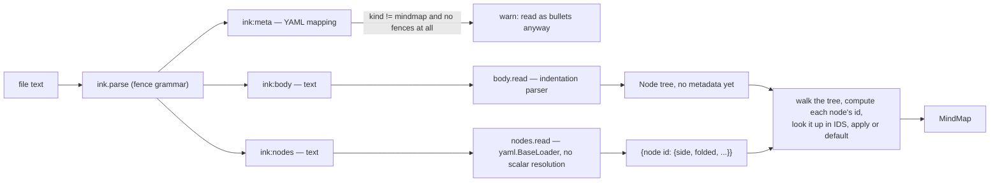

# jiyuu — roadmap

jiyuu is a desktop mindmap viewer and editor, similar to FreeMind and Freeplane, written in
Python with Flet. It opens existing Freeplane `.mm` maps and stores its own maps as `.ink`
files, using the file grammar from inkspire-api — a public, separate project of the author's
at https://github.com/InkSpireEditor/inkspire-api — so the two tools could be merged later.
The `.ink` format is jiyuu's native format; there is no separate markdown format.

This file is the only specification an implementing agent needs. Every algorithm, data
structure, numeric default and worked example below is final, not illustrative — where a
hash or a coordinate is shown, it is the real output of the stated algorithm on the stated
input, reproducible by running it. An implementer should not need to invent an approach
where this file already gives one; where it leaves something open, that is said explicitly
under "Open questions" or inside the step, with a default to use until it is revisited.

Where a step names inkspire-api, it is referring to a public project
(https://github.com/InkSpireEditor/inkspire-api) — citing it in a shipped docstring or
comment is fine, but only together with that link and, where relevant, the specific file or
commit, never assumed as something the reader already knows. The same test applies to any
other outside reference: name it only with enough of a link that a reader could go check it
themselves.

## How to use this file

Steps are done in order. A step is started by setting its status to `in progress`. It is
finished in the change that completes it: every box in the step is ticked, its status
becomes `done`, and any decision taken while doing the step is added to the Decisions table
below. That change is staged and proposed for commit, never committed automatically — see
`CLAUDE.md`'s session workflow for how a step moves from implementation to a commit the user
makes themselves. A step whose done condition fails stays `in progress`, and the failure is
written under it. A step may not start before every step it depends on is `done`.

Status values: `todo`, `in progress`, `done`, `blocked: <reason>`.

## Decisions

| Decision | Reason |
|---|---|
| Python `>=3.12,<4.0.0` in `requires-python`, 3.14 in CI | Same as inkspire-api |
| Flet 1.0.x (1.0.4 on PyPI on 2026-10-16, `requires_python >=3.10`) | Possible mobile build later from the same code |
| Linux desktop only for now. One map per window | User's choice |
| Maps under ~200 nodes. The view may be rebuilt on each change | User's maps are this size |
| Native format: `.ink`, grammar copied from inkspire-api `origin/main` at `01bc14a` (`inkspire_api/ink.py`, `docs/ink-format.md`) | Possible merge with inkspire later |
| `ink:meta` holds `kind: mindmap` | Tells a map apart from a prose `.ink` file |
| `ink:body` holds the tree as indented `- ` bullets, 2 spaces per level | Readable as a markdown list, editable on a phone |
| Node text is one plain line | User's choice |
| `ink:nodes` holds per-node metadata (folded, side), keyed by node ID | `ink-format.md`: metadata derived from the body goes in a section after it |
| Node ID: blake2b of a JSON-encoded path, first 16 hex chars | Same primitive and length as inkspire's `paragraph_hash`; JSON encoding removes every escaping question a delimiter-joined path would raise |
| Same-text siblings get an occurrence number (1, 2, 3, ...) inside the path | Each can be folded or sided independently |
| An `ink:nodes` entry matching no current node is dropped on save; the node gets defaults | Metadata can be recalculated, never needed to keep the tree |
| FreeMind-style layout: the root forks into an independent left column and an independent right column; every other node's children stay on their ancestor's side | User's choice |
| Layout defaults: node padding 16px horizontal / 8px vertical each side, vertical gap between sibling subtrees 12px, horizontal gap between a parent's edge and its children's edge 48px | Concrete numbers needed to implement step 3; no visual design pass has been done — revisit once the viewer is on screen |
| `.mm` read and written; Freeplane data jiyuu does not model is dropped | User has Freeplane maps |
| A `.mm` file is never overwritten by autosave; editing it creates `<stem>.ink` beside it | Autosave would otherwise drop Freeplane data on every write |
| Markdown: export only | User's choice |
| Autosave, no explicit save. Debounce 1.5 s | User's choice |
| Freeplane default shortcuts | User's choice |
| Build order: viewer (reading `.mm`), then `.ink`, then editor, then exports | Autosave needs `.ink` to exist before editing exists |
| jiyuu is licensed PolyForm-Noncommercial-1.0.0, copyright Maxime PUYS, same as inkspire-api | Lets step 7 copy code from inkspire-api into jiyuu with no licence conflict, since both are the same author's projects |
| `jiyuu/cli.py` defines an empty `@app.callback()` alongside `version` | Typer collapses a `Typer()` app with exactly one registered command into that command itself, invoked with no name; the callback keeps `version` (and every command added later) addressed by name, e.g. `jiyuu version` |
| `.github/workflows/pylintrc` disables `unexpected-keyword-arg` (E1123) and `too-many-function-args` (E1121) | Confirmed by direct test: astroid cannot infer that Flet's `@control`-decorated classes behave like dataclasses, so every Flet control call with arguments is a false positive (even `flet.Text("hi", size=16)` alone triggers both). `ty check`, run on every change alongside pylint, infers this correctly and is kept as the real check for this error class |
| Rendering approach confirmed (step 1): one `Container` per node on a `Stack` inside an `InteractiveViewer`, text measured with Pillow and padded by `LayoutSettings.pad_x`/`pad_y` | Step 1's checks B and C passed against this approach with real measurements; no fallback needed |
| Font: DejaVu Sans, size 16 by default | Step 1 confirmed its licence (Bitstream Vera, permissive; DejaVu's own changes public domain) permits bundling, and measured its rendered width against Pillow's prediction |
| Redo is also bound to Ctrl+Shift+Z, alongside Ctrl+Y | Step 1's keyboard check: confirmed as this desktop's own convention, and as a distinct, reliably-reported `(key="Z", shift=True, ctrl=True)` event |
| `Node` is `@dataclass(eq=False)`: compared and hashed by identity, not by field values | Same-text sibling disambiguation and `dict[Node, Rect]` (step 3) both need this; default dataclass equality would make two structurally identical siblings collide and would make `Node` unhashable |
| DejaVu Sans ships as a package asset (`jiyuu/assets/DejaVuSans.ttf`, with its own licence text alongside it, both listed in `pyproject.toml`'s `include`), not referenced by a system path | Portability: step 1's feasibility check used this machine's own system font path, which only this machine has |
| `InteractiveViewer` needs `constrained=False` and a large `boundary_margin` to pan at all around content bigger than the viewport, and `trackpad_scroll_causes_scale=True` so a trackpad's scroll zooms (matching FreeMind) rather than pans | Found by hand in step 3's demo viewer; step 1's check B never exercised real pointer gestures, only the programmatic `.pan`/`.zoom` calls, so this went unnoticed until something used it interactively |

## The `.ink` map file

### Shape

A map file is an `.ink` file (inkspire-api grammar, `===== ink:<name>` fences) with exactly
three sections in this order, the last two optional:

```
===== ink:meta
kind: mindmap
title: Project
===== ink:body
- Project
  - Goals
    - I/O
    - TODO
    - TODO
  - Risks
    - Flet performance
===== ink:nodes
"7be48fc73f0ebe9c": {side: "right"}
"32a21dfedf2cf99c": {side: "left"}
```

`ink:meta` → `ink:body` → `ink:nodes` is the pipeline a reader follows:



### `ink:meta`

A YAML mapping, exactly as inkspire's `ink:meta`. `kind: mindmap` marks the file as a map; it
is added on first save if missing. Any other key (`title`, or one inkspire itself would read,
such as `status`) is kept verbatim across a load/save round trip, unread by jiyuu.

### `ink:body` — reading

Reading never drops node text; anything it cannot place is attached to the tree anyway and
reported through `check`.

**Line shape.** A node line is: optional leading whitespace, a marker (`-`, `*` or `+`), one
required space, then the text, which is stripped of surrounding whitespace. A line with no
recognised marker is still read as a node — the whole stripped line becomes its text — with a
warning. Leading whitespace is counted in characters (a tab counts as one character, and
mixing tabs and spaces inside a body is reported as a warning, but does not stop the parse).

**Algorithm.** A stack of `(indentation, node)` pairs tracks every node on the path from the
root down to the line most recently read — the nodes that could still become a parent of what
comes next.

```python
def read_body(text: str) -> tuple[Node | None, list[Problem]]:
    problems: list[Problem] = []
    lines = [(i + 1, line) for i, line in enumerate(text.splitlines()) if line.strip()]
    if not lines:
        return None, [Problem(1, ERROR, "the body is empty")]

    root: Node | None = None
    stack: list[tuple[int, Node]] = []

    for line_no, raw in lines:
        indent, marker_found, text = split_line(raw)  # indent = count of leading ws chars
        if not marker_found:
            problems.append(Problem(line_no, WARNING, "line has no '-', '*' or '+' marker"))
        node = Node(text=text)

        if root is None:
            root = node
            stack = [(indent, node)]
            continue

        while len(stack) > 1 and indent <= stack[-1][0]:
            stack.pop()

        parent_indent, parent_node = stack[-1]
        if indent > parent_indent:
            parent_node.children.append(node)
            stack.append((indent, node))
        elif indent == parent_indent:  # len(stack) == 1: back at the root's own indentation
            problems.append(Problem(line_no, ERROR,
                "more than one top-level line; attached as a child of the first"))
            parent_node.children.append(node)
            stack.append((indent, node))
        else:  # indent < parent_indent, len(stack) == 1: dedented past the root itself
            problems.append(Problem(line_no, WARNING,
                "indentation does not match any open level; attached as a child of the root"))
            parent_node.children.append(node)
            stack.append((indent, node))

    return root, problems
```

**Worked trace**, over the canonical example above (indentation shown as the character count):

| Line | Text | Indent | Stack before (indent:text) | Action |
|---|---|---|---|---|
| 1 | `- Project` | 0 | — | becomes root; stack = `[(0, Project)]` |
| 2 | `  - Goals` | 2 | `(0,Project)` | `2 > 0` → child of Project; push `(2, Goals)` |
| 3 | `    - I/O` | 4 | `(0,Project),(2,Goals)` | `4 > 2` → child of Goals; push `(4, I/O)` |
| 4 | `    - TODO` | 4 | `(0,P),(2,G),(4,I/O)` | `4 <= 4` → pop I/O; now top is `(2,Goals)`, `4 > 2` → child of Goals; push `(4, TODO₁)` |
| 5 | `    - TODO` | 4 | `(0,P),(2,G),(4,TODO₁)` | same as line 4 → child of Goals; push `(4, TODO₂)` |
| 6 | `  - Risks` | 2 | `(0,P),(2,G),(4,TODO₂)` | pop `TODO₂`, pop `Goals` (both `<=2`); top `(0,Project)`, `2 > 0` → child of Project; push `(2, Risks)` |
| 7 | `    - Flet performance` | 4 | `(0,P),(2,Risks)` | `4 > 2` → child of Risks |

A malformed input, for the two reportable cases:

```
- Project
  - Goals
- Extra root line
```

Line 3 has indent 0, equal to the root's own indent, with the stack already popped back to
just `(0, Project)` — this is the "more than one top-level line" case: `Extra root line`
becomes a third child of `Project`, and `check` reports an error on line 3. The tree is never
left without that text.

### `ink:body` — writing

Always exactly `- ` and 2 spaces per indentation level, `\n` line endings, a final newline.
Every written line starts with spaces or `-`, so a written body can never be misread as a
`.ink` fence line (which must start with `=====`).

```python
def write_body(root: Node) -> str:
    lines: list[str] = []

    def emit(node: Node, depth: int) -> None:
        lines.append(f"{'  ' * depth}- {node.text}\n")
        for child in node.children:
            emit(child, depth + 1)

    emit(root, 0)
    return "".join(lines)
```

### Node paths and IDs

A node's **path** is the list of `[text, n]` pairs from the first level below the root down
to the node, where `n` is 1 for the first sibling with that exact text under its parent, 2
for the second, and so on. The root itself is never part of any path, so renaming the root
keeps every other node's metadata.

```python
def path_of(node: Node, root: Node) -> list[list]:
    chain: list[list] = []
    current = node
    while current is not root:
        parent = parent_of(current, root)
        same_text = [c for c in parent.children if c.text == current.text]
        occurrence = same_text.index(current) + 1
        chain.append([current.text, occurrence])
        current = parent
    chain.reverse()
    return chain

def node_id(path: list[list]) -> str:
    encoded = json.dumps(path, ensure_ascii=False, separators=(",", ":")).encode("utf-8")
    return hashlib.blake2b(encoded).hexdigest()[:16]
```

JSON-encoding the whole path before hashing is what lets node text contain `/`, `"`, `#` or
anything else without any escaping rule: the path is one opaque byte string to the hash, not
something built by joining text with a separator.

**Real computed values**, for the worked example tree above (`Project` is the root and is not
hashed):

| Node | Path | `node_id` |
|---|---|---|
| Goals | `[["Goals", 1]]` | `7be48fc73f0ebe9c` |
| Risks | `[["Risks", 1]]` | `32a21dfedf2cf99c` |
| Goals → I/O | `[["Goals", 1], ["I/O", 1]]` | `3a3e72d688ada732` |
| Risks → Flet performance | `[["Risks", 1], ["Flet performance", 1]]` | `1beebbe825bf2289` |
| Goals → TODO (1st) | `[["Goals", 1], ["TODO", 1]]` | `93daa0a88332d655` |
| Goals → TODO (2nd) | `[["Goals", 1], ["TODO", 2]]` | `57b391dbe76f697e` |

So the worked `ink:nodes` section at the top of this document, in full, is:

```
===== ink:nodes
"7be48fc73f0ebe9c": {side: "right"}
"32a21dfedf2cf99c": {side: "left"}
```

(`Goals` on the right, `Risks` on the left; everything else defaults to unfolded, and
non-first-level nodes never carry `side`.)

### `ink:nodes`

One line per node carrying metadata, in body order (a stable, deterministic order rather than
hash order, so a diff of two saves is readable). The key is quoted with `json.dumps`; the
value is a flow mapping whose string values are quoted the same way. Reading uses
`yaml.load(text, Loader=yaml.BaseLoader)` — the same approach as inkspire's
`provenance.py`'s `render_section`/loading, and for the same reason: an unquoted 16-hex-digit
key that happens to be all digits is read by a normal YAML loader as an integer, which then
matches no node.

**A real all-digit example**: the path `[["Node", 1], ["974", 1]]` hashes to
`1984891675846323` — sixteen decimal digits, a legal hex string that is also a legal
(enormous) YAML integer if left unquoted. Written through `json.dumps`, it is
`"1984891675846323"`, read back as the string `1984891675846323` by `BaseLoader`, and matches
its node. Left bare, this exact file would silently lose that node's metadata on every load —
which is why every key is unconditionally quoted on write, with no "is this one risky"
check.

Known keys inside an entry: `side` (`"left"` or `"right"`, meaningful only on first-level
nodes — written for every first-level node, so layout does not depend on re-running the
balancing rule the same way twice), `folded` (`"true"` only; its absence means unfolded, so a
map with nothing folded has no `folded` keys at all). Any other key already present in an
entry is kept on save as long as that entry's node still exists; an entry whose key matches no
current node's `node_id` is dropped.

```python
def read_nodes_section(text: str) -> dict[str, dict] | None:
    try:
        loaded = yaml.load(text, Loader=yaml.BaseLoader)
    except yaml.YAMLError:
        return None
    if loaded is None:
        return {}
    if not isinstance(loaded, dict):
        return None
    return loaded  # every key and every string value is already `str`, by BaseLoader

def render_nodes_section(entries: dict[str, dict]) -> str:
    lines = []
    for node_id, fields in entries.items():  # body order
        body = ", ".join(f"{k}: {json.dumps(v)}" for k, v in fields.items())
        lines.append(f"{json.dumps(node_id)}: {{{body}}}\n")
    return "".join(lines)
```

### Applying metadata on load, dropping it on save

```python
def apply_nodes_section(root: Node, entries: dict[str, dict]) -> None:
    for node in walk(root):               # body order, excludes the root
        fields = entries.get(node_id(path_of(node, root)), {})
        node.side = fields.get("side")       # None if absent -> balancing decides it
        node.folded = fields.get("folded") == "true"
        node.extra = {k: v for k, v in fields.items() if k not in ("side", "folded")}

def build_nodes_section(root: Node) -> dict[str, dict]:
    entries: dict[str, dict] = {}
    for node in walk(root):
        fields = dict(node.extra)
        if node.parent_of(node) is root and node.side is not None:
            fields["side"] = node.side
        if node.folded:
            fields["folded"] = "true"
        if fields:
            entries[node_id(path_of(node, root))] = fields
    return entries
```

An entry is simply never produced for a node with nothing to say, so a freshly-created map
file has no `ink:nodes` section at all — `ink.render` already omits an empty section, per
the grammar in step 7.

## Cross-cutting guards

These apply to every step below, not just the one that introduces them.

- CI (pylint ≥ 9.5, `ty check`, pytest) passes at the end of every step.
- Modules outside `jiyuu/ui/` never import `flet`. A test added in step 2 enforces this by
  importing every non-UI module in a subprocess and checking `flet` is not in `sys.modules`
  afterwards.
- No real person's name, real map content, or other identifying detail anywhere that gets
  committed: not in a fixture, a test, a docstring, a code comment, a commit message, or this
  file. Fixtures use placeholder text (`Project`, `Goals`, `Foo`, `Jane Doe`). The user's own
  Freeplane and `.ink` maps are opened from outside the repository for manual testing and are
  never copied into it, even temporarily — see `CLAUDE.md`'s privacy section for the full
  rule and what to do when one of them exposes a bug.
- Reading never drops node text. Anything not understood is reported through `check`, not
  raised.
- Writing never produces a file its own reader cannot read back to the same tree (round-trip
  tests in steps 8, 9 and 14).
- A `.mm` file is never written except by an explicit export to a path the user chose.
- Autosave never overwrites a file that changed on disk since jiyuu last read or wrote it.
- Writes are atomic: write a temporary file in the same directory, then `os.replace`.
- Whenever a step produces something visually meaningful (a tree, a computed layout, a
  parsed map), `scripts/demo_viewer.py` is extended to show it in a real Flet window, so the
  user can look at and try new features as they land rather than only reading a test-pass
  report. It is promoted into `jiyuu/ui/app.py` at step 5 rather than discarded.

## Steps

Each step lists what it depends on, its tasks, its tests, step-specific guards, blockers or
risks, and the condition that marks it done. Tasks and tests are tracked with checkboxes.

### Step 0: Project setup

- [x] Status: `done`
- Depends on: none.
- Tasks:
  - [x] `git init`.
  - [x] `pyproject.toml`:

    ```toml
    [project]
    name = "jiyuu"
    version = "0.1.0"
    description = "A FreeMind/Freeplane-compatible mindmap viewer and editor"
    requires-python = ">=3.12,<4.0.0"
    dependencies = [
        "flet (>=1.0.4,<2.0.0)",
        "pyyaml (>=6.0.3,<7.0.0)",
        "defusedxml (>=0.7.1,<0.8.0)",
        "typer",
        "pillow",
    ]

    [project.scripts]
    jiyuu = "jiyuu.cli:app"

    [tool.poetry]
    requires-poetry = ">=2.0"
    packages = [{ include = "jiyuu" }]

    [tool.poetry.group.dev.dependencies]
    pytest = "*"
    pytest-cov = "^7.1.0"
    pylint = "^4.0.8"
    ty = "^0.0.80"

    [tool.pytest.ini_options]
    testpaths = ["tests"]

    [build-system]
    requires = ["poetry-core>=2.0"]
    build-backend = "poetry.core.masonry.api"
    ```
  - [x] Dev dependency group: already included above.
  - [x] `.editorconfig` copied verbatim from inkspire-api (`charset = utf-8`, LF,
        4-space indent, trim trailing whitespace, `.md` exempted from trailing-whitespace
        trimming).
  - [x] `.gitignore`: `__pycache__/`, `*.py[cod]`, `/.venv/`, `/.pytest_cache/`,
        `/.ruff_cache/`, `/.coverage`, `/htmlcov/`, `/dist/`, `*.egg-info/`.
  - [x] `.github/workflows/lint.yaml`, `test.yaml` and `pylintrc` copied from
        inkspire-api's, with `inkspire_api lorebook timeline` replaced by `jiyuu` everywhere
        it is the lint/test target, and the pytest coverage flag changed to
        `--cov jiyuu`.
  - [x] `LICENSE`: PolyForm Noncommercial 1.0.0, matching inkspire-api's, with `license`
        and `license-files` set in `pyproject.toml` (not originally listed in this step's
        tasks; added because step 7 copies code from inkspire-api, which carries this
        licence — see the Decisions table).
  - [x] `jiyuu/__init__.py` holding `__version__ = "0.1.0"`.
  - [x] `jiyuu/cli.py`:

    ```python
    import typer

    from . import __version__

    app = typer.Typer()

    @app.callback()
    def main() -> None:
        """jiyuu's top-level command group."""
        # Typer collapses an app with exactly one registered command into that command
        # itself, invoked with no name. This callback, though it does nothing on its own,
        # keeps `version` (and every command added later) invoked by name instead.

    @app.command()
    def version() -> None:
        """Print jiyuu's version."""
        print(__version__)
    ```
  - [x] `tests/__init__.py`, `tests/conftest.py` (empty to start).
  - [x] `README.md` with install (`poetry install`) and run (`poetry run jiyuu version`)
        commands.
- Tests:
  - [x] `jiyuu version` prints `0.1.0` (checked with typer's `CliRunner`).
- Blockers/risks: a dependency without a Python 3.14 wheel. If one turns up, record it here
  and pin the development virtualenv to 3.13 while keeping 3.14 in CI only if it installs
  there. **Did not occur**: all 37 dependencies, including Flet 1.0.4, installed cleanly
  under Python 3.14.7.
- Done when: `poetry install`, `poetry run pytest`, `poetry run pylint ...` and
  `poetry run ty check` all pass locally, and the first commit is made. **Met**: pytest 1
  passed, pylint 10.00/10, `ty check` reports no errors; the commit itself is proposed below
  for the user to make.

### Step 1: Flet feasibility check

- [x] Status: `done`
- Depends on: 0.
- Purpose: confirm the rendering approach before any UI code depends on it. Steps 3 and 5
  are written assuming "one `Container` per node on a `Stack`" works; this step either
  confirms that or forces a rewrite of step 5's approach before it starts.
- Tasks, in `scripts/flet_check.py` (excluded from pylint and coverage since neither's CI
  invocation targets `scripts/`, and from pytest by not matching `test_*`):
  - [x] Check A — open a bare Flet desktop window: `flet.app(target=main)` where `main`
        just sets a page title, on Linux, under Python 3.14.
  - [x] Check B — place 200 `ft.Container(content=ft.Text(...))` at absolute positions
        inside `ft.Stack`, that `Stack` inside `ft.InteractiveViewer` (Flet's pan/zoom
        container), with edges drawn as cubic Bézier paths on an `ft.canvas.Canvas`
        beneath the stack. Programmatically pan and zoom a few times and print the time
        between each `page.update()` call. Record whether it stays under roughly 33 ms
        (≈30 fps) per update with all 200 nodes visible.
  - [x] Check C — text measurement: bundle one TTF font with a licence compatible with
        this project (DejaVu Sans is Bitstream Vera + Public Domain/Arev, both
        redistributable; confirm before bundling), register it via `page.fonts`, and for a
        set of 10 sample strings compare Pillow's
        `ImageFont.truetype(font_path, size).getlength(text)` against the width Flet
        actually renders a `Container` at (read back via the control's resulting size, or
        an `on_resize`-style callback if Flet 1.0 exposes one for a `Text` control).
        Record the largest absolute difference across the 10 strings.
  - [x] Check D — keyboard: attach `page.on_keyboard_event` and, with an `ft.TextField`
        on the page, manually press each of: every arrow key, Tab, Insert, Enter, F2,
        Delete, Space, Ctrl+Z, Ctrl+Y. For each, record (a) whether the page-level handler
        fired, and (b) whether it fired while the `TextField` had focus.
- Blockers/risks: none of the three anticipated fallbacks below were needed; kept for
  reference in case a future machine or Flet version behaves differently.
  - No reliable way to read back a rendered text width (check C has no fallback reading):
    fall back to the Pillow estimate plus a fixed padding margin (record the margin chosen
    here), and accept that very unusual fonts/scripts may not fit exactly. **Not needed**:
    `Container`/`Text` is a `LayoutControl`, whose `on_size_change` reports the real
    rendered size after layout — see Check C's results below.
  - Check B exceeds ~33 ms per update with 200 controls: fall back to drawing every node as
    `canvas.Text` plus `canvas.Rect` on one `ft.canvas.Canvas`, with hit-testing done in
    Python against the same rectangles `layout.py` already computes (point-in-rectangle,
    tested top-most node first). Record this fallback here, and rewrite step 5's tasks to
    draw on the canvas instead of building controls before step 5 starts. **Not needed**:
    see Check B's results below.
  - Tab does not reach `page.on_keyboard_event` (it moves focus instead): fall back to a
    different key for "new child" in step 11 (Insert alone, dropping the Tab alias), and
    record that as a decision in the Decisions table above. **Not needed**: see Check D's
    results below — Tab reaches `page.on_keyboard_event` reliably.
- Done when: each of the four checks has a written result in this section (pass/fail and
  the measured number), and the chosen approach — or whichever fallback was needed — is
  added to the Decisions table. **Met**:

  **Check A — pass.** `ft.run(main)` opened a native window on this Linux desktop (Wayland,
  via XWayland fallback for input) under Python 3.14.7, with no exception.

  **Check B — pass.** Ten programmatic `zoom`/`pan` calls on 200 positioned containers,
  timed end-to-end around each `page.update()`, across four separate runs:

  | Run | Update times (ms) |
  |---|---|
  | 1 | 23.5, 20.3, 22.9, 16.8, 11.6, 15.5, 5.2, 4.8, 4.5, 4.7 |
  | 2 | 23.6, 15.2, 35.9, 28.4, 17.7, 13.8, 14.7, 16.6, 11.1, 12.0 |
  | 3 | 17.0, 12.4, 24.8, 18.1, 10.4, 13.6, 23.3, 9.0, 12.4, 14.5 |
  | 4 | 17.7, 13.0, 21.9, 48.7, 31.2, 14.5, 9.8, 7.5, 12.0, 9.5 |

  Most calls land well under the 33 ms (≈30 fps) budget; two calls, in two different runs,
  exceeded it (35.9 ms, 48.7 ms) without a repeating pattern — most likely one-off
  scheduling jitter on this desktop rather than a sustained cost of the approach. One
  `Container` per node on a `Stack` inside an `InteractiveViewer` is confirmed as the
  rendering approach for step 5; the canvas-only fallback is not needed.

  **Check C — pass.** Comparing `ImageFont.getlength` (DejaVu Sans, size 16) against each
  string's actual rendered width, reported through `Container.on_size_change`:

  | String | Pillow (px) | Flet (px) | Difference |
  |---|---|---|---|
  | `Project` | 54.78 | 56.49 | +1.71 |
  | `Goals` | 44.81 | 46.02 | +1.21 |
  | `I/O` | 22.70 | 23.45 | +0.75 |
  | `TODO` | 47.30 | 48.28 | +0.98 |
  | `Risks` | 41.53 | 42.75 | +1.22 |
  | `Flet performance` | 137.38 | 141.32 | +3.95 |
  | `Résumé` | 64.17 | 65.65 | +1.48 |
  | `A/B` | 27.33 | 28.06 | +0.73 |
  | `#tag` | 39.66 | 40.64 | +0.98 |
  | `He said "hi"` | 94.14 | 97.09 | +2.95 |

  Flet always renders slightly wider than Pillow's prediction, by 0.7–4.0 px across these
  ten strings, growing mildly with string length. `Container.on_size_change` (inherited
  from `LayoutControl`) is a reliable way to read back a rendered size, so the Pillow-only
  fallback margin is not needed; the existing `pad_x = 16` px per side in `LayoutSettings`
  already absorbs a gap several times this size.

  **Check D — pass, with one correction.** `page.on_keyboard_event` fired for every key
  tested — every arrow key, Tab, Insert, Enter, F2, Delete, Space, Ctrl+Z, Ctrl+Y — whether
  or not an `ft.TextField` on the same page had focus at the time; no key was ever silently
  consumed before reaching it. While the field had focus, Flutter's own `TextField` *also*
  consumed several of these for editing — arrow keys moved the text cursor, Delete deleted
  a character, Space inserted one, and Enter blurred the field — independently of
  `page.on_keyboard_event` still firing for the same key press. This confirms step 11's
  design is necessary, not optional: jiyuu's own code must suppress tree-navigation actions
  while a node is being text-edited, since Flet delivers the event regardless of what the
  focused field does with it. One correction to step 11's keybinding table: on this
  desktop, Ctrl+Shift+Z is the conventional redo shortcut, confirmed as a distinct
  `(key="Z", shift=True, ctrl=True)` event — added as a second accepted redo binding
  alongside Ctrl+Y (recorded in the Decisions table).

### Step 2: Tree model and node IDs

- [x] Status: `done`
- Depends on: 0.
- Tasks:
  - [x] `jiyuu/model.py`:

    ```python
    @dataclass
    class Node:
        text: str
        children: list["Node"] = field(default_factory=list)
        folded: bool = False
        side: str | None = None          # "left" / "right" / None; meaningful on
                                          # first-level nodes only
        extra: dict[str, str] = field(default_factory=dict)  # unknown ink:nodes keys

    @dataclass
    class MindMap:
        root: Node
        meta: dict = field(default_factory=dict)      # ink:meta, as read
        other_sections: dict[str, str] = field(default_factory=dict)  # anything besides
                                                                       # meta/body/nodes
    ```
  - [x] `walk(root) -> Iterator[Node]`: depth-first, body order, **excluding** the root
        (paths are never computed for it).
  - [x] `parent_of(node, root) -> Node | None`: depth-first search for the parent; `None`
        only for the root itself.
  - [x] `path_of(node, root)` and `node_id(path)`, exactly as given under "Node paths and
        IDs" above.
  - [x] `tests/data/node_ids.json`, with exactly this content (every value below is a real
        computed hash, not a placeholder):

    ```json
    [
      {"label": "root's direct child", "path": [["Goals", 1]],
       "id": "7be48fc73f0ebe9c"},
      {"label": "deep node, three levels", "path": [["Goals", 1], ["I/O", 1], ["Sockets", 1]],
       "id": "4f8376264b3ac471"},
      {"label": "first same-text sibling", "path": [["TODO", 1]],
       "id": "93daa0a88332d655"},
      {"label": "second same-text sibling", "path": [["TODO", 2]],
       "id": "57b391dbe76f697e"},
      {"label": "non-ASCII text", "path": [["Résumé", 1]],
       "id": "d372d71ad9aa94a8"},
      {"label": "text containing a slash", "path": [["A/B", 1]],
       "id": "5fd47c1d5589e7e2"},
      {"label": "text containing a quote", "path": [["He said \"hi\"", 1]],
       "id": "979299541639824d"},
      {"label": "text containing a hash", "path": [["#tag", 1]],
       "id": "c5d91d056df13401"},
      {"label": "empty text", "path": [["", 1]],
       "id": "84085c5ae4973aef"},
      {"label": "all-digit hash (quoting hazard)", "path": [["Node", 1], ["974", 1]],
       "id": "1984891675846323"}
    ]
    ```
  - [x] The no-`flet`-import test described under Cross-cutting guards, in
        `tests/test_no_flet_import.py`: for each module under `jiyuu/` except
        `jiyuu/ui/*` and `jiyuu/cli.py`, run
        `python -c "import <module>; import sys; assert 'flet' not in sys.modules"` in a
        subprocess.
- Tests:
  - [x] Every vector in `node_ids.json` matches `node_id(path)` exactly.
  - [x] Building a tree with two `TODO` siblings under `Goals`, then swapping their order,
        leaves the first position holding occurrence 1 and the second holding occurrence 2
        (occurrence is positional among same-text siblings, not tied to a specific
        `Node` object).
  - [x] The no-`flet`-import test passes.
- Done when: the tests above pass, and `tests/data/README.md` says one line: `node_ids.json`
  is a specification (hashes computed by hand with `hashlib` directly), not a recording of
  whatever the code currently does. **Met**: 19 tests pass, 100% coverage of `jiyuu/model.py`.

  One bug found and fixed while writing the tests: `parent_of`'s search only walked
  `walk(root)`'s results, which exclude `root` itself by design — so it could never find
  `root` as the parent of one of its own direct children, and raised `ValueError` for every
  first-level node instead. Fixed by checking `root.children` directly before falling back
  to the walk.

  One decision not spelled out in the pseudocode above: `Node` is declared
  `@dataclass(eq=False)`, so it compares and hashes by identity. Two sibling nodes can be
  completely identical in every field — the two bare `TODO` leaves in the occurrence test
  are exactly this case — and still need to be told apart by which object they are, both
  for `path_of`'s occurrence counting (`list.index`, `in`) and so a `Node` can be used as a
  dictionary key (needed by `dict[Node, Rect]` in step 3) at all; the default dataclass
  behaviour would make equal-by-value nodes collide and would make `Node` unhashable.

### Step 3: Layout

- [x] Status: `done`
- Depends on: 1, 2.
- Rule (FreeMind-style, root forks, everything else inherits its side): the **root** splits
  its children into two independent vertical columns, left and right; **every other node**
  stacks all of its children in one column on its own side. A node with no side recorded
  among the root's children is assigned, in body order, to whichever column currently has
  the smaller total height — ties go to the right.
- Coordinate convention: a node's box is `Rect(x, y, width, height)` with `(x, y)` its
  **top-left corner**. The root's box is horizontally centred on `x = 0` (`x = -width / 2`);
  everything else is built outward from its parent's edge nearest to it. For a right-side
  node, `x` is its left edge; `horizontal_gap` is measured from a parent's right edge to its
  child's left edge. For a **left-side** node, the box is still stored as
  `Rect(x, y, width, height)` with `x` its left edge, but it is *placed* right-to-left: the
  placement algorithm below computes each left-side node's right edge first (the edge
  nearest its parent) and derives `x = right_edge - width`. Vertically, the **whole plane**
  is centred on `y = 0`: the top-level call passes `y_top = -height / 2`, where `height` is
  the full height the root's subtree needs, so the root — and, in a balanced layout, often
  its first-level children too — ends up centred on `y = 0`, not merely starting there.
- Tasks:
  - [x] `jiyuu/measure.py`:

    ```python
    class Measurer(Protocol):
        def size_of(self, text: str) -> tuple[float, float]: ...  # (width, height) of the
                                                                    # text alone, no padding

    class PillowMeasurer:
        def __init__(self, font_path: str, size: int): ...
        def size_of(self, text: str) -> tuple[float, float]:
            font = ImageFont.truetype(self.font_path, self.size)
            left, top, right, bottom = font.getbbox(text or " ")
            return (right - left, bottom - top)
    ```
    and a `FixedMeasurer(width_per_char: float, height: float)` fake for tests, returning
    `(len(text) * width_per_char, height)`.
  - [x] `jiyuu/layout.py`:

    ```python
    @dataclass
    class LayoutSettings:
        pad_x: float = 16.0      # each side
        pad_y: float = 8.0       # each side
        vertical_gap: float = 12.0    # between sibling subtrees
        horizontal_gap: float = 48.0  # parent edge to child edge

    def node_box_size(node: Node, measurer: Measurer, settings: LayoutSettings) -> tuple[float, float]:
        w, h = measurer.size_of(node.text)
        return (w + 2 * settings.pad_x, h + 2 * settings.pad_y)

    # --- pass 1: bottom-up, heights only -----------------------------------

    def column_height(nodes: list[Node], measurer, settings) -> float:
        if not nodes:
            return 0.0
        heights = [subtree_height(n, measurer, settings) for n in nodes]
        return sum(heights) + settings.vertical_gap * (len(heights) - 1)

    def subtree_height(node: Node, measurer, settings, *, is_root: bool = False) -> float:
        _, own_h = node_box_size(node, measurer, settings)
        if node.folded or not node.children:
            return own_h
        if is_root:
            right = column_height([c for c in node.children if resolved_side(node, c) == "right"], measurer, settings)
            left = column_height([c for c in node.children if resolved_side(node, c) == "left"], measurer, settings)
            return max(own_h, right, left)
        return max(own_h, column_height(node.children, measurer, settings))

    # --- pass 2: top-down, assign Rects -------------------------------------

    def place_column(nodes, near_x, y_top, available_height, side, measurer, settings, out):
        heights = [subtree_height(n, measurer, settings) for n in nodes]
        total = sum(heights) + settings.vertical_gap * (len(heights) - 1)
        y = y_top + (available_height - total) / 2
        for child, h in zip(nodes, heights):
            place(child, near_x, y, h, side, measurer, settings, out)
            y += h + settings.vertical_gap

    def place(node, near_x, y_top, height_for_node, side, measurer, settings, out, *, is_root=False):
        w, h = node_box_size(node, measurer, settings)
        y_center = y_top + height_for_node / 2
        x = (near_x if side == "right" else near_x - w) if not is_root else -w / 2
        out[node] = Rect(x, y_center - h / 2, w, h)
        if node.folded or not node.children:
            return
        if is_root:
            right_x = x + w + settings.horizontal_gap
            left_x = x - settings.horizontal_gap
            place_column([c for c in node.children if resolved_side(node, c) == "right"],
                         right_x, y_top, height_for_node, "right", measurer, settings, out)
            place_column([c for c in node.children if resolved_side(node, c) == "left"],
                         left_x, y_top, height_for_node, "left", measurer, settings, out)
        else:
            child_near_x = (x + w + settings.horizontal_gap) if side == "right" \
                           else (x - settings.horizontal_gap)
            place_column(node.children, child_near_x, y_top, height_for_node, side,
                         measurer, settings, out)

    def layout(root: Node, measurer: Measurer, settings: LayoutSettings) -> tuple[dict[Node, Rect], list[Edge]]:
        rects: dict[Node, Rect] = {}
        height = subtree_height(root, measurer, settings, is_root=True)
        place(root, 0.0, -height / 2, height, "right", measurer, settings, rects, is_root=True)
        edges = [Edge(parent=p, child=c, side="right" if rects[c].x >= rects[p].x else "left")
                 for p in rects for c in p.children if c in rects]
        return rects, edges
    ```
    `y_top = -height / 2`, not `0.0`, is what centres the root (and the whole plane) on
    `y = 0` — see the Coordinate convention above. `resolved_side(root, child)` reads
    `child.side` if set, else runs the balancing rule against the **current** running
    totals computed so far in body order (ties to the right), and writes the result back
    onto `child.side` itself — which both makes passes 1 and 2 agree on the same assignment
    without re-deriving it twice, and keeps the assignment stable across repeated layout
    calls rather than re-balanced from scratch, possibly differently, every time. An edge's
    side is read off the two boxes already placed — whichever one is further right — rather
    than tracked separately, since it has to agree with wherever they actually ended up.
  - [x] An edge is drawn from the midpoint of the parent's facing edge (right edge if the
        child is on the right, left edge if on the left) to the midpoint of the child's
        near edge, as a cubic Bézier curve bulging horizontally (control points offset
        horizontally by half of `horizontal_gap`, not vertically) — this is what step 1's
        check B already exercised.
  - [x] `scripts/demo_viewer.py`: builds the worked-example tree from this document as real
        `Node`/`MindMap` objects, lays it out with `layout.layout`, and draws it in a Flet
        window — the same positioned-`Container`-on-a-`Stack`-inside-an-`InteractiveViewer`
        approach `scripts/flet_check.py` already validated, with edges as the same Bézier
        curves. Stays open until closed by hand, so the result is something to actually look
        at rather than only a passing assertion on its coordinates.
- Worked example, over the same tree as above, with every node given a **fixed** box height
  of 32px (ignoring real text metrics here, only to keep the arithmetic checkable by hand;
  real heights come from `node_box_size` once step 1 picks a font) and
  `vertical_gap = 12`, `horizontal_gap = 48`:

  ```
  Project
   ├─ Goals (right)
   │   ├─ I/O
   │   ├─ TODO
   │   └─ TODO
   └─ Risks (left)
       └─ Flet performance
  ```

  - `subtree_height(I/O) = subtree_height(TODO₁) = subtree_height(TODO₂) = 32` (no children).
  - `column_height(Goals' children) = 32*3 + 12*2 = 120`.
  - `subtree_height(Goals) = max(32, 120) = 120`.
  - `subtree_height(Flet performance) = 32`; `column_height(Risks' children) = 32`;
    `subtree_height(Risks) = max(32, 32) = 32`.
  - Right column height = `column_height([Goals]) = 120`. Left column height =
    `column_height([Risks]) = 32`.
  - `subtree_height(Project, is_root) = max(32, 120, 32) = 120`.
  - Placement: the whole plane is centred on `y = 0`, so the top-level call uses
    `y_top = -height/2 = -60`. `Project`'s own box is centred at
    `y_center = -60 + 120/2 = 0`, height 32, so its box top is `y = -16`. The right column
    gets the *same* span, `y_top = -60`, `available_height = 120`; since its one child
    (`Goals`) already needs the full 120, it is placed with no further offset
    (`y = -60 + (120-120)/2 = -60`), so `Goals`'s own box is centred at
    `y_center = -60 + 120/2 = 0` too — top `y = -16`, the same as `Project`'s. The left
    column gets the same span as well; its one child (`Risks`, height 32) is centred within
    it: `y = -60 + (120-32)/2 = -16`, so `Risks`'s own box is centred at
    `y_center = -16 + 32/2 = 0` — top `y = -16`, the same box position as `Goals`'s, because
    both are centred within the identical 120-tall span the root's layout reserved on each
    side.
- Tests:
  - [x] A single root with no children: one `Rect` at `(-w/2, -h/2, w, h)`.
  - [x] One child on each side, with the heights above, matching exactly.
  - [x] Balancing when no side is recorded for any first-level node (first child goes
        right, second goes left, third goes right again, ties broken to the right).
  - [x] An explicit `side` is respected even when it leaves the two columns unbalanced.
  - [x] A folded node's subtree occupies exactly its own height, regardless of what its
        (hidden) children would need.
  - [x] No two rectangles overlap, checked on randomly generated trees of up to 200 nodes
        (property-based, e.g. with `hypothesis`, or a seeded random generator and a fixed
        set of seeds if `hypothesis` is not added as a dependency).
  - [x] Every edge's two endpoints sit on the correct facing edges of the two boxes it
        connects.
- Done when: the tests above pass, laying out 200 nodes takes under 50 ms (timed in a test
  marked `slow`, or measured once and the number written into this section), and
  `scripts/demo_viewer.py` is run and checked by eye against the worked example above (root
  centred, `Goals` on the right, `Risks` on the left, no boxes overlapping). **Met**: 37
  tests pass (`tests/test_layout.py`, `tests/test_measure.py`), 200-node layouts took
  0.7–1.0 ms across 10 random trees, well under the 50 ms budget.

  Two things found and fixed while implementing this step, both now folded into the text
  above rather than left as errata:

  - The worked example's own placement arithmetic used `y_top = 0` at the top level, which
    does not actually centre the root on `y = 0` — it only does that in the trivial case
    where the root's own height equals the whole subtree's height. `y_top = -height / 2` is
    what the Coordinate convention actually requires, and is what both the pseudocode and
    the worked example now show.
  - `jiyuu/layout.py`'s `_place` and `_place_column` originally took every one of their
    parameters positionally, which pylint flagged (`too-many-positional-arguments`) and
    which also made call sites harder to read; `measurer`, `settings` and `out` are now
    keyword-only at both.

  Running `scripts/demo_viewer.py` also found real bugs in how it drove `InteractiveViewer`
  — nothing in `jiyuu/layout.py` itself — fixed by hand, since these can only be found and
  checked by someone actually dragging and scrolling, not by an automated test:

  - `constrained`, which defaults to `True`, forces content bigger than the viewport to fit
    the viewport instead — the exact opposite of what panning around a map needs, per this
    control's own documentation. Panning did not work at all until this was set `False`.
  - `boundary_margin`, which defaults to zero, confines panning to exactly the content's own
    bounds, leaving no empty space around a small map to pan into. Set to a generous margin
    instead.
  - `trackpad_scroll_causes_scale` (default `False`) makes a trackpad's two-finger scroll
    pan rather than zoom; set to `True` so scrolling zooms instead, matching FreeMind's own
    scroll-to-zoom convention — the trade-off being that two-finger scroll no longer pans
    at all (dragging still does).
  - Left open, deferred to step 5 rather than chased down now: with scroll-to-zoom and a
    natural-scrolling trackpad, the zoom direction feels backwards to at least one user.
    No property on `InteractiveViewer` controls this directly; a `GestureDetector.on_scroll`
    handler driving `InteractiveViewer.zoom` by hand, instead of its own built-in trackpad
    handling, is the likely fix, but needs someone with a trackpad to actually check it.

### Step 4: `.mm` reader

- [ ] Status: `todo`
- Depends on: 2.
- Freeplane/FreeMind element and attribute mapping:

  | `.mm` element/attribute | jiyuu field | Notes |
  |---|---|---|
  | `<node TEXT="...">` | `Node.text` | Primary source of node text |
  | `<node><richcontent TYPE="NODE"><html>...<body>...` | `Node.text`, if `TEXT` is absent | Plain text extracted from the HTML body; any line break inside it becomes one space, with a warning |
  | `<node FOLDED="true">` | `Node.folded = True` | `FOLDED` absent or `"false"` → `False` |
  | `<node POSITION="right"\|"left">`, direct child of the map's root only | first-level `Node.side` | A `POSITION` value other than `left`/`right` is ignored with a warning. A `POSITION` on a deeper node is ignored silently — Freeplane itself does not write one there |
  | everything else (`map_styles`, `attribute`, `attribute_registry`, `icon`, `edge`, `font`, `cloud`, `arrowlink`, `hook`, a `<node>`'s `ID`/`CREATED`/`MODIFIED`/`LOCALIZED_TEXT`) | dropped | counted in the returned warnings so `jiyuu check` can report "N Freeplane attributes were dropped" |

- Example input, exercising the three text sources and both sides:

  ```xml
  <map version="freeplane 1.9.13">
  <node TEXT="Project" FOLDED="false" ID="ID_1">
    <node TEXT="Goals" POSITION="right" ID="ID_2" FOLDED="false">
      <node TEXT="I/O" ID="ID_3"/>
    </node>
    <node POSITION="left" ID="ID_4" FOLDED="true">
      <richcontent TYPE="NODE">
        <html><body><p>Risks</p></body></html>
      </richcontent>
      <node TEXT="Flet performance" ID="ID_5"/>
    </node>
  </node>
  </map>
  ```

  reads as the same tree used throughout this document: `Project` (root) → `Goals` (right,
  unfolded) → `I/O`; `Project` → `Risks` (left, **folded** — read from its `richcontent`
  since it has no `TEXT`) → `Flet performance` (present in the tree even though its parent
  is folded; folding is a view concern, not a parsing one).

- Tasks:
  - [ ] `jiyuu/formats/mm.py`, `read(text: str) -> tuple[MindMap, list[str]]`, parsed with
        `defusedxml.ElementTree.fromstring` (never the standard library's `ElementTree`
        directly, to keep external entities and DTD processing refused).
  - [ ] Recursive descent: `_read_node(element, is_first_level: bool) -> Node`, building
        `Node.text` / `.folded` / `.side` per the mapping table, recursing into every child
        `<node>` element, and appending one warning string per dropped/ignored thing it
        sees (named by element or attribute, e.g. `"dropped <icon> on node 'Goals'"`).
  - [ ] The map's outermost element must be exactly one `<node>` under `<map>`; anything
        else (`<arrowlink>` at the map level, more than one top-level `<node>`) produces a
        warning and the first `<node>` found is used as the root.
- Tests, against hand-written fixtures in `tests/data/mm/`:
  - [ ] A FreeMind 1.0.1-style file (no `richcontent`, `TEXT` on every node).
  - [ ] A Freeplane-style file with `map_styles`, `attribute`/`attribute_registry`, `icon`,
        `<node><richcontent TYPE="NOTE">` (a note, not node text — must **not** be read as
        the node's text), `richcontent TYPE="NODE"` node text, and a cloned node (`<node>`
        with no `TEXT`/`richcontent` of its own, referencing another by Freeplane's own
        mechanism — treated as an empty-text node with a warning, since clone resolution is
        out of scope).
  - [ ] Malformed XML (an unclosed tag) produces a warning and does not crash; the file is
        reported as unreadable rather than partially parsed.
  - [ ] An XML entity (`&amp;`, `&#233;`) and non-ASCII text (`Résumé`) round-trip through
        `read` correctly.
  - [ ] The example input above reads to exactly the tree and metadata described after it.
- Guards: no external entities or DTD processing — covered by using `defusedxml` rather than
  `xml.etree.ElementTree` directly; a test feeding a billion-laughs-style payload confirms it
  raises rather than hangs or allocates unboundedly.
- Blockers/risks: a Freeplane variant the fixtures do not cover. The user opens several of
  their own maps by hand at the end of step 5 and reports anything that reads wrong; each
  fix adds a new synthetic fixture that reproduces the problem, so no real map content
  enters the repository.
- Done when: the tests above pass, and `jiyuu check <file.mm>` prints the warnings a file
  produces, one per line.

### Step 5: Viewer window

- [ ] Status: `todo`
- Depends on: 1, 3, 4.
- Tasks:
  - [ ] `jiyuu/ui/app.py`: `flet.app(target=build)`, where `build(page)` creates one
        `AppState` (current `MindMap`, current `dict[Node, Rect]`/`list[Edge]` from
        `layout.py`, selected node) and wires it to the controls below.
  - [ ] `jiyuu/ui/canvas.py`: for each visible node (its nearest folded ancestor, if any,
        is not itself — a node under a folded ancestor is not drawn at all), one
        `ft.Container` positioned at its `Rect` inside an `ft.Stack`; edges drawn on an
        `ft.canvas.Canvas` behind the `Stack`, as Bézier paths per step 3. If step 1 forced
        the canvas-only fallback, draw node boxes and text on the canvas instead and do the
        hit-testing in Python against the same `Rect`s.
  - [ ] A fold marker drawn on any node with at least one child, showing the number of
        *hidden* descendants when folded (nothing when unfolded and nothing when a leaf).
        Clicking it toggles `node.folded` and re-runs `layout.layout(...)` — folding state
        lives only in memory until step 12 wires up saving.
  - [ ] `jiyuu open <file>` (`.mm` or `.ink`, picked by extension) and a File → Open file
        picker (`ft.FilePicker`).
  - [ ] Pan by dragging the background (`ft.InteractiveViewer`, or manual drag handling if
        the fallback from step 1 applies); zoom with the mouse wheel, clamped to a sane
        range (e.g. 25%–400%). Carry over the `constrained`/`boundary_margin`/
        `trackpad_scroll_causes_scale` settings step 3's demo viewer needed (Decisions
        table) rather than rediscovering them, and resolve the two issues step 3 deferred
        here: a trackpad's scroll-to-zoom direction, which felt backwards to at least one
        user, and a general, hands-on check of pan/zoom feel now that it is the real
        viewer, not a demo script.
  - [ ] "Centre on root", bound to Escape: resets pan/zoom so the root's `Rect` is centred
        in the viewport at 100%.
  - [ ] The window title is `"{file name} — jiyuu"`.
- Tests: the automated tests in this step cover only the non-UI helpers it adds, if any
  (e.g. a pure function mapping a file extension to a reader). Everything else is a manual
  checklist, ticked by the user:
  - [ ] Every fixture from step 4 opens without a crash.
  - [ ] Three of the user's own Freeplane maps open and read correctly.
  - [ ] Folding and unfolding works by clicking the marker.
  - [ ] Panning and zooming both work, and "centre on root" recovers from being lost.
  - [ ] The window resizes without the layout breaking.
- Done when: the manual checklist above is ticked by the user.

### Step 6: Selection and keyboard navigation

- [ ] Status: `todo`
- Depends on: 5.
- Rule table — `next_selection(current, key)`, where "facing" means the side the current
  node is on (`right` for the root and any node with no side of its own, by convention, when
  computing *its own* Right/Left — see the root row):

  | Key | From a right-side node (or the root, going right) | From a left-side node (or the root, going left) |
  |---|---|---|
  | Right | first child (see "child choice" below), or no-op if folded/leaf | parent |
  | Left | parent (the root, if the node is first-level) | first child, or no-op if folded/leaf |
  | Up | previous visible sibling, or no-op if first | previous visible sibling, or no-op if first |
  | Down | next visible sibling, or no-op if last | next visible sibling, or no-op if last |
  | Space | toggles `current.folded`; selection does not move | toggles `current.folded`; selection does not move |
  | Home | the root | the root |

  From the **root**, Right selects the first child of the right column and Left selects the
  first child of the left column (so both arrows move "outward", matching FreeMind).
- **Child choice** on entering a subtree: each `Node` gains a transient (not saved)
  `last_entered: Node | None` attribute. Entering remembers it if set, otherwise the middle
  child by index (`children[len(children) // 2]`), matching FreeMind. Leaving a subtree
  (pressing the key back towards the parent) sets the parent's `last_entered` to the child
  just left.
- Tasks:
  - [ ] `jiyuu/navigation.py` (no Flet import): `next_selection(root, selected, key) -> Node`
        implementing the table and child-choice rule above, operating only on `Node`/side
        information, never on pixel coordinates.
  - [ ] UI wiring: a selection highlight (an outline on the selected node's `Container`),
        and the view auto-scrolls/pans just enough to keep the selection's `Rect` inside the
        viewport (no change if it is already visible).
- Tests:
  - [ ] A table of `(tree shape, selected node, key) -> expected next selection`, covering:
        a right-side node going both directions, a left-side node going both directions,
        the root going Right then Left, Up/Down at the first/last sibling (no-op), Space on
        a folded and an unfolded node, Home from a deep node.
  - [ ] Re-entering a subtree after leaving it selects the node last left, not the middle
        child.
- Done when: the tests above pass, and every key above is checked by hand against the
  running app.

### Step 7: `.ink` grammar

- [ ] Status: `todo`
- Depends on: 0.
- ABNF (adapted from inkspire-api's `docs/ink-format.md` at `01bc14a`, same grammar, copied
  here so this step has no external dependency to resolve):

  ```abnf
  fence-line = "=====" 1*SP "ink:" name *SP EOL
  name       = 1*32( %x61-7A / "_" )        ; lowercase ASCII and underscore
  text-line  = *( %x00-09 / %x0B-FF ) EOL   ; any line that is not a fence-line
  EOL        = LF / CRLF

  file     = bare / *section
  bare     = *text-line                     ; no fence anywhere: the whole file is body
  section  = fence-line *text-line
  ```

- Tasks:
  - [ ] Copy the grammar part of inkspire-api's `inkspire_api/ink.py` at commit `01bc14a`
        into `jiyuu/formats/ink.py`: `SUFFIX`, `FENCE`, `FENCE_PREFIX`, `SECTION_META`,
        `MAX_NAME_LENGTH`, `NAME_CHARACTERS`, `MAX_HEADER_BYTES`, `ERROR`, `WARNING`,
        `Document`, `Problem`, `_Section`, `fence_line`, `section_name`, `_read`,
        `_mapping`, `parse`, `render`, `read_header`, `check` and their private helpers; and
        `dump_yaml` from `inkspire_api/fs.py`.
  - [ ] jiyuu's own section names replace inkspire's: `SECTION_BODY = "body"` (kept, same
        meaning), `SECTION_NODES = "nodes"` (new — jiyuu's own), and
        `KNOWN_SECTIONS = (SECTION_META, SECTION_BODY, SECTION_NODES)`.
  - [ ] Drop everything specific to inkspire's own section set and header fields:
        `SECTION_PROVENANCE`, `SECTION_CONTEXT_SUMMARY`, `KNOWN_KEYS`, `header_fields`,
        `with_header`, `render_with`, `display_name`, and the header-field-specific checks
        inside `check` (title/status/summary validation) — jiyuu's own meta key, `kind`, is
        validated in step 9, not here.
  - [ ] The module's docstring describes the grammar fully and self-containedly (the shape,
        the fence rule, section ordering, what is preserved verbatim on a round trip), and
        separately credits its origin with an actual link: inkspire-api
        (https://github.com/InkSpireEditor/inkspire-api), `inkspire_api/ink.py`, commit
        `01bc14a`, and the differences from it listed above.
  - [ ] Copy inkspire-api's matching tests (`tests/test_ink.py` or equivalent) and adapt
        them to jiyuu's section names.
- Tests:
  - [ ] The copied/adapted tests pass.
  - [ ] `render(parse(x))` is byte-identical to `x` for every valid fixture file.
  - [ ] A fence line is recognised only with exactly five `=` characters — four or six do
        not open a section.
- Done when: the tests above pass.

### Step 8: Body reader and writer

- [ ] Status: `todo`
- Depends on: 2, 7.
- Tasks:
  - [ ] `jiyuu/formats/body.py`: `read(body: str) -> tuple[Node | None, list[Problem]]` and
        `write(root: Node) -> str`, implementing exactly the algorithms given under
        "`ink:body` — reading" and "— writing" above (this step is where those two code
        blocks actually live; nothing new to design here, only to type in and test).
  - [ ] `tests/data/bodies.json`, with entries at least as detailed as:

    ```json
    [
      {"label": "canonical form",
       "body": "- Project\n  - Goals\n    - I/O\n  - Risks\n",
       "tree": {"text": "Project", "children": [
          {"text": "Goals", "children": [{"text": "I/O", "children": []}]},
          {"text": "Risks", "children": []}
       ]},
       "problems": []},
      {"label": "4-space indentation reads the same shape",
       "body": "- Project\n    - Goals\n        - I/O\n",
       "tree": {"text": "Project", "children": [
          {"text": "Goals", "children": [{"text": "I/O", "children": []}]}
       ]},
       "problems": []},
      {"label": "missing marker",
       "body": "- Project\n  Goals\n",
       "tree": {"text": "Project", "children": [{"text": "Goals", "children": []}]},
       "problems": [{"line": 2, "level": "warning", "message_contains": "marker"}]},
      {"label": "two top-level lines",
       "body": "- Project\n  - Goals\n- Extra\n",
       "tree": {"text": "Project", "children": [
          {"text": "Goals", "children": []},
          {"text": "Extra", "children": []}
       ]},
       "problems": [{"line": 3, "level": "error", "message_contains": "top-level"}]},
      {"label": "empty body",
       "body": "",
       "tree": null,
       "problems": [{"line": 1, "level": "error", "message_contains": "empty"}]}
    ]
    ```
- Tests:
  - [ ] Every vector in `bodies.json` reads to its stated tree and problems (comparing
        problem messages by substring, per `message_contains`, so wording can be refined
        without breaking the test).
  - [ ] `write(read(x)[0]) == x` for every vector whose `body` is already in canonical form.
  - [ ] `read(write(tree))[0]` reconstructs an equal tree, for trees generated with up to 200
        nodes and some same-text siblings among them.
- Done when: the tests above pass.

### Step 9: Map file load/save and `ink:nodes`

- [ ] Status: `todo`
- Depends on: 8.
- Tasks:
  - [ ] `jiyuu/formats/mapfile.py`:

    ```python
    def load(path: Path) -> tuple[MindMap | None, list[Problem]]:
        document = ink.parse(path.read_text(encoding="utf-8"))
        problems = []
        if document.meta.get("kind") != "mindmap" and not document.sections and not document.meta:
            problems.append(Problem(1, WARNING, "no ink:meta 'kind: mindmap'; read as a map anyway"))
        root, body_problems = body.read(document.body)
        problems += body_problems
        if root is None:
            return None, problems
        nodes_text = document.sections.get("nodes", "")
        entries = read_nodes_section(nodes_text) if nodes_text else {}
        if entries is None:
            problems.append(Problem(1, WARNING, "ink:nodes could not be parsed; every node defaults"))
            entries = {}
        apply_nodes_section(root, entries)
        other = {name: text for name, text in document.sections.items() if name != "nodes"}
        meta = dict(document.meta)
        meta.setdefault("kind", "mindmap")
        return MindMap(root=root, meta=meta, other_sections=other), problems

    def dump(mindmap: MindMap) -> str:
        sections = dict(mindmap.other_sections)
        nodes_text = render_nodes_section(build_nodes_section(mindmap.root))
        if nodes_text:
            sections["nodes"] = nodes_text
        return ink.render(mindmap.meta, body.write(mindmap.root), sections)
    ```
  - [ ] `jiyuu check <file.ink>`: run `load`, print every `Problem` as
        `path:line: level: message`, exit non-zero if any is an error.
  - [ ] The viewer (step 5) opens `.ink` files through `mapfile.load`.
- Tests:
  - [ ] Round-tripping a fixture file through `load` then `dump` reproduces it byte for
        byte.
  - [ ] An `ink:nodes` entry whose key matches no current node (simulate a node renamed
        since the file was last saved) is dropped by `build_nodes_section` on the next
        `dump`.
  - [ ] The all-digit vector from `node_ids.json` (`1984891675846323`) is written quoted and
        read back as the string `"1984891675846323"`, matching its node — not read back as
        an integer that matches nothing.
  - [ ] A hand-written file with **unquoted** keys in `ink:nodes` (e.g. `7be48fc7...: ...`
        with no quotes, for a key that is not all-digit) still reads correctly, because
        `BaseLoader` reads every scalar as text regardless of quoting.
  - [ ] A `.ink` file with prose and no `ink:meta` `kind` key opens as a map read from its
        single line of text (one root, no children), with the warning from `load` above.
  - [ ] An unknown section (anything besides `meta`/`body`/`nodes`) survives a load/dump
        round trip byte for byte.
- Done when: the tests above pass, and the viewer opens an `.ink` file written by `dump`.

### Step 10: Edit commands and undo

- [ ] Status: `todo`
- Depends on: 2.
- Tasks — each command below takes the tree and the currently selected node, mutates the
  tree in place, and returns the `Node` that should be selected afterwards (`jiyuu/editing.py`,
  no Flet import):

  | Command | Behaviour | Returns |
  |---|---|---|
  | `add_child(node)` | appends a new `Node(text="")` to `node.children`; if `node` is the root and has no first-level children yet, side-balancing (step 3) assigns its side once layout next runs | the new node, ready for the editor to open it for text entry |
  | `add_sibling(node)` | if `node` is the root, same as `add_child(root)`; otherwise inserts a new `Node(text="")` into the parent's `children` right after `node` | the new node |
  | `delete(node)` | if `node` is the root, no-op (the root cannot be deleted); otherwise removes `node` (and its whole subtree) from its parent's `children` | the previous sibling, else the next sibling, else the parent |
  | `rename(node, text)` | `node.text = text` | `node` |
  | `move_up(node)` / `move_down(node)` | swaps `node` with its previous/next sibling in the parent's `children`; no-op at either end of the list | `node` |
  | `promote(node)` | moves `node` out of its parent's `children` and into its grandparent's `children`, right after its former parent; no-op if `node` is first-level or the root | `node` |
  | `toggle_fold(node)` | `node.folded = not node.folded`; no-op if `node` has no children | `node` |
  | `set_side(node, side)` | only meaningful on a first-level node; sets `node.side` | `node` |

  Each table row above is one function with that exact signature and behaviour; "no-op"
  means the function returns the input node unchanged and records no undo entry (see below).
  - [ ] Undo/redo by snapshot: before any command except a recorded no-op, deep-copy the
        tree (`copy.deepcopy`, or a hand-written recursive copy of `Node`) onto an undo
        stack capped at 100 entries (oldest dropped first); redo stack cleared on any new
        command. `undo()`/`redo()` swap the live tree with the top of the respective stack.
        Deep-copying the whole tree on every command is accepted here because maps are
        capped at ~200 nodes (per the Decisions table) — this is not expected to be fast
        enough for much larger maps, and is not meant to be.
- Tests:
  - [ ] Each command in the table, checked individually against a small fixture tree.
  - [ ] A sequence of several commands, then `undo()` repeatedly back to the start, then
        `redo()` forward again, checked to match at every step.
  - [ ] `delete` on the middle sibling of three selects the previous sibling; `delete` on the
        first sibling selects the next one; `delete` on an only child selects the parent.
  - [ ] `move_up` on the first sibling, and `promote` on a first-level node, are both no-ops
        and add no undo entry (confirmed by checking the undo stack's length is unchanged).
- Done when: the tests above pass.

### Step 11: Editor UI

- [ ] Status: `todo`
- Depends on: 6, 10.
- Keybinding table (Freeplane defaults; re-check these specific bindings against a current
  Freeplane install before wiring them, and record any correction here as a decision):

  | Key | Calls |
  |---|---|
  | Insert, Tab | `editing.add_child(selected)`, then enters text-edit mode on the result |
  | Enter | if not currently editing text: `editing.add_sibling(selected)` and enters text-edit mode on the result. If currently editing text: commits the edit (see below) |
  | F2 | enters text-edit mode on `selected`, without creating a node |
  | any printable character, while not already editing | enters text-edit mode on `selected` with that character as the starting text (replacing it), matching Freeplane's "just start typing" behaviour |
  | Delete | `editing.delete(selected)` |
  | Ctrl+Up / Ctrl+Down | `editing.move_up(selected)` / `move_down(selected)` |
  | Ctrl+Z | `editing.undo()` |
  | Ctrl+Y, Ctrl+Shift+Z | `editing.redo()` (both bound; confirmed in step 1 that Ctrl+Shift+Z is this desktop's own convention) |
  | Escape, while editing text | discards the in-progress edit (no `rename` call) |
  | every key from step 6's table | handled exactly as in step 6, and only while **not** editing text |
- Tasks:
  - [ ] Text-edit mode: an `ft.TextField` overlaid on the selected node's `Container`,
        pre-filled with its current text (selected, so typing replaces it, for the F2 case)
        or with the single starting character (for the "just start typing" case). While it
        is open, none of step 6's or this table's other bindings are handled by the
        page-level key handler — only Enter (commit: `editing.rename(selected, field.value)`,
        close the field, re-run layout, re-select `selected`) and Escape (close the field
        without calling `rename`) are handled, by the field itself.
  - [ ] If step 1 found that Tab does not reach the page-level handler, this step uses only
        Insert for "new child", per the decision recorded in step 1.
- Blockers/risks: depends on step 1's findings about Tab capture and about whether
  page-level key events fire while a `TextField` has focus — if they do not, Enter/Escape
  must be handled through the `TextField`'s own `on_submit`/keyboard callback instead of the
  page-level handler, which changes where the "commit" code above is attached but not what
  it does.
- Done when: a manual checklist covering every row of the keybinding table above is ticked
  by the user, run against the live app.

### Step 12: Autosave

- [ ] Status: `todo`
- Depends on: 9, 11.
- Conflict handling, end to end:

  ```mermaid
  sequenceDiagram
      participant Editor as jiyuu (in memory)
      participant Disk as the .ink file on disk
      Editor->>Disk: load(path); remember content hash H0
      Note over Editor: user edits; 1.5s after the\nlast change, autosave fires
      Editor->>Disk: read current bytes, hash -> H1
      alt H1 == H0 (nothing else touched the file)
          Editor->>Disk: write temp file, os.replace(temp, path)
          Editor->>Editor: H0 := hash of what was just written
      else H1 != H0 (changed outside jiyuu since H0)
          Editor->>Editor: stop autosaving, show conflict banner
          Note over Editor: "reload" -> load(path) again, discard in-memory tree, H0 := H1
          Note over Editor: "keep mine" -> write to <stem>.conflict.ink (never to path), H0 unchanged
      end
  ```

- Tasks:
  - [ ] `jiyuu/document.py` (no Flet import):

    ```python
    @dataclass
    class Document:
        path: Path
        mindmap: MindMap
        last_io_hash: bytes          # hash of the bytes last read from / written to `path`
        dirty: bool = False
        conflicted: bool = False     # set once H1 != H0; blocks further autosaves until resolved

    def mark_changed(doc: Document) -> None:
        doc.dirty = True
        # (re)start a 1.5s debounce timer that calls `save(doc)` when it fires

    def save(doc: Document) -> None:
        if doc.conflicted:
            return
        on_disk = doc.path.read_bytes() if doc.path.exists() else b""
        if hashlib.blake2b(on_disk).digest() != doc.last_io_hash:
            doc.conflicted = True
            return  # caller shows the banner
        text = mapfile.dump(doc.mindmap).encode("utf-8")
        tmp = doc.path.with_suffix(doc.path.suffix + ".tmp")
        tmp.write_bytes(text)
        os.replace(tmp, doc.path)
        doc.last_io_hash = hashlib.blake2b(text).digest()
        doc.dirty = False
    ```
  - [ ] Save 1.5 seconds after the last change (debounced: each new change restarts the
        timer rather than queuing another save), and once more, synchronously, on window
        close if `dirty` is still `True`.
  - [ ] Opening a `.mm` file creates a `Document` whose `path` is `<stem>.ink` (never the
        `.mm` path itself); if `<stem>.ink` already exists, prompt for a different name
        before the first autosave can fire, rather than silently picking one.
  - [ ] The conflict banner offers exactly two actions, matching the diagram: "reload"
        (re-`load`s `path`, replacing the in-memory tree, clears `conflicted`) and "keep
        mine" (writes the in-memory tree to `<stem>.conflict.ink`, leaves `path` and
        `last_io_hash` untouched, clears `conflicted` so autosave resumes targeting the
        *original* `path` on the next change).
- Tests:
  - [ ] The debounce logic, driven by a fake/injectable clock: five changes within 1.5s
        produce exactly one save call.
  - [ ] Opening a `.mm` and triggering an autosave never writes to the `.mm` path.
  - [ ] Modifying the file on disk between two saves is detected (the second `save()` call
        sets `conflicted` instead of overwriting it).
  - [ ] A write that fails partway (simulate by making the temp-file write raise) leaves the
        original file at `path` byte-for-byte unchanged, because of the atomic
        write-then-`os.replace` guard.
- Done when: the tests above pass, and a manual check confirms the conflict banner appears
  after editing the same file in jiyuu and, separately, in a text editor, in that order.

### Step 13: `.mm` export

- [ ] Status: `todo`
- Depends on: 9.
- Reverse of step 4's mapping table:

  | jiyuu field | `.mm` output |
  |---|---|
  | `Node.text` | `TEXT="..."` (XML-escaped) |
  | `Node.folded` | `FOLDED="true"` if true; omitted (defaults to false in Freeplane) if false |
  | first-level `Node.side` | `POSITION="right"` / `POSITION="left"` |
  | every node | a synthetic `ID="ID_<n>"`, `n` a simple incrementing counter in body order (not derived from `node_id` — Freeplane's own IDs are a separate namespace with their own format, and reusing jiyuu's hash there would imply a stability guarantee this export does not need) |
- Tasks:
  - [ ] `jiyuu/formats/mm.py`, `write(mindmap: MindMap) -> str`: emits
        `<map version="freeplane 1.9.13">`, then one `<node>` per the table above, nested to
        match the tree, serialised with the standard library's `xml.etree.ElementTree`
        (writing is safe with it; only *reading* untrusted files needs `defusedxml`).
  - [ ] File → Export as `.mm`, and `jiyuu export --mm <in.ink> <out.mm>`.
- Tests:
  - [ ] `mm.read(mm.write(mindmap))` reproduces `mindmap`'s tree, folding and first-level
        sides exactly (IDs and anything else `.mm`-only are expected to differ and are not
        compared).
  - [ ] The written file parses with the standard library's `xml.etree.ElementTree` with no
        error.
- Done when: the tests above pass, and Freeplane itself opens a file exported this way
  without complaint (manual check).

### Step 14: Markdown export

- [ ] Status: `todo`
- Depends on: 9.
- Tasks:
  - [ ] `jiyuu/formats/markdown.py`, `write(mindmap: MindMap) -> str`: the root as
        `# {root.text}\n\n`, followed by `body.write` applied to each of the root's children
        in turn, each written as its own top-level bullet (i.e. the same bullet syntax as
        `ink:body`, which is already a valid Markdown list — this export only adds the `#`
        heading for the root and otherwise reuses `body.write`).
  - [ ] File → Export as Markdown, and `jiyuu export --md <in.ink> <out.md>`.
  - [ ] Documented in the module docstring: node text is written as is, with no Markdown
        escaping — a node whose text contains `*` or `_` may render as emphasis in whatever
        views the exported file afterwards.
- Tests:
  - [ ] The worked example tree from this document exports to exactly:

    ```markdown
    # Project

    - Goals
      - I/O
      - TODO
      - TODO
    - Risks
      - Flet performance
    ```
- Done when: the test above passes.

## Later (not scheduled)

Search across nodes; drag-and-drop to move a node; notes, icons, colours, and links between
arbitrary nodes (each needs its `.ink` and `.mm` representation decided before it is built);
several maps open in tabs; an Android build; merging with inkspire-api (would move
`jiyuu/formats/ink.py`'s grammar into a package shared by both tools).

## Open questions

Each is listed with the default in effect until it is answered.

- Should an `ink:nodes` line carry a `# <path>` comment, for hand-editing. Default: no.
- What happens when two first-level nodes are both moved to the same side by hand in a text
  editor. Default: no special case — the layout places both in that side's column, in body
  order.
